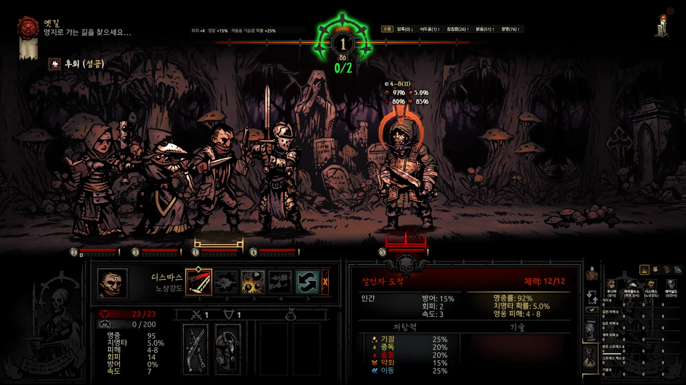
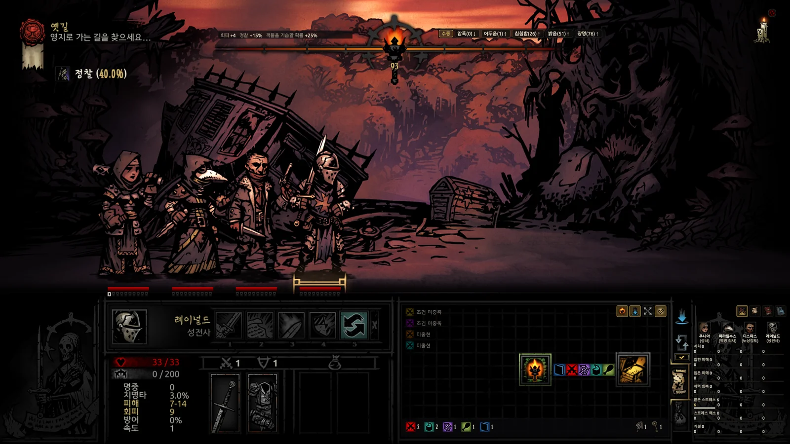
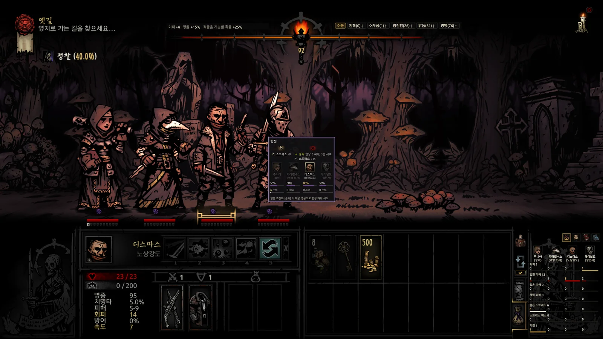
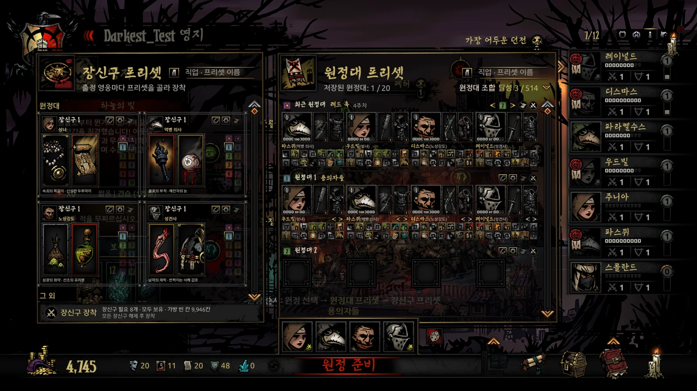
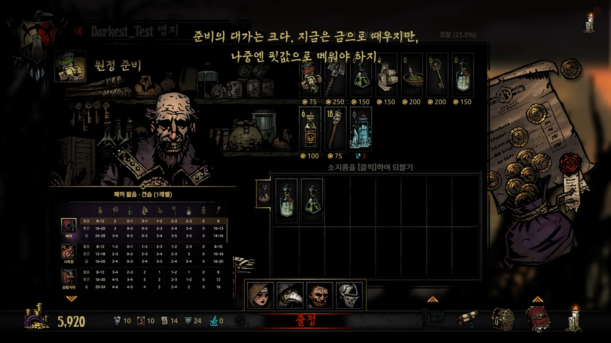
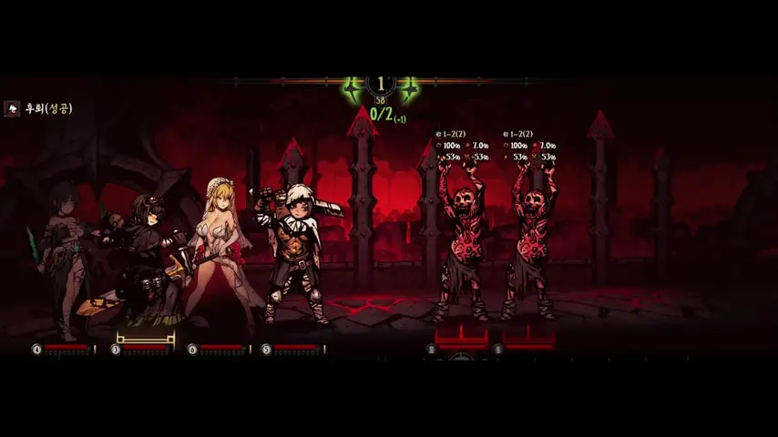
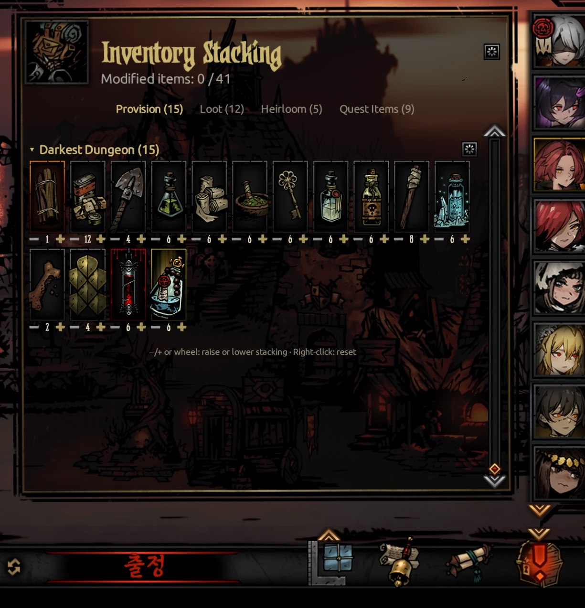

**English** · [한국어](docs/ko/README.md) · [日本語](docs/ja/README.md) · [中文](docs/zh/README.md)

# Ancestor's Map — DD Field Guide

**Darkest Dungeon’s hidden numbers, right on your game screen.**

An overlay for Darkest Dungeon 1 that uses the game’s own formulas to calculate values from live memory, your save, and your active DLC and mods.

  

[All features](#all-features) · [User guide](docs/en/guide.md) · [Changelog](docs/en/CHANGELOG.md)

Free for personal use · Mod support · No direct changes to game files. See [Safety](#safety) for memory access and input assistance.

<!-- SHOT S1: 오버레이 전투 움짤 8 ~ 10초(영어 · 1600×900) — 기술을 바꿀 때마다 적 머리 위 값이 바뀌는 장면. 찍으면 같은 이름으로 덮어쓰기 -->

- **See details from your active mods in one place.** Data from enabled mods is merged automatically, bringing together details on the enemies, skills, trinkets, quirks and other content they add or change.
- **Compare before you act.** Preview damage and the chances to hit, crit and apply effects to each target, based on current gear, buffs and resistances.
- **Check the map before moving on.** See enemy groups, curio outcomes and traps. Choose separately whether to reveal the full map, enemy information and hunger tiles.
- **Reuse your party setup.** Load a party preset, equip everyone’s trinkets at once, then auto-buy from the recommended provisions table.

> Developed with AI assistance (Claude, Codex) — design, in-game testing and final decisions by the author.

## All features

<table>
<tr>
<td valign="top" width="380">
<b>General</b>
<ul>
<li><b>Standalone window mode</b> Everything in one window; no further feature development</li>
<li><b>Overlay mode</b> Info placed on the game screen</li>
<li><b>Mod and DLC support</b> Values from active mods and DLC</li>
<li><b>Codex</b> Enemy, trinket, quirk and disease search</li>
<li><b>Four languages</b> Uses the game’s official terminology</li>
<li><b>Skin Spine Separation</b> Use skin mods with different spines on the same class at once</li>
</ul>
</td>
<td valign="top" width="380">
<b>Town</b>
<ul>
<li><b>Roster-wide meter</b> Compare cumulative stats across all heroes</li>
<li><b>Building upgrade planner</b> Compare upgrade costs with available resources</li>
<li><b>Building navigation</b> Q / E: previous / next building</li>
<li><b>Hide the Butcher’s Circus</b> Choose whether to show the icon in town settings</li>
<li><b>Disable Courtyard Town Event</b> Stops the recurring stress event that overrides other town events</li>
<li><b>Expedition Level Limit</b> Default · Relaxed · Removed</li>
<li><b>Inventory Stacking</b> Adjust stack sizes for base game and mod items</li>
<li><b>Party presets</b> Stored per save file; reload your most recent party</li>
<li><b>Trinket presets</b> 10 per class; equip the whole party at once</li>
<li><b>Random party selection</b></li>
<li><b>Recommended provisions and auto-buy</b> Buy recommended amounts; sell surplus</li>
</ul>
</td>
</tr>
<tr>
<td valign="top" width="380">
<b>Expedition</b>
<ul>
<li><b>Speed settings (speed multipliers)</b> Adjust forward movement, backward movement, combat, scouting and room transitions separately</li>
<li><b>Auto-hide object counters</b> Hover over the bottom-left corner of the overlay map for 0.5 seconds to show the counters and supply totals</li>
<li><b>Detailed dungeon map</b> Curios, traps and enemy groups per tile</li>
<li><b>Full map reveal</b> Preview unexplored areas</li>
<li><b>Spoiler controls</b> Revealed areas only; hide enemy info</li>
<li><b>Quest progress and routes</b> Paths to objectives, keys and boss rooms</li>
<li><b>Object counters</b> Remaining battles, curios and traps</li>
<li><b>Special encounters</b> Spawn chances and confirmed locations</li>
<li><b>Click rooms on the map to move</b></li>
<li><b>Object details and interaction cards</b> Compare outcomes and odds; make choices directly on the card</li>
<li><b>Provisions usage summary</b> List and count the places where each provision can be used</li>
<li><b>Automatic stops before traps</b></li>
<li><b>Auto-switch at curios</b> Automatically select the Antiquarian</li>
<li><b>Auto torch</b> Maintain chosen light level or darkness</li>
<li><b>Scouting and nighttime ambush chances</b></li>
<li><b>Inventory sorting and sell values</b> Merge stacks and organize items</li>
<li><b>Auto-collect Journals</b> Journal pages register as soon as they drop</li>
<li><b>Activity log and meter</b> Meters for combat, exploration and each hero’s contributions over your last 10 expeditions</li>
</ul>
</td>
<td valign="top" width="380">
<b>Combat</b>
<ul>
<li><b>Turn order</b> Exact order and chance to act next</li>
<li><b>Damage and probability preview</b> Damage, hit and crit chances for each target</li>
<li><b>Active status effects</b> Remaining duration and damage-over-time ticks on the next turn</li>
<li><b>Stalling warning</b> Reinforcement risk and actions that prevent it</li>
<li><b>Retreat chance and outcome</b></li>
<li><b>Restore default party order</b> Automatically after battle or with Caps Lock</li>
</ul>
</td>
</tr>
</table>

<table>
<tr>
<!-- SHOT S2: 오버레이 지도 — 전체 지도 공개 · 보스방까지 길 안내 (영어 · 1600×900) -->
<td width="380" align="center"> Full map reveal</td>
<!-- SHOT S3: 함정 · 골동품 앞 게임 화면 가운데 상호작용 카드 (영어 · 1600×900) -->
<td width="380" align="center"> Object details and interaction cards</td>
</tr>
<tr>
<!-- SHOT S4: 원정대 프리셋 판 (영어 · 1600×900) -->
<td width="380" align="center"> Party presets</td>
<!-- SHOT S5: 보급품 구입 화면 추천 표 · 자동 구매 (영어 · 1600×900) -->
<td width="380" align="center"> Recommended provisions and auto-buy</td>
</tr>
<tr>
<td width="380" align="center"> Skin Spine Separation</td>
<td width="380" align="center"> Inventory Stacking</td>
</tr>
</table>

See the [user guide](docs/en/guide.md) for instructions.

## Get started in three steps

1. Get `AncestorsMap.zip` from the [latest release](https://github.com/Eolaloe/DD-AncestorsMap/releases/latest).
2. Extract it to any folder.
3. Load your save in the game, then run `AncestorsMap.exe`. If the runtime is missing, you’ll get an installation prompt.

New here? The question-mark button opens a guided tour with 31 steps across seven chapters. See the [user guide](docs/en/guide.md) for full instructions.

### Requirements & compatibility

- Windows 10/11, the [.NET 8 Desktop Runtime](https://dotnet.microsoft.com/download/dotnet/8.0) and an installed copy of Darkest Dungeon 1.

- Live information and input assistance require a supported **64-bit** game build.
  Steam, DRM-free (`_windowsnosteam`) and GOG are supported.
  With a 32-bit or unrecognised build, the app skips memory reading, offers save-based features only, and explains why in the log's status line.

- Keep the game's vertical sync on (Darkest Dungeon's default).
  If it is forced off in your graphics card settings or a Steam launch option, the game uses up the GPU and the overlay can lag badly.
  The app shows a notice when the game runs without vertical sync.

- Active DLC, mods and their load order are read from your save.
  Tested dungeon mods include Courtyard Plus, Farmstead Plus, The Sunward Isles, Vermintide and The Fiend Festival.
  Not every mod has been tested.

- Supports 한국어, English, 日本語 and 简体中文.
  It follows the game language on first run, then uses the language you choose in the app.

## Safety

| Memory access | Scope |
|---|---|
| **Read** | Reads the current game state for maps, combat information and other features. |
| **Write** | Changes only the values each feature needs: Speed settings · Hide the Butcher’s Circus · Disable Courtyard Town Event · Auto-collect Journals · Expedition Level Limit · Inventory Stacking. Original values are recorded first and restored when you turn the feature off or close the app normally. |
| **Hooking** | Skin Spine Separation: loads a module into the running game and changes only which spine and effects each hero uses. Nothing is saved, and it is gone when the game closes. |

- No direct writes to game files or saves.
  App settings and expedition records are stored separately.

- Input helpers send real clicks, keystrokes and drags.
  Automatic stops before traps and party reordering after battle are enabled by default; you can turn each off.
  Hovering over the bag can also trigger input to open the inventory.
  The game may save the results of these actions as part of its normal saves.

- Don’t move the mouse or hold `[Shift]` during auto-buy or sorting.
  The app connects to GitHub to check for updates. It needs no account or API key and does not upload game records.
  Antivirus software may flag the app by mistake. Use the SHA-256 hashes on the release page to verify your downloads.

See the [user guide](docs/en/guide.md) for details on safety and input controls.

## What each version series added

| Series | Main additions |
|---|---|
| 1.0 (1.0.2 ~ 1.0.8) | Dungeon map and combat cards, logs and meters, room travel, supply recommendations and auto-buy. |
| 1.1 (1.1.0 ~ 1.1.4) | Battle screen, clickable exploration cards, trap stopping, inventory sorting, riposte and auto torch. |
| 1.2 (1.2.0) | Overlay mode: information placed directly on the game's UI. |
| 1.3 (1.3.0 ~ 1.3.6) | Party and trinket presets, turn-order odds, overlay controls, building navigation, auto-switching at curios and speed settings. |
| 1.4 (1.4.0) | Support for game version 28385 (Steam and DRM-free), with the combat rules added by the modding update. |
| 1.5 (1.5.0 ~ 1.5.2) | GOG support, more accurate combat numbers (most approximate values now exact), Death's Door death chance, frame limit notice. |
| 1.6 (1.6.0) | Skin Spine Separation (skin mods with different spines on the same class), Inventory Stacking, Disable Courtyard Town Event, Auto-collect Journals, Expedition Level Limit. |

For details on each version, see the [full changelog](docs/en/CHANGELOG.md) and [Releases](https://github.com/Eolaloe/DD-AncestorsMap/releases).

## Known limitations

- The app can reveal information the game hides, including enemy groups, hunger tiles, turn order and retreat results.
  Enable only the information you want.
- Provisions recommendations draw on wikis, guides and dungeon generation rules; mod dungeon values include calculated estimates.
  Adjust them for your party and exploration plans.
- Overlay mode has been checked on 16:9 screens.
  On other aspect ratios or with the game in windowed mode, positions may be off.

## Reporting issues

Open an [issue](https://github.com/Eolaloe/DD-AncestorsMap/issues) with your app version (click the signature), game version (Steam / DRM-free / GOG), active mods, and which screen and action caused the problem.
Include a screenshot and the app's notification text if possible.

## License & credits

[LICENSE](LICENSE) — free for personal use; share the official repository link (ask before re-uploading the file or sharing a modified build); no selling.
Darkest Dungeon is a game by Red Hook Studios.

Korean grammatical particle handling draws on [es-hangul](https://github.com/toss/es-hangul) (toss, MIT) and kohangul (MIT).

[User guide](docs/en/guide.md) · [Download the latest release](https://github.com/Eolaloe/DD-AncestorsMap/releases/latest)
