# Ancestor's Map — DD Field Guide

**[⬇ Download / 다운로드 / ダウンロード / 下载](https://github.com/Eolaloe/DD-AncestorsMap/releases/latest)**

> Developed with AI assistance (Claude, Codex) — design, in-game testing and final decisions by the author. 
> AI(Claude · Codex)의 도움으로 개발했습니다 — 기획 · 게임 확인 · 최종 판단은 제작자가 직접 합니다. 
> AI（Claude・Codex）の支援を受けて開発しました。企画・ゲームでの確認・最終判断は作者自身が行っています。 
> 本工具在 AI（Claude、Codex）的协助下开发——策划、游戏内测试与最终决定均由作者亲自完成。

 <b>한국어 설명서</b>

다키스트 던전 1의 **지도 · 전투 정보 · 활동 일지**를 게임 위에 띄워 주는 오버레이입니다.

항상 최상위 창으로 떠서 전체화면 게임 위에 겹쳐지고, 앱을 클릭해도 입력은 게임이 그대로 받습니다. **게임 화면 위에 겹쳐 두고 쓰는 것을 권장합니다.**

바닐라 정보를 고정으로 넣어 둔 것이 아닙니다. **지금 불러온 세이브에 켜진 본편 + DLC + 모드 데이터를 적용 순서대로 읽어 병합**하므로, 모드가 추가하거나 바꾼 골동품 · 적 · 장신구 · 기벽도 실제 인게임 값 그대로 보입니다. 이름과 설명은 게임 번역을 사용하며, 다른 세이브를 불러오면 알아서 다시 맞춥니다. 도감 검색란에 글을 쓸 때는 앱이 입력을 받습니다.

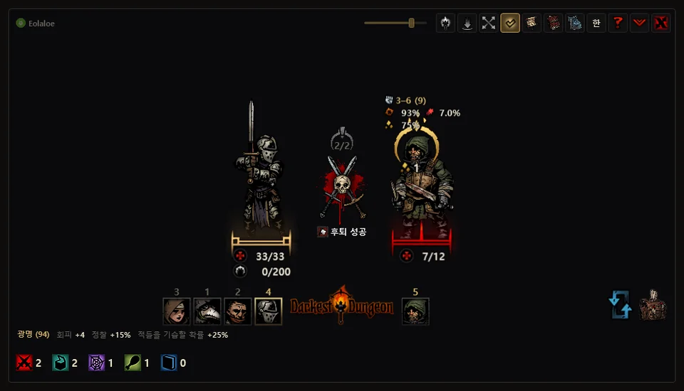

### 무엇이 되나

- **전투 화면** — 고른 기술의 피해·명중·치명타·효과 확률을 대상 위에 표시합니다. 아군 지원, 자리 이동, 적이 고른 기술과 대상, 현재 상태와 다음 차례의 지속 효과도 볼 수 있습니다.
- **탐험 중 선택** — 골동품·장애물·허기짐 카드에서 결과를 보고 선택지를 누릅니다. 함정 카드에서는 영웅별 해제 확률과 스트레스를 비교한 뒤 해제할 영웅을 고릅니다.
- **함정 앞 자동 정지·소지품 정리** — 정찰된 함정 앞에서 멈추고, 가방 버튼이나 `[I]`로 소지품을 정리합니다. 가방에 마우스를 올리면 게임의 소지품·전리품 칸에 판매가를 표시합니다.
- **상세 지도** — 골동품 결과, 적 구성, 남은 칸, 필요한 보급품, 목표까지의 길과 정찰·밝기 보정을 확인합니다.
- **기록과 마을 준비** — 활동 일지·미터기·영웅 표, 도감 검색, 추천 보급품(던전 추가 모드 포함)과 자동 구매, 건물·추가 건물 요구 재화 계산을 제공합니다.
- **화면 안내** — 물음표 버튼에서 7장 31단계 안내를 엽니다. 녹화된 견본 장면을 보며 따라가고, 일부 단계에서는 직접 마우스를 올려 카드를 볼 수 있습니다.

### 별도 창 모드

앱이 게임 위에 별도 창으로 떠서 지도·전투 화면·카드·기록을 한 창에 모아 보여 줍니다. 창 크기와 배경 불투명도는 자유롭게 조절할 수 있습니다. 세이브를 불러오면 오버레이 모드로 자동 전환되며, 이후에는 원하는 모드로 바꿀 수 있습니다.

<table>
<tr><td align="center" width="50%"> 골동품 카드</td><td align="center" width="50%">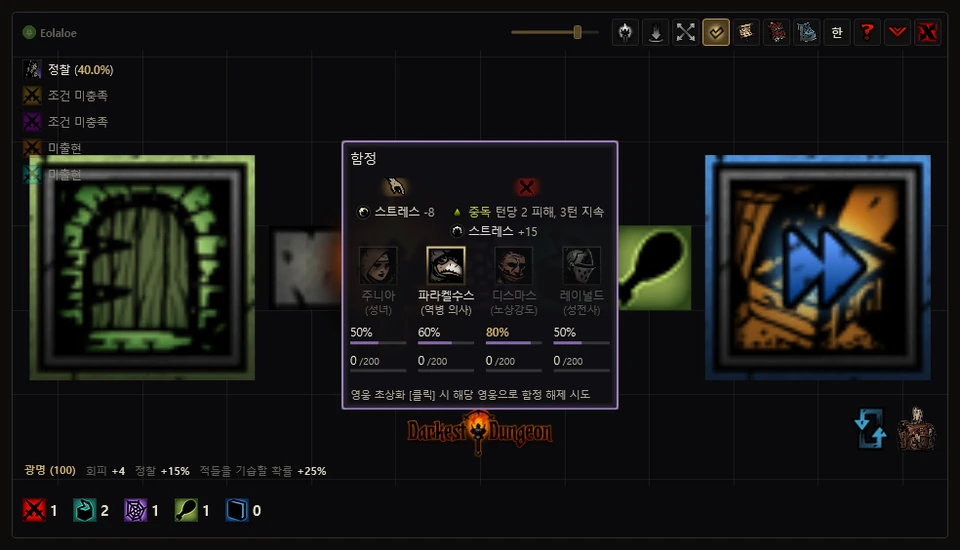 함정 해제</td></tr>
<tr><td align="center" width="50%">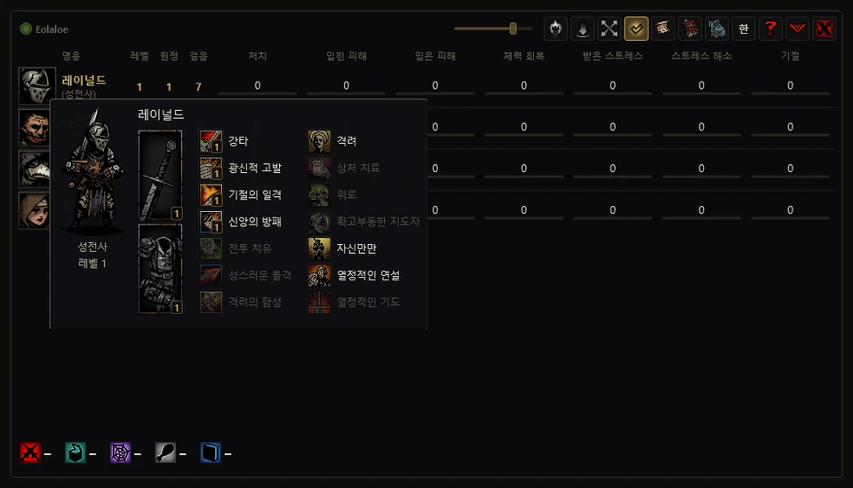 영웅 표와 카드</td><td align="center" width="50%">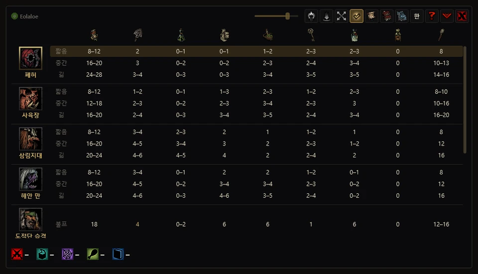 보급품 추천</td></tr>
<tr><td align="center" width="50%">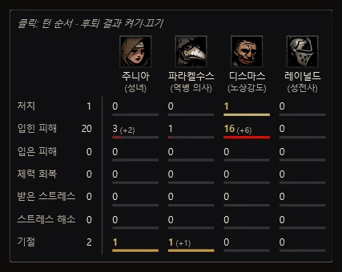 원정 미터기</td><td align="center" width="50%">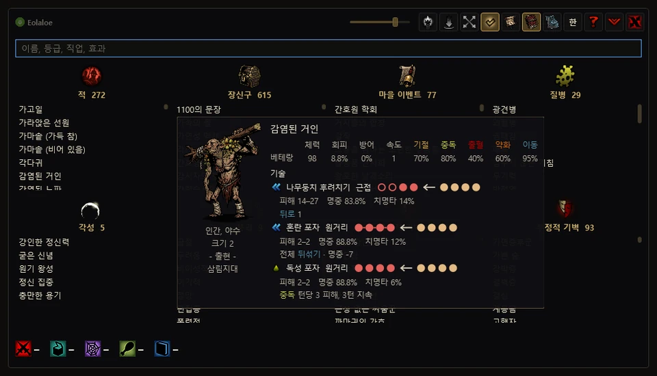 도감</td></tr>
</table>

### 오버레이 모드

<code>[ &#96; ]</code> 키나 오른쪽 위 마름모 버튼으로 두 모드를 바꿉니다. **세이브를 불러오면 자동으로 오버레이 모드로 전환**됩니다. 게임을 먼저 켜 둔 채 앱을 켜도 같으며, 이후에는 자유롭게 바꿀 수 있습니다.

별도 창 모드가 정보를 한 창에 모아 보여 준다면, 오버레이 모드는 앱 창을 촛불 버튼 하나로 접고 **게임 화면 위에 투명한 층을 하나 씌워 정보를 게임 UI의 제자리에 직접 얹습니다.** 게임의 글꼴·그림·배치를 그대로 따라, 원래 게임에 있던 화면처럼 자연스럽게 정보를 보여 주는 것이 목표입니다.

- **탐험** — 게임 지도 칸에 앱 지도가 들어가고, 골동품·함정·장애물·허기짐 카드는 게임 화면 가운데에 뜹니다. 정찰 확률과 횃불 단계는 게임 표시 옆에 붙습니다.
- **전투** — 턴 순서, 머리 위 피해·확률, 걸린 상태를 인물마다 표시하고, 스톨링은 라운드 숫자 둘레의 빛 색으로 알립니다.
- **사이드 패널** — 원정 중에는 오른쪽 패널에서 미터기·활동 일지·도감·마을 건물을 탭으로 봅니다. `[Backspace]`·`[Home]`·`[End]`로 탭을 바꿉니다. 켠 탭을 다시 누르면 버튼만 남기고 접히며, 접은 상태를 기억합니다.
- **마을** — 영지 이름 아래에 명단 전체 미터기 표를, 아래 버튼 줄 위 화살표로 도감·건물 증축 판을 엽니다. 원정 선택 화면에서는 원정대 프리셋을, 마을·원정 선택·보급품 화면에서는 장신구 프리셋을 사용합니다. 보급품 화면에서는 금화 위 화살표로 보급품 표(자동 구매 포함)를 엽니다.
- 자리는 게임이 실제로 쓰는 배치 값을 읽어 맞춥니다. 영웅 정보·메뉴·확인 창이 뜨거나 로딩 중일 때는 잠시 숨고, 촛불을 누르거나 같은 키를 다시 누르면 별도 창 모드로 돌아옵니다. 접은 채 끄면 다음에도 오버레이 모드로 시작합니다.
- **요소별 켜기·끄기** — 사이드 패널 탭 위 화살표의 **오버레이 켜기 · 끄기**에서 지도·정보 카드·전투 수치·상태 효과·턴 순서 등을 따로 켜고 끕니다.
- **알림 자막** — 편성·장착·구매 등 자동 입력의 진행과 결과·중단 까닭을 게임 화면 위 자막으로 봅니다.
- 오버레이 모드 동안은 작업 표시줄·Alt+Tab에서 앱이 빠집니다. 별도 창으로 펼치면 작업 표시줄에 다시 나타납니다.
- 늘 맨 위에 있는 촛불을 누르면 별도 창으로 펼치고, 촛불의 X 버튼으로 앱을 끕니다. 앱을 한 번 더 실행해도 별도 창으로 펼쳐집니다.

<table>
<tr><td align="center" width="50%">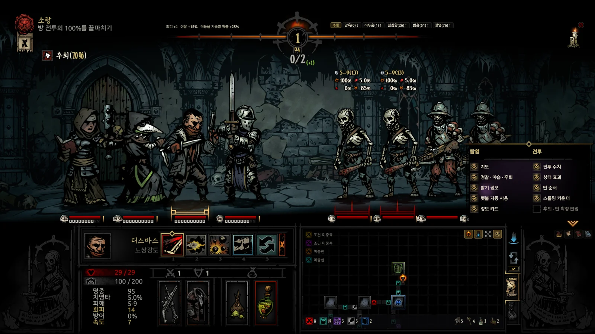 오버레이 켜기 · 끄기</td></tr>
</table>
<!-- 그림: 알림 자막 -->

<table>
<tr><td align="center" width="50%">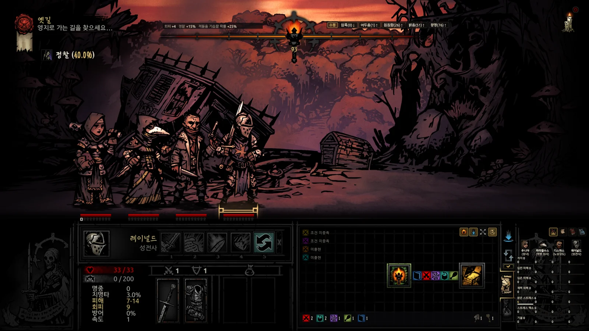 탐험 — 지도</td><td align="center" width="50%">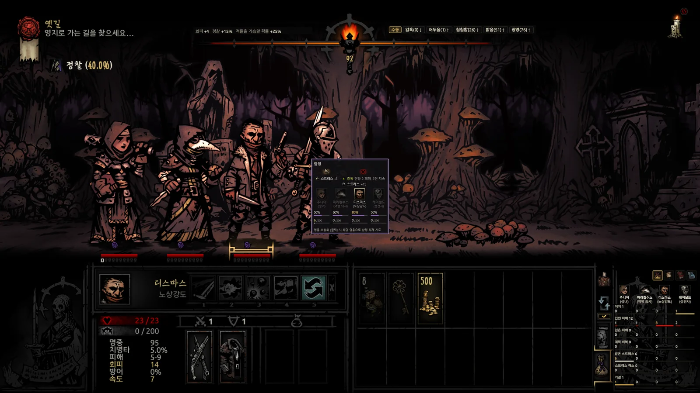 탐험 — 함정 카드</td></tr>
<tr><td align="center" width="50%">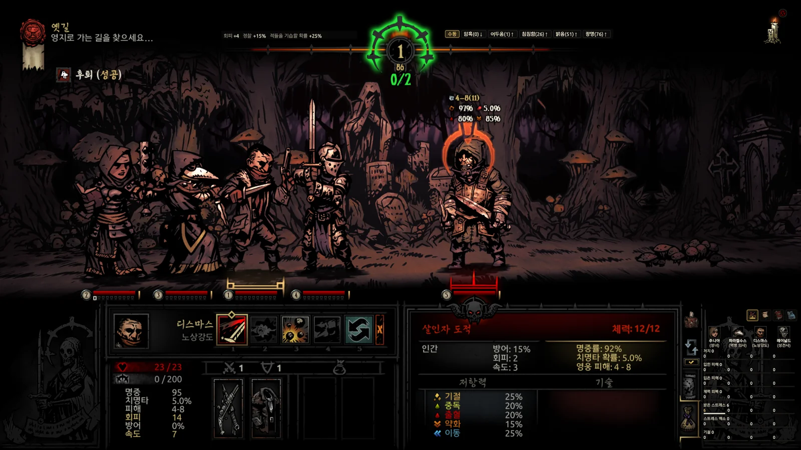 전투 — 스톨링·머리 위 값</td><td align="center" width="50%">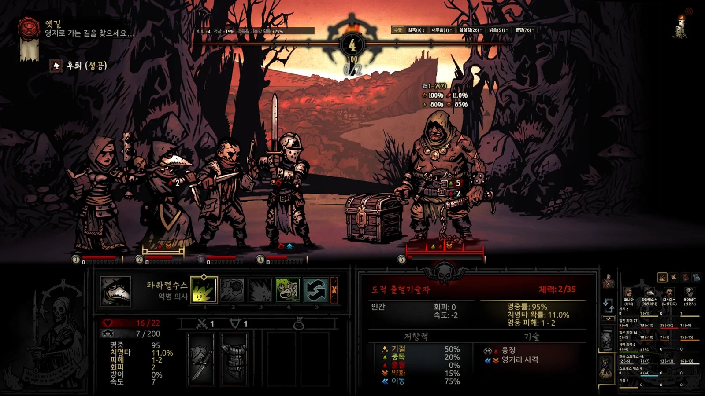 전투 — 적 정보</td></tr>
<tr><td align="center" width="50%">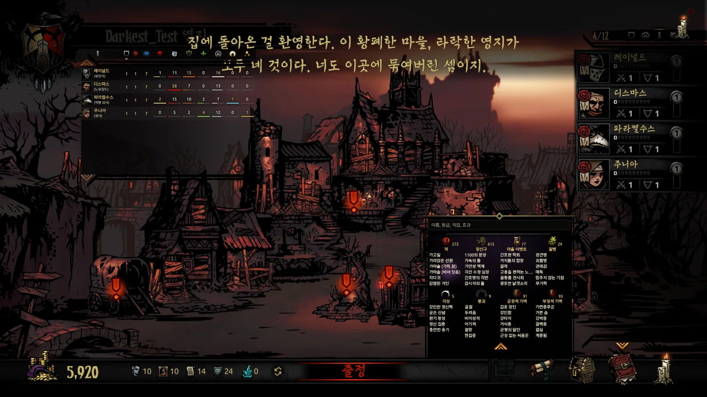 마을 — 미터기·도감</td><td align="center" width="50%">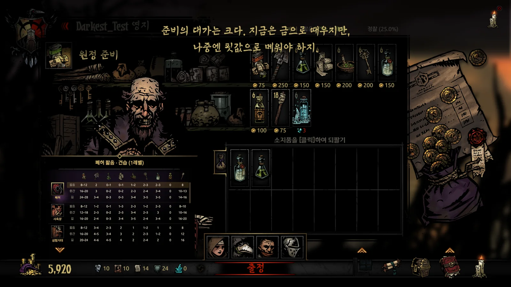 마을 — 보급품</td></tr>
</table>

### 자세히

기능별 설명 펼치기

#### 전투

- 전투가 시작되면 기본 화면의 지도가 전투 화면으로 바뀝니다. 아군 차례에는 고른 기술이 닿는 대상들의 수치를, 적 차례에는 적이 선택한 대상의 수치를 표시합니다. 회복·강화·이동 기술도 해당 배치로 보여 줍니다.
- 인물 위 두 열에서 걸린 상태와 남은 기간, 다음 차례의 지속 효과량을 구분합니다. 지속 피해로 체력이 소진될 것으로 예상되면 핏자국으로 알립니다. 아래에는 체력과 스트레스가 표시됩니다.
- 아래 초상에 마우스를 올리면 영웅·적의 전투 카드가 뜹니다. 현재 장비·기벽·질병·강화와 조건을 반영한 수치, 적의 기술·대상 선택 확률을 비교할 수 있습니다. 스킨과 변신·태세도 현재 모습에 맞춥니다.
- 턴 순서, 스톨링의 증원 위험, 후퇴 확률을 표시합니다. 확정 턴 순서·후퇴 결과는 기본으로 켜져 있으며 별도 창에서는 가운데 타이틀을 눌러 끕니다. 끄면 아직 행동이 남은 영웅·적마다 **다음 차례 예상 확률**을, 후퇴는 성공 확률을 표시합니다. 오버레이에서는 **후퇴 · 턴 확정 판정**으로 바꿉니다. 타이틀에 마우스를 올리면 원정 미터기가 뜹니다.
- 턴 순서 예상 확률은 숨겨진 굴림을 읽지 않고 속도와 주사위 규칙으로 예상한 값입니다. 일부 상황은 표본 추정이며, 라운드 시작 속도를 확인하지 못하면 현재 속도로 근사합니다.

<!-- 그림: 턴 순서 예상 확률 -->

#### 지도와 탐험

- 방·복도·골동품·함정·장애물·전투·허기짐 칸을 표시합니다. 기본은 밝혀진 구역만 보기이며, 안개를 끄면 전체를 볼 수 있습니다. 목표 골동품·보스·안뜰의 경로는 열쇠와 잠긴 문의 순서를 고려합니다.
- 아래 계수기에서 남은 칸을, 보급품 그림에서 그 품목의 사용처를 확인합니다. 전투·허기짐 아이콘으로 아직 가 보지 않은 칸의 적 구성과 허기짐 칸 표시를 따로 끌 수 있습니다. 정찰 확률, 밝기 보정, 특수 조우의 위치 또는 출현 조건도 볼 수 있습니다.
- 게임에서 골동품·장애물·허기짐 창이 열리면 대응하는 카드가 뜹니다. 열을 누르면 게임의 선택지를 실행하며, 골동품 아이템 열은 해당 아이템을 사용합니다. 보급품이 부족한 열은 실행하지 않습니다.
- 정찰된 함정 앞 자동 정지는 기본으로 켜져 있으며 함정 계수기로 끕니다. 해제는 자동으로 하지 않습니다. 카드에서 영웅을 고르면 그 영웅으로 해제를 시도합니다.
- 탐험 대기 중 가방 버튼이나 `[I]`로 같은 품목 묶음을 합치고 칸을 정리합니다. 퀘스트 아이템은 제자리에, 빈 칸은 뒤에 둡니다. 전투 후에는 전리품 창을 닫고 탐험으로 돌아왔을 때 기본 원정대로 자동 복귀합니다. 기본으로 켜져 있으며 원정대 버튼으로 끕니다.

#### 원정대 · 장신구 프리셋

- **원정대 프리셋** — 오버레이 모드의 원정 선택 화면에서 명단 옆 화살표로 엽니다. 세이브별로 원정대를 저장하고, **원정대 편성**으로 클릭 한 번에 출정 칸을 채웁니다. 게임 명단·출정 칸에서 영웅을 드래그하거나 지금 원정대를 저장해 등록합니다.
- 고른 원정에 못 가는 영웅은 붉은 X와 까닭을 표시합니다. **최근 원정대**를 다시 불러오고, 직업·프리셋 이름으로 검색하거나 같은 직업의 다른 영웅으로 바꿀 수 있습니다. **원정대 조합**에서 본편·DLC·모드의 원정대 이름 조합과 달성 여부를 봅니다.
- **무작위 원정대 편성** — 원정 선택 화면의 주사위 버튼으로, 그 원정에 갈 수 있는 영웅 가운데서 출정 칸 순서까지 무작위로 편성합니다.
- **장신구 프리셋** — 마을·원정 선택·보급품 화면에서 사용합니다. 세이브별로 **직업마다 10개**를 저장하며, 가방에서 장신구를 드래그해 등록합니다. 프리셋에 마우스를 올리면 세트 효과를 포함한 효과 합계를 봅니다.
- 출정 영웅마다 프리셋을 고르고 **장신구 장착**으로 원정대 전체에 일괄 장착합니다. 직업별 최근 출정 장신구 구성 두 벌은 **최근 장신구 1 · 2**로 남습니다. 금별은 최근 1, 은별은 최근 2이며, 별을 다시 누르면 저장할 프리셋을 고를 수 있습니다.

<table>
<tr><td align="center" width="50%">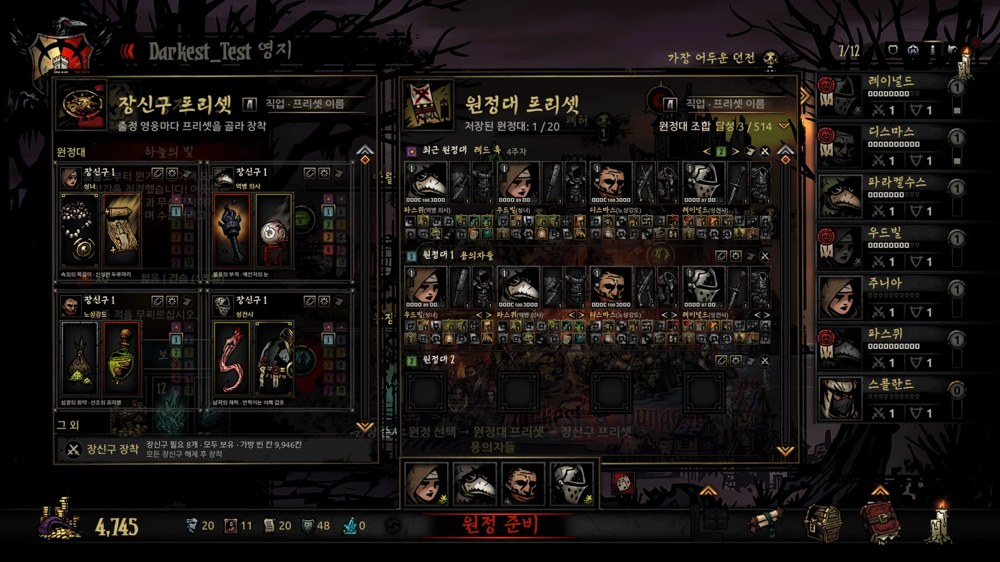 원정대 프리셋</td><td align="center" width="50%">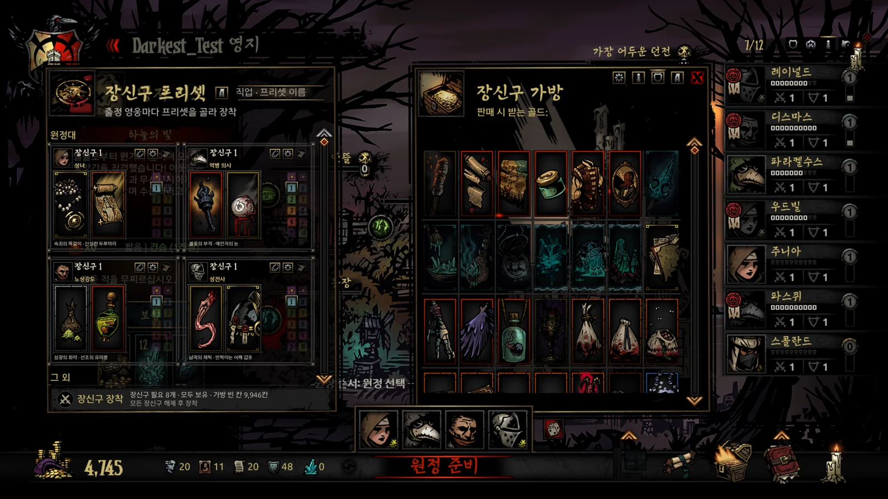 장신구 프리셋 · 효과 합계</td></tr>
</table>

#### 기록과 마을 준비

- 활동 일지는 전투·탐험·야영 기록을 계속 쌓으며 `[End]`로 엽니다. 전투가 시작돼도 일지로 자동 전환하지 않습니다. 세이브별 최근 원정 10개와 종결 미터기를 다시 볼 수 있습니다.
- 마을 영웅 표에서 레벨·원정·걸음과 앱이 기록한 누적 수치를 비교합니다. 초상에 마우스를 올리면 장비·전투 기술·야영 기술이 보입니다.
- 보급품 표는 던전·원정 길이에 맞는 추천 수량을 보여 줍니다. 켜 둔 던전 모드(안뜰+, 농장+, 태양을 향한 섬들, 버민타이드, 악마의 축제)의 던전도 함께 나오고, 고른 퀘스트의 줄을 강조해 그 던전을 표 맨 위로 올립니다. 줄을 클릭하면 구매·판매·비용을 미리 보여 주고, **3초 안에 같은 줄을 다시 클릭하면 구매**합니다. 범위는 큰 값으로 맞추고 무료 지급품은 판매하지 않습니다. 핏빛 저주 영웅을 위한 피도 조절하며 마을에 남는 쇠약 영웅 몫을 남깁니다.
- 도감에서 적·장신구·마을 이벤트·질병·각성·붕괴·기벽을 이름·등급·직업·효과로 검색합니다. 건물·추가 건물 화면에서는 고른 증축에 필요한 재화와 보유량을 비교합니다. 계획 기능이며 게임에서 대신 건설하지 않습니다.

### 설치

1. [최신 릴리스](https://github.com/Eolaloe/DD-AncestorsMap/releases/latest)에서 `AncestorsMap.zip`을 받아 아무 폴더에 풉니다.
2. `AncestorsMap.exe`를 실행합니다. **.NET 8 Desktop Runtime**이 없으면 설치 안내가 뜹니다.
3. 게임을 실행하면 세이브를 자동으로 찾습니다. 처음에는 오른쪽 위 물음표 버튼으로 화면 안내를 열어 보세요.

### 요구·호환

- Windows 10/11, [.NET 8 Desktop Runtime](https://dotnet.microsoft.com/download/dotnet/8.0), 설치된 Darkest Dungeon 1이 필요합니다. 앱 실행 파일은 약 **8.6MB**이며 런타임은 별도입니다.
- 실시간 정보와 입력 보조는 지원하는 **64비트** 게임에서 사용합니다. 스팀 공개판·`coming_in_hot` 베타의 스팀 및 DRM 없는(`_windowsnosteam`) 실행 파일을 지원합니다. 32비트·인식하지 못하는 게임 버전에서는 메모리를 읽지 않고 세이브 기반 기능만 제공하며, 일지 상태 줄에 이유를 표시합니다.
- 활성 DLC·모드와 적용 순서를 읽어 반영합니다. 던전 추가 모드는 Courtyard Plus, Farmstead Plus, The Sunward Isles, Vermintide, The Fiend Festival로 확인했습니다. 모든 모드를 검증한 것은 아닙니다.
- 스팀 설치를 기준으로 하며 DRM 없는 실행 파일도 확인했습니다. GOG 등 다른 플랫폼은 설치·세이브 경로를 자동으로 찾지 못할 수 있습니다.
- 한국어·English·日本語·简体中文을 지원합니다. 처음에는 게임 언어를 따르고, 이후에는 앱에서 선택한 언어를 사용합니다.

### 안전

- **게임 파일·세이브·게임 메모리에 직접 쓰지 않으며, 게임 프로세스에 코드를 주입하지 않습니다.** 메모리는 읽기 권한으로 엽니다. 앱 자체의 설정과 원정 기록은 따로 저장합니다.
- **입력 보조 기능은 실제 게임 조작입니다.** 방 이동, 카드 선택과 아이템 사용, 함정 해제, 자동 구매, 소지품 정리, 기본 원정대 설정, 원정대 편성·장신구 장착은 게임에 클릭·키·드래그 입력을 보냅니다. 이 조작의 결과는 게임의 정상 저장에 반영될 수 있습니다.
- 함정 앞 자동 정지는 이동 키·마우스 버튼을 떼는 입력과 이동 키 반복 차단을 사용합니다. **기본 켬**이며 함정 계수기로 끕니다. 전투 후 자동 원정대 복귀도 **기본 켬**이며 원정대 버튼으로 끕니다.
- 가방에 마우스를 올려 판매가를 볼 때도, 탐험 중 게임이 지도 창이면 `[Tab]` 입력으로 소지품 창을 엽니다. 보기 기능 중에도 이처럼 입력을 보내는 경우가 있습니다.
- 자동 구매·정리 중에는 마우스를 움직이지 마세요. 정리할 때 `[Shift]`를 누르지 마세요. 게임의 버리기 조작과 겹쳐 앱이 드래그를 진행하지 않습니다.
- 앱의 통신은 GitHub 릴리스 확인입니다. 시작할 때 자동 확인하며 앱 정보에서 수동으로 다시 확인할 수 있습니다. 계정·API 키가 필요 없고 게임 기록을 업로드하지 않습니다.
- 다른 프로그램의 메모리를 읽어 일부 백신이 오탐할 수 있습니다. 다운로드 검증에는 릴리스에 제공된 SHA-256을 사용하세요.

### 업데이트

시작할 때 새 버전을 확인합니다. 왼쪽 위 서명을 클릭하면 현재 버전과 **업데이트 확인**을 볼 수 있습니다. **새 버전 출시** 알림은 오버레이에서도 별도 창으로 펼쳐 표시하며, 자동 전환은 알림을 닫은 뒤 이어갑니다. **업데이트 내용 보기**로 릴리스 페이지를 열어 새 zip을 받으세요. 자동 다운로드·교체는 하지 않습니다. 실행 중인 앱을 종료하고 새 파일을 덮어쓰면 됩니다. 설정과 원정 기록은 `%LocalAppData%\AncestorsMap`에 남습니다.

### 조작

| 키·마우스 | 동작 |
|---|---|
| <code>[ &#96; ]</code> 또는 마름모 버튼 | 오버레이 모드 켜기·끄기 — 앱 창은 촛불 버튼으로 접히고 정보는 게임 화면 제자리에. 촛불 클릭으로도 복귀 |
| `[Backspace]` | 기본 화면으로: 마을 영웅 표 / 보급품 표 / 탐험 지도 / 전투 화면 |
| `[Home]` / `[End]` | 도감 / 활동 일지 열기·닫기 |
| `[Caps Lock]` | 지금 기본 원정대 설정 |
| `[I]` 또는 가방 클릭 | 탐험 대기 중 소지품 정리 |
| 가방에 마우스 올리기 | 게임 소지품·열린 전리품 칸의 판매가 |
| 원정대 그림 클릭 | 전투 후 기본 원정대 자동 복귀 켜기·끄기 |
| 왼쪽 드래그 / 오른쪽 드래그 | 앱 창 이동 / 지도 이동 |
| 휠 / 휠 클릭 | 지도 확대·축소 / 안개 켜기·끄기 |
| 앱 지도의 이어진 방 클릭 | 방 안에 있을 때 게임에서 그 방으로 이동 |
| 자동으로 뜬 카드의 열 클릭 | 골동품·장애물·허기짐 선택 또는 영웅을 골라 함정 해제 |
| 보급품 줄 클릭 → 3초 안에 같은 줄 클릭 | 구매 미리보기 → 자동 구매 |
| 창 경계 드래그 / 위 슬라이더 | 창 크기 / 배경 불투명도 |
| 물음표 / 서명에 마우스 올리기·클릭 | 화면 안내 / 조작표·앱 정보 |

게임 위 단축키는 게임 창이 앞에 있을 때 동작합니다. `[I]`는 탐험 대기 중에만 앱이 가져가며, 그 밖에는 게임의 원래 키로 동작합니다. 앱 자체에서는 <code>[ &#96; ]</code>·`[Home]`·`[End]`도 사용할 수 있고, 검색란에 글이 있을 때 `[Backspace]`는 글자를 지웁니다. 구매·정리는 게임 창을 활성화하며, 방 이동·카드 선택·함정 해제 등도 게임 창이 앞에 있어야 합니다.

오버레이 모드에서는 원정 중 `[Backspace]`·`[Home]`·`[End]`가 사이드 패널의 미터기·도감·활동 일지 탭을 바꾸고, 마을에서는 게임 키로 그대로 동작합니다.

### 화면 안내

물음표 버튼에서 처음 사용, 지도, 탐험 중 선택, 전투, 원정 관리, 마을 준비, 기록과 검색을 살펴보세요. 처음 6장은 녹화된 견본 장면이므로 게임을 실행하지 않아도 볼 수 있습니다. 마지막 ‘기록과 검색’ 장은 사용자 자료를 엽니다. 마우스를 올릴 수 있는 단계에서는 금색 테두리 안에 올려 보세요. 어두운 곳을 누르거나 오버레이 모드로 바꾸면 안내를 닫습니다.

### 알려진 한계

- 적 구성·허기짐 칸·턴 순서·후퇴 결과 등 게임이 숨기는 정보도 표시합니다. 필요한 항목만 켜서 사용하세요.
- 게임이 업데이트되면 지원 여부를 확인할 때까지 실시간 기능을 사용할 수 없습니다. 일부 세이브 기반 표시는 게임이 저장할 때까지 늦을 수 있습니다.
- 추천 보급품은 위키·공략·던전 생성 규칙을 참고한 값이며, 모드 던전은 계산 추정치를 포함합니다. 원정대와 탐험 계획에 맞춰 조절하세요.
- 자동 입력은 게임 화면과 배치에 영향을 받습니다. 지원하지 않는 배치나 일부 모드에서는 기능이 제한될 수 있습니다.
- 오버레이 모드는 16:9 화면에서 확인했습니다. 다른 화면비나 게임을 창 모드로 띄웠을 때는 자리가 어긋날 수 있습니다.

### 문제 신고

[Issues](https://github.com/Eolaloe/DD-AncestorsMap/issues)에 앱 버전(서명 클릭), 게임 버전(공개판 / `coming_in_hot` / DRM 없는 판), 활성 모드 목록, 어느 화면에서 어떤 조작을 했는지 적어 주세요. 가능하면 스크린샷과 앱에 나온 알림 문구도 첨부해 주세요.

### 라이선스 · 크레딧

[LICENSE](LICENSE) — 개인 사용 자유, 공유는 공식 저장소 링크로(파일 재업로드 · 수정본은 문의), 판매 금지.
Darkest Dungeon 은 Red Hook Studios 의 게임입니다.
Claude · Codex 의 도움을 받아 만들었습니다.

한국어 조사 처리 규칙은 [es-hangul](https://github.com/toss/es-hangul)(toss, MIT) · kohangul(MIT)을 참고했습니다.

 <b>日本語の説明</b>

Darkest Dungeon 1の**マップ・戦闘情報・アクティビティ・ログ**をゲーム画面に重ねて表示するアプリです。

フルスクリーンのゲームの上にも常に最前面で重なり、アプリをクリックしても入力はそのままゲーム側に届きます。**ゲーム画面の上に重ねて使うことをおすすめします。**

バニラの情報を固定で埋め込んでいるわけではありません。**いまロードしているセーブで有効な本編・DLC・MODのデータを適用順に読み込んで統合する**ので、MODで追加・変更されたキュリオ・敵・トリンケット・奇癖も、実際のゲーム内の数値どおりに表示されます。名前や説明にはゲームの翻訳を使い、別のセーブをロードしても自動で合わせ直します。図鑑の検索欄に文字を入力するときはアプリ側に切り替わります。

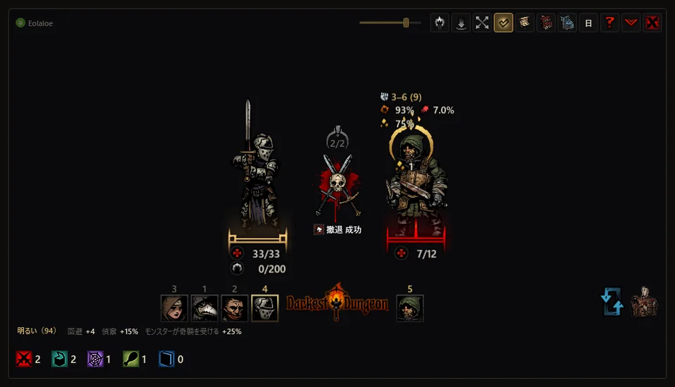
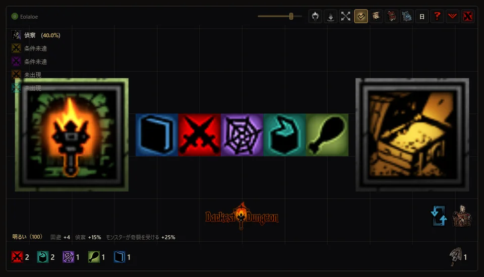

### できること

- **戦闘画面** — 選んだスキルのダメージ・命中・クリティカル・効果の確率を対象の上に表示します。味方への支援、移動、敵が選んだスキルと対象、現在の状態と次のターンの継続効果も確認できます。
- **探索中の選択** — キュリオ・障害物・空腹のカードで結果を確認し、そのまま選択肢を実行できます。トラップカードでは英雄ごとの解除確率とストレスを比べ、解除する英雄を選べます。
- **トラップ前の自動停止・所持品整理** — 偵察済みのトラップの手前で停止します。バッグのボタンか[I]で所持品を整理でき、バッグにマウスを合わせるとゲームの所持品・戦利品の枠に売却額を表示します。
- **詳細マップ** — キュリオの結果、敵の編成、残りのマス、必要な補給品、目標への経路、偵察確率や明るさの補正を確認できます。
- **記録と村での準備** — ログ・メーター・英雄表、図鑑検索、おすすめ補給品（ダンジョン追加MODを含む）と自動購入、建物・区画に必要な資源の計算を利用できます。
- **画面ガイド** — はてなマークから全7章・31ステップの案内を開けます。録画した見本の場面で説明し、一部のステップではマウスを合わせてカードを見ることもできます。

### 別ウィンドウモード

アプリがゲームの上に別ウィンドウとして浮かび、マップ・戦闘画面・カード・記録を1つのウィンドウにまとめて表示します。ウィンドウの大きさと背景の不透明度は自由に調整できます。セーブを読み込むとオーバーレイモードに自動で切り替わり、その後は好きなモードに変更できます。

<table>
<tr><td align="center" width="50%">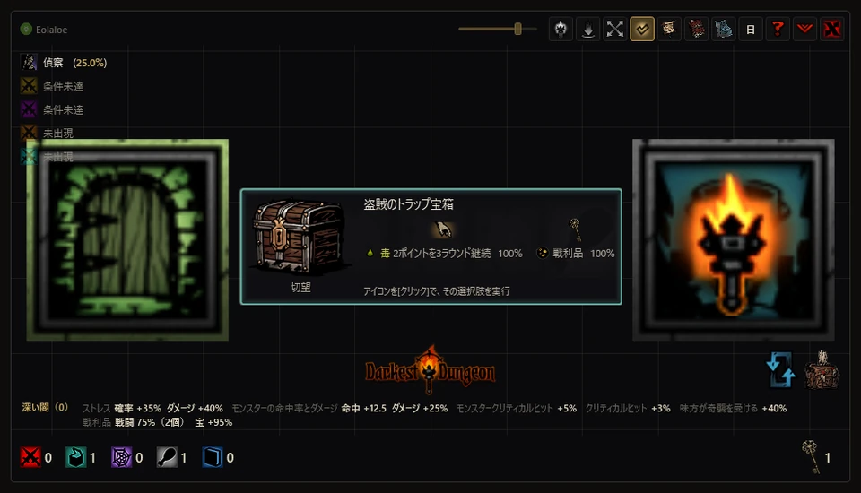 キュリオカード</td><td align="center" width="50%">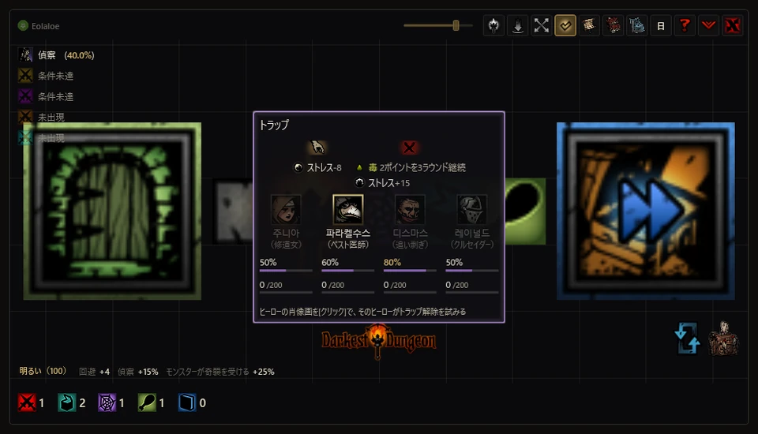 トラップ解除</td></tr>
<tr><td align="center" width="50%">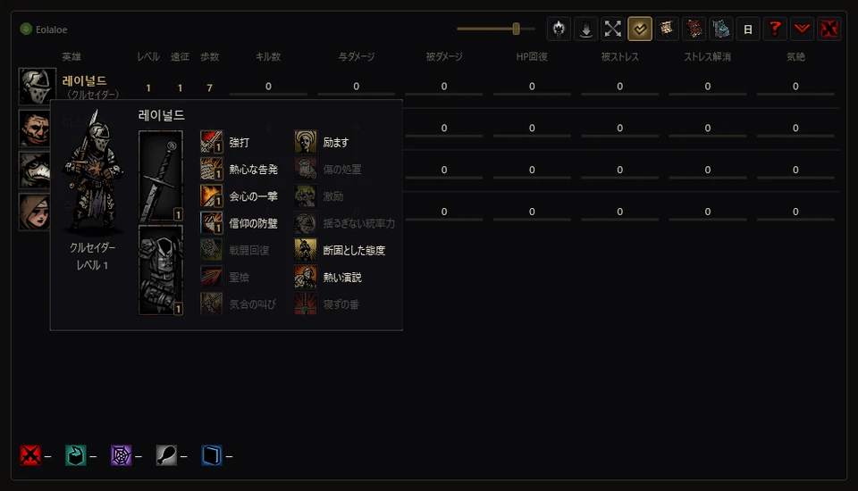 英雄表とカード</td><td align="center" width="50%">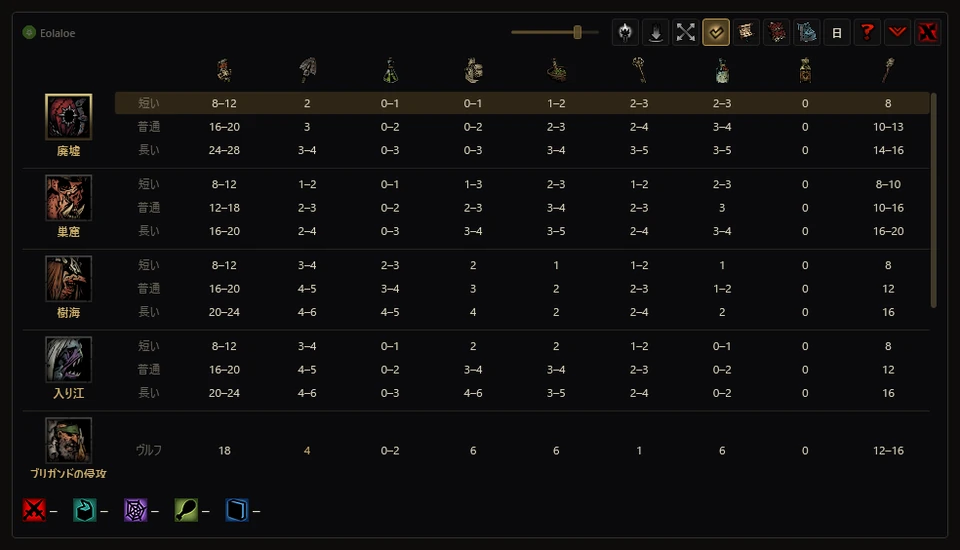 おすすめ補給品</td></tr>
<tr><td align="center" width="50%">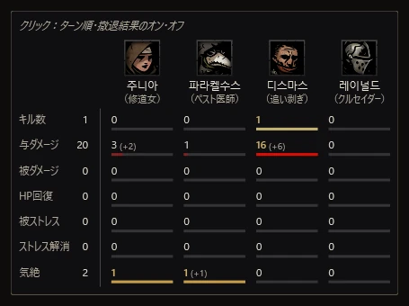 遠征メーター</td><td align="center" width="50%">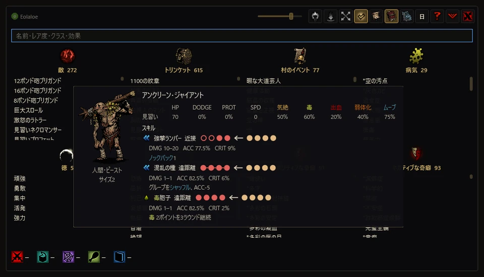 図鑑</td></tr>
</table>

### オーバーレイモード

<code>[ &#96; ]</code>キーか右上のひし形ボタンでモードを切り替えます。**セーブを読み込むと、自動でオーバーレイモードに切り替わります。** ゲームを先に起動してからアプリを開いた場合も同じです。その後は自由に切り替えられます。

別ウィンドウモードが情報を1つのウィンドウにまとめて見せるのに対し、オーバーレイモードはアプリのウィンドウをろうそくのボタン1つにたたみ、**ゲーム画面の上に透明なレイヤーを1枚重ねて、ゲームUIの本来の位置に情報を直接表示します。** ゲームのフォント・画像・配置をそのまま使い、もともとゲームにあった画面のように自然に情報を見せることを目指しています。

- **探索** — ゲームのマップ欄にアプリのマップが入り、キュリオ・トラップ・障害物・空腹のカードはゲーム画面の中央に表示されます。偵察確率とたいまつの段階は、ゲーム本来の表示の横に並びます。
- **戦闘** — ターン順、頭上のダメージ・確率、かかっている状態を人物ごとに表示し、ストーリングはラウンド数のまわりの光の色で知らせます。
- **サイドパネル** — 遠征中は右のパネルで、メーター・アクティビティ・ログ・図鑑・村の建物をタブで見られます。[Backspace]・[Home]・[End]でタブを切り替えます。開いているタブをもう一度クリックするとボタンだけを残してたたみ、その状態を記憶します。
- **村** — 領地名の下に名簿全体のメーター表を表示し、下のボタン列の上の矢印から図鑑・建物の増築パネルを開きます。クエスト選択画面ではパーティープリセットを、村・クエスト選択・補給品画面ではトリンケットプリセットを使えます。補給品の画面では、金貨の上の矢印から補給品表（自動購入を含む）を開きます。
- 表示位置は、ゲームが実際に使っている配置の値を読み取って合わせます。英雄の詳細・メニュー・確認ウィンドウが開いているときやロード中は一時的に隠れます。ろうそくをクリックするか同じキーをもう一度押すと、別ウィンドウモードに戻ります。たたんだまま終了すると、次回もオーバーレイモードで始まります。
- **要素ごとの表示切替** — サイドパネルのタブ上の矢印から**オーバーレイの表示切替**を開き、マップ・情報カード・戦闘数値・付与中の効果・ターン順などを個別に切り替えられます。
- **通知字幕** — 編成・装備・購入などの自動操作の進行、結果、中断理由をゲーム画面上の字幕で確認できます。
- オーバーレイモード中はタスクバー・Alt+Tabにアプリが表示されません。別ウィンドウに戻すとタスクバーに再表示されます。
- 常に最前面のろうそくをクリックすると別ウィンドウに戻り、ろうそくのXボタンでアプリを終了できます。アプリをもう一度起動しても別ウィンドウに戻ります。

<table>
<tr><td align="center" width="50%"> オーバーレイの表示切替</td></tr>
</table>
<!-- 図：通知字幕 -->

<table>
<tr><td align="center" width="50%"> 探索 — マップ</td><td align="center" width="50%"> 探索 — トラップカード</td></tr>
<tr><td align="center" width="50%"> 戦闘 — ストーリング・頭上の数値</td><td align="center" width="50%"> 戦闘 — 敵の情報</td></tr>
<tr><td align="center" width="50%"> 村 — メーター・図鑑</td><td align="center" width="50%"> 村 — 補給品</td></tr>
</table>

### 詳しい機能

機能ごとの説明を開く

#### 戦闘

- 戦闘が始まると、基本画面がマップから戦闘画面に切り替わります。味方のターンでは選んだスキルが届く対象の数値を、敵のターンでは敵が選んだ対象の数値を表示します。回復・強化・移動スキルも、それぞれに合った配置で表示します。
- キャラクターの上の2列には、付与中の状態と残り期間、次のターンの継続効果量を分けて表示します。継続ダメージでHPが尽きる見込みなら血しぶきで示します。下には現在のHPとストレスを表示します。
- 下段の肖像にマウスを合わせると戦闘カードが開きます。現在の装備・奇癖・病気・強化や条件を反映した数値と、敵のスキル・対象選択確率を比べられます。スキン、変身、構えも現在の姿に合わせます。
- ターン順、ストーリングによる増援の危険、撤退確率を表示します。確定したターン順と撤退の成否は初期状態でオンです。別ウィンドウでは中央のタイトルでオフにすると、まだ行動が残っている英雄・敵ごとの**次に行動する確率（推定）**と撤退の成功確率を表示します。オーバーレイでは**撤退・ターンの確定判定**で切り替えます。タイトルにマウスを合わせると遠征メーターが開きます。
- ターン順の予想確率は、隠された出目を読まず、速度とダイスのルールから予想した値です。一部の状況では標本による推定を使い、ラウンド開始時の速度を確認できない場合は現在の速度で近似します。

<!-- 図：ターン順の予想確率 -->

#### マップと探索

- 部屋・通路・キュリオ・トラップ・障害物・戦闘・空腹マスを表示します。初期状態では判明した範囲だけを表示し、霧をオフにすると全体を見られます。クエスト用キュリオ・ボス・呪われた庭園への経路は、鍵と施錠された扉の順序も考慮します。
- 下段のカウンターで残りのマスを、補給品のアイコンで使い道を確認できます。戦闘・空腹アイコンから、未訪問マスの敵編成と空腹マスの表示を個別に隠せます。偵察確率、明るさの補正、特殊エンカウントの位置や出現条件も表示します。
- ゲームでキュリオ・障害物・空腹の画面が開くと、対応するカードが現れます。列をクリックするとゲームの選択肢を実行し、キュリオのアイテム列ならそのアイテムを使います。補給品が足りない列は実行しません。
- 偵察済みのトラップ前の自動停止は初期状態でオンです。トラップのカウンターでオフにできます。自動解除はしません。カードで英雄を選ぶと、その英雄で解除を試みます。
- 探索待機中にバッグか[I]を押すと、同じ品目をまとめて並べ直します。クエストアイテムはそのまま、空き枠は末尾に置きます。戦闘後は、戦利品画面を閉じて探索に戻った時点でデフォルトの整列順に自動で戻します。初期状態はオンで、パーティーのボタンでオフにできます。

#### パーティー・トリンケットプリセット

- **パーティープリセット** — オーバーレイモードのクエスト選択画面で、名簿横の矢印から開きます。セーブごとにパーティーを保存し、**パーティー編成**をクリックして出撃枠に配置します。名簿・出撃枠から英雄をドラッグするか、現在のパーティーを保存して登録します。
- 選んだクエストに行けない英雄には赤いXと理由を表示します。**最近のパーティー**の呼び出し、職業・プリセット名での検索、同じ職業の別の英雄への交代ができます。**パーティー構成**では本編・DLC・MODのパーティー名の組み合わせと達成状況を確認できます。
- **ランダムパーティー編成** — クエスト選択画面のサイコロボタンで、そのクエストに行ける英雄から出撃枠の順番も含めてランダムに編成します。
- **トリンケットプリセット** — 村・クエスト選択・補給品画面で使えます。セーブごとに**職業あたり10個**保存でき、袋からトリンケットをドラッグして登録します。プリセットにマウスを合わせると、セット効果を含む効果の合計を表示します。
- 出撃する英雄ごとにプリセットを選び、**トリンケット装備**でパーティー全員にまとめて装備します。職業ごとの直近2組の出撃時の装備は、**最近のトリンケット 1・2**に残ります。金の星は最近の1組目、銀の星は2組目です。星をもう一度クリックすると、保存先のプリセットを選べます。

<table>
<tr><td align="center" width="50%"> パーティープリセット</td><td align="center" width="50%"> トリンケットプリセット・効果の合計</td></tr>
</table>

#### 記録と村での準備

- アクティビティ・ログは戦闘・探索・キャンプの記録を続け、[End]で開けます。戦闘開始時にログへ自動で切り替わることはありません。セーブごとに直近10回の遠征と最終メーターを振り返れます。
- 村の英雄表ではレベル・遠征回数・歩数と、アプリが記録した累計値を比較できます。肖像にマウスを合わせると装備・戦闘スキル・キャンプスキルを表示します。
- 補給品の表はダンジョンと遠征の長さに応じたおすすめ数を示します。有効にしたダンジョンMOD（Courtyard Plus・Farmstead Plus・The Sunward Isles・Vermintide・The Fiend Festival）のダンジョンも表示し、選んだクエストの行を強調してそのダンジョンを表の一番上に移します。行をクリックして購入・売却・費用を確認し、**3秒以内に同じ行をもう一度クリックで購入**します。数量に幅があれば上限に合わせ、無料支給品は売りません。赤の呪いを受けた英雄のための血も調整し、村に残る消耗状態の英雄の分を確保します。
- 図鑑では敵・トリンケット・村のイベント・病気・徳・精神崩壊・奇癖を、名前・レア度・クラス・効果で検索できます。建物・区画の画面では、選んだ強化に必要な資源と所持量を比較できます。計画用の機能で、ゲーム内で代わりに建設するものではありません。

### 導入

1. [最新リリース](https://github.com/Eolaloe/DD-AncestorsMap/releases/latest)から`AncestorsMap.zip`をダウンロードし、任意のフォルダーに展開します。
2. `AncestorsMap.exe`を実行します。**.NET 8 Desktop Runtime**がなければ、インストールの案内が表示されます。
3. ゲームを起動するとセーブを自動で探します。初めて使うときは、右上のはてなマークから画面ガイドを開いてみてください。

### 動作環境・互換性

- Windows 10/11、[.NET 8 Desktop Runtime](https://dotnet.microsoft.com/download/dotnet/8.0)、インストール済みのDarkest Dungeon 1が必要です。アプリ本体は約**8.6MB**の実行ファイル1つで、ランタイムは別途必要です。
- リアルタイム情報と操作補助は、対応する**64ビット版**のゲームで使えます。Steam公開版・`coming_in_hot`ベータのSteam用およびDRMフリー用（`_windowsnosteam`）実行ファイルに対応しています。32ビット版や未対応のバージョンではメモリを読まず、セーブに基づく機能だけを使い、ログの状態欄に理由を表示します。
- 有効なDLC・MODと適用順を読み取ります。ダンジョン追加MODはCourtyard Plus、Farmstead Plus、The Sunward Isles、Vermintide、The Fiend Festivalで確認しています。すべてのMODを検証したわけではありません。
- Steamのインストールを基準とし、DRMフリー実行ファイルでも確認しています。GOGなどではインストール先やセーブの場所を自動検出できない場合があります。
- 한국어・English・日本語・简体中文に対応しています。初回はゲームの言語を使い、その後はアプリで選んだ言語を使います。

### 安全性

- **ゲームファイル・セーブ・ゲームメモリに直接書き込まず、ゲームのプロセスにコードを注入しません。** メモリは読み取り権限だけで開きます。アプリ自身の設定と遠征記録は別に保存します。
- **操作補助は実際にゲームを操作します。** 部屋の移動、カードの選択とアイテム使用、トラップ解除、自動購入、所持品整理、整列、パーティー編成・トリンケット装備は、クリック・キー・ドラッグ入力を送ります。その結果はゲームの通常のセーブに反映されることがあります。
- トラップ前の自動停止では、移動キーやマウスボタンを離す入力を送り、移動キーのリピート入力を止めます。**初期状態はオン**で、トラップのカウンターから切り替えます。戦闘後の自動整列も**初期状態はオン**で、パーティーのボタンで切り替えます。
- バッグにマウスを合わせて売却額を見るときも、探索中にゲームがマップ画面を開いていれば、[Tab]入力で所持品画面を開きます。表示のために入力を送る場合もあります。
- 自動購入・整理中はマウスを動かさないでください。整理時は[Shift]を押さないでください。ゲームの破棄操作と重なるため、アプリはドラッグを行いません。
- 通信はGitHubのリリース確認に使います。起動時に自動で確認し、アプリ情報から手動でも確認できます。アカウントやAPIキーは不要で、ゲームの記録をアップロードしません。
- 他のプログラムのメモリを読むため、一部のウイルス対策ソフトが誤検知する場合があります。ダウンロードしたファイルはリリースに記載されたSHA-256で確認できます。

### 更新

起動時に新しいリリースを確認します。左上の署名をクリックすると現在のバージョンと**更新を確認**が表示されます。**新バージョン公開**の通知は、オーバーレイでも別ウィンドウを開いて表示し、自動切り替えは通知を閉じるまで待ちます。**更新内容を見る**からリリースページを開き、zipをダウンロードしてください。自動ダウンロード・置き換えは行いません。アプリを終了してから新しいファイルを上書きします。設定と遠征記録は`%LocalAppData%\AncestorsMap`に残ります。

### 操作

| キー・マウス | 操作 |
|---|---|
| <code>[ &#96; ]</code>またはひし形ボタン | オーバーレイモードのオン・オフ — アプリのウィンドウはろうそくのボタンにたたまれ、情報はゲーム画面の本来の位置に。ろうそくのクリックでも元に戻る |
| [Backspace] | 基本画面へ：村の英雄表／補給品表／探索マップ／戦闘画面 |
| [Home]／[End] | 図鑑／アクティビティ・ログを開く・閉じる |
| [Caps Lock] | 今すぐデフォルトの整列順に戻す |
| [I]またはバッグをクリック | 探索待機中に所持品を整理 |
| バッグにマウスを合わせる | ゲームの所持品・開いている戦利品の枠に売却額 |
| パーティーのアイコンをクリック | 戦闘後の自動整列のオン・オフ |
| 左ドラッグ／右ドラッグ | アプリの移動／マップの移動 |
| ホイール／ホイールクリック | マップの拡大・縮小／霧のオン・オフ |
| アプリのマップで隣接する部屋をクリック | 部屋にいるとき、その部屋へゲーム内で移動 |
| 自動表示されたカードの列をクリック | キュリオ・障害物・空腹の選択、または英雄を選んでトラップ解除 |
| 補給品の行をクリック→3秒以内に同じ行 | 購入内容の確認→自動購入 |
| ウィンドウの端をドラッグ／上部スライダー | サイズ／背景の不透明度 |
| はてなマーク／署名にマウスを合わせる・クリック | 画面ガイド／操作一覧・アプリ情報 |

ゲーム上のショートカットは、ゲームウィンドウが前面にあるときに動きます。[I]は探索待機中だけアプリが受け取り、それ以外はゲーム本来の操作になります。アプリ側でも<code>[ &#96; ]</code>・[Home]・[End]を使えます。検索欄に文字があるときの[Backspace]は文字を消します。購入・整理はゲームを前面に出して行い、部屋の移動・カードの選択・トラップ解除などもゲームが前面にある必要があります。

オーバーレイモードでは、遠征中の[Backspace]・[Home]・[End]がサイドパネルのメーター・図鑑・アクティビティ・ログのタブを切り替え、村ではゲーム本来のキーとして動きます。

### 画面ガイド

はてなマークから、使い始め、マップ、探索中の選択、戦闘、遠征管理、村での準備、記録と検索を確認できます。最初の6章は録画した見本の場面なので、ゲームを起動しなくても見られます。最後の「記録と調べもの」は利用者のデータを開きます。マウスを合わせられるステップでは金色の枠の中を試してください。暗い部分をクリックするかオーバーレイモードに切り替えると、ガイドを閉じます。

### 制限事項

- 敵の編成、空腹マス、ターン順、撤退の成否など、ゲームが隠している情報も表示します。必要な項目だけ有効にしてください。
- ゲームの更新後は、対応を確認するまでリアルタイム機能を使えません。セーブに基づく一部の表示は、ゲームが保存するまで遅れることがあります。
- おすすめ補給品はWiki・攻略情報・ダンジョン生成ルールを参考にしています。MODダンジョンには計算による推定値も含みます。パーティーや探索の予定に合わせて調整してください。
- 操作補助はゲーム画面と配置に依存します。未対応の配置や一部のMODでは機能が制限される場合があります。
- オーバーレイモードは16:9の画面で確認しています。ほかの画面比や、ゲームをウィンドウモードで起動したときは位置がずれることがあります。

### 不具合の報告

[Issues](https://github.com/Eolaloe/DD-AncestorsMap/issues)に、アプリのバージョン（署名をクリック）、ゲームのバージョン（公開版／`coming_in_hot`／DRMフリー版）、有効なMOD、どの画面で何をしたかを書いてください。可能ならスクリーンショットとアプリに表示された通知文も添えてください。

### ライセンス・クレジット

[LICENSE](LICENSE) — 個人での利用は自由。共有は公式リポジトリのリンクで(ファイルの再アップロード・改変版は要相談)。販売禁止。
Darkest Dungeon は Red Hook Studios のゲームです。
Claude と Codex の助けを借りて作りました。

韓国語の助詞処理ルールは[es-hangul](https://github.com/toss/es-hangul)（toss、MIT）・kohangul（MIT）を参考にしています。

 <b>简体中文说明</b>

这是一个在《暗黑地牢》1游戏画面上显示**地图、战斗信息和活动日志**的悬浮工具。

即使游戏全屏也会始终置顶显示，点击工具窗口也不会抢走输入，操作仍然由游戏接收。**建议将其叠放在游戏画面上使用。**

工具里没有写死任何原版数据。它会**按照加载顺序读取当前存档所启用的本体、DLC 和所有模组的数据并合并**，因此模组新增或修改的奇物、敌人、饰品和特质，也会按游戏内的实际数值显示。名称与说明采用游戏译文，读取另一个存档时会自动重新同步。在图鉴搜索框中输入文字时，键盘输入交给工具。

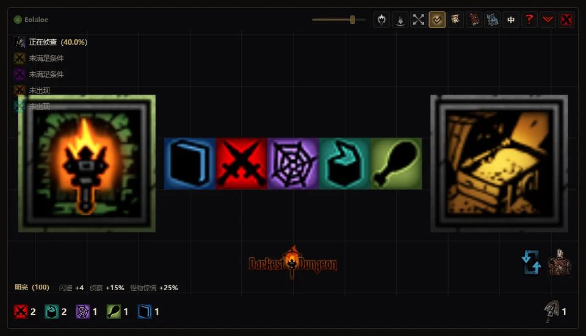

### 主要功能

- **战斗界面**——在目标上方显示所选技能的伤害、命中、暴击和效果概率，也能查看队友支援、位移、敌人选定的技能与目标，以及当前状态和下次行动的持续效果。
- **探索中的选择**——在奇物、障碍物和饥饿卡片中查看结果并执行选项。陷阱卡片列出各英雄的解除概率与压力，供你选择由谁尝试解除。
- **陷阱前自动停止与物品整理**——在已侦察到的陷阱前停步；点击背包或按[I]整理物品。将鼠标移到背包上，可在游戏的物品栏和战利品格中显示售价。
- **详细地图**——查看奇物结果、敌人组成、剩余格数、补给用途、目标路线，以及侦察概率和亮度修正。
- **记录与城镇准备**——提供活动日志、统计面板、英雄表、图鉴搜索、补给推荐（含地牢模组）与自动购买，以及建筑升级与区域建筑所需资源的计算。
- **界面指南**——点击问号打开7章、31步的引导。说明使用预先录制的示例场景，部分步骤还可以移入鼠标查看卡片。

### 独立窗口模式

工具以独立窗口浮在游戏上方，把地图、战斗界面、卡片和记录集中显示在一个窗口中。窗口大小和背景不透明度可自由调整。载入存档后会自动切换到叠加模式，此后可自由切换模式。

<table>
<tr><td align="center" width="50%">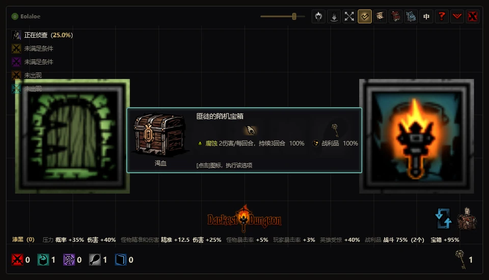 奇物卡片</td><td align="center" width="50%">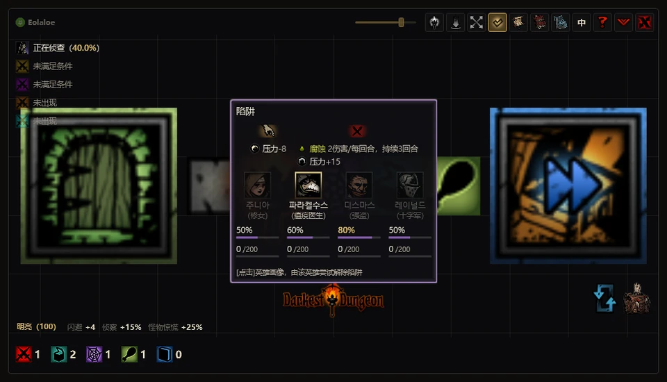 解除陷阱</td></tr>
<tr><td align="center" width="50%">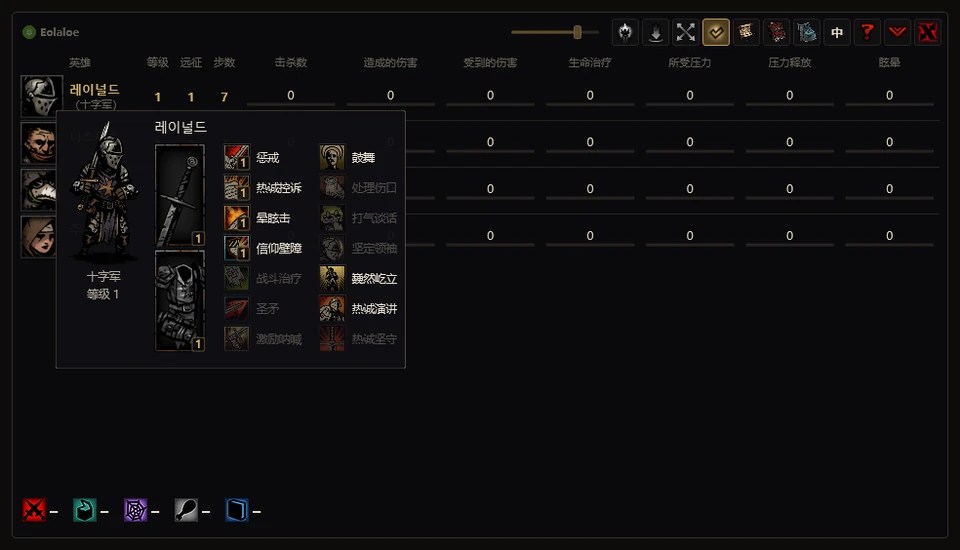 英雄表与卡片</td><td align="center" width="50%">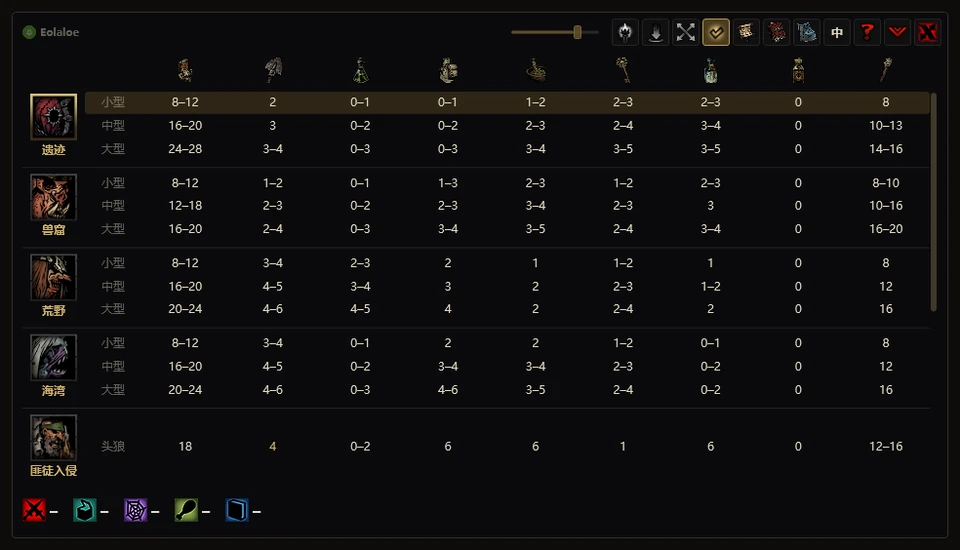 补给推荐</td></tr>
<tr><td align="center" width="50%">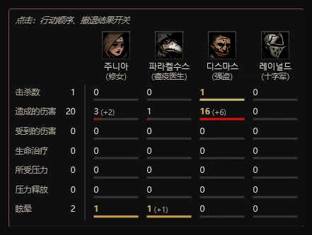 远征统计</td><td align="center" width="50%">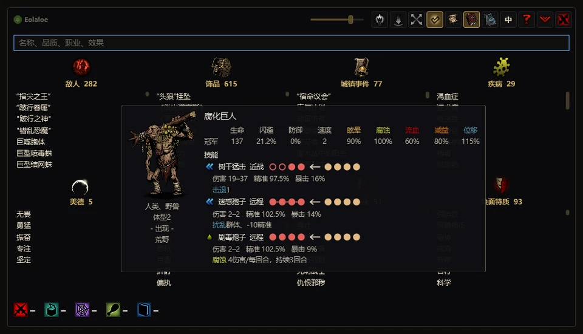 图鉴</td></tr>
</table>

### 叠加模式

按<code>[ &#96; ]</code>键或右上角的菱形按钮可切换模式。**载入存档后会自动切换到叠加模式。** 先启动游戏再打开工具时也一样，此后可自由切换。

独立窗口模式把信息集中在一个窗口中，而叠加模式会把工具窗口收成一个蜡烛按钮，并**在游戏画面上覆盖一层透明图层，把信息直接显示在游戏界面的对应位置。** 它沿用游戏的字体、图像和布局，力求像游戏原本就有的界面一样自然地呈现信息。

- **探索**——工具地图嵌入游戏的地图栏；奇物、陷阱、障碍物和饥饿卡片显示在游戏画面中央。侦察概率和火把档位紧挨在游戏原有显示旁。
- **战斗**——在每个角色身上显示行动顺序、头顶的伤害与概率以及当前状态；拖延战斗的状态以回合数外圈的光色提示。
- **侧边面板**——远征中可在右侧面板以标签页查看统计面板、活动日志、图鉴和城镇建筑，用[Backspace]、[Home]、[End]切换标签页。再次点击已打开的标签页可收起面板，只保留按钮，并记住收起状态。
- **城镇**——城镇名称下方显示全体英雄的统计表；底部按钮栏上方的箭头可打开图鉴和建筑升级面板。任务选择界面可使用队伍预设；城镇、任务选择和补给界面可使用饰品预设。在补给界面，金币上方的箭头可打开补给表（含自动购买）。
- 显示位置会读取游戏实际使用的布局数值来对齐。英雄详情、菜单或确认窗口打开时以及加载中会暂时隐藏；点击蜡烛或再次按该键即可回到独立窗口模式。若在收起状态下退出，下次也会以叠加模式启动。
- **按元素开关**——通过侧边面板标签页上方的箭头打开**显示或隐藏叠加层**，可分别开关地图、信息卡片、战斗数值、状态效果和行动顺序等元素。
- **通知字幕**——编组、装备、购买等自动操作的进度、结果和中断原因会以游戏画面上的字幕显示。
- 叠加模式下，工具不会出现在任务栏或Alt+Tab中；展开为独立窗口后会重新显示在任务栏中。
- 蜡烛始终置顶，点击可展开为独立窗口，点击蜡烛上的X按钮可退出工具。再次运行工具也会展开独立窗口。

<table>
<tr><td align="center" width="50%"> 显示或隐藏叠加层</td></tr>
</table>
<!-- 图片：通知字幕 -->

<table>
<tr><td align="center" width="50%"> 探索——地图</td><td align="center" width="50%"> 探索——陷阱卡片</td></tr>
<tr><td align="center" width="50%"> 战斗——拖延战斗与头顶数值</td><td align="center" width="50%"> 战斗——敌人信息</td></tr>
<tr><td align="center" width="50%"> 城镇——统计表与图鉴</td><td align="center" width="50%"> 城镇——补给</td></tr>
</table>

### 功能详情

展开各项功能说明

#### 战斗

- 进入战斗后，主界面会从地图切换为战斗界面。己方行动时，显示所选技能可作用目标的数值；敌方行动时，只显示敌人已选定目标的数值。治疗、增益和位移技能也会按相应阵型展示。
- 角色上方的两列分别显示已有状态及剩余时间、下次行动的持续效果量。预计持续伤害会耗尽生命时，以血迹提示。角色下方显示当前生命和压力。
- 将鼠标移到下方头像上，可打开英雄或敌人的战斗卡片，比较计入当前装备、特质、疾病、增益及触发条件后的数值，以及敌人选择技能和目标的概率。外观也会跟随当前皮肤、变身或姿态。
- 显示行动顺序、拖延战斗带来的增援风险和撤退概率。确定的行动顺序与撤退结果默认开启。在独立窗口中，点击中央标题关闭后，会为仍有行动次数的英雄和敌人显示**接下来行动的概率（估计）**，撤退则显示成功概率。在叠加模式中使用**撤退、回合确定判定**切换。将鼠标移到标题上可打开远征统计面板。
- 行动顺序的预测概率根据速度与骰子规则估算，不读取隐藏的掷骰结果。部分情况采用抽样估算；无法确认回合开始时的速度时，以当前速度近似计算。

<!-- 图片：行动顺序预测概率 -->

#### 地图与探索

- 显示房间、走廊、奇物、陷阱、障碍物、战斗和饥饿格。默认只显示已知区域，关闭迷雾后可查看全图。任务奇物、首领和庭院的路线会考虑钥匙与锁门的先后顺序。
- 下方计数器显示剩余格子，补给图标显示该物品的用途。战斗与饥饿图标可分别隐藏未到访格子的敌人组成和饥饿格。还可查看侦察概率、亮度修正，以及特殊遭遇的位置或出现条件。
- 游戏打开奇物、障碍物或饥饿窗口时，工具会显示对应卡片。点击列即可执行游戏选项；点击奇物的物品列会使用相应物品。补给不足的列不会执行。
- 已侦察陷阱前的自动停止默认开启，可点击陷阱计数器关闭。工具不会自动解除陷阱；需要在卡片中选择英雄，由该英雄尝试解除。
- 探索待机时点击背包或按[I]，会合并同类堆叠并整理顺序。任务物品留在原位，空格移到末尾。战斗后，关闭战利品窗口、返回探索时会自动恢复初始队伍阵型；此功能默认开启，可通过队伍按钮关闭。

#### 队伍与饰品预设

- **队伍预设**——在叠加模式的任务选择界面，点击名册旁的箭头打开。按存档分别保存队伍，点击**编组队伍**即可将英雄编入出征栏位。可从名册或出征栏位拖入英雄，也可直接保存当前队伍。
- 无法参加所选任务的英雄会显示红色X和原因。可载入**最近的队伍**，按职业或预设名称搜索，或替换为同职业的其他英雄。**队伍阵容**列出本体、DLC和模组中的队伍名称组合及达成情况。
- **随机编组队伍**——点击任务选择界面的骰子按钮，从能参加该任务的英雄中随机编组，出征栏位顺序也随机。
- **饰品预设**——可在城镇、任务选择和补给界面使用。每个存档按**每种职业10个预设**保存，从背包拖入饰品来登记。将鼠标移到预设上，可查看包含套装效果的效果合计。
- 为每位出征英雄选择预设，再点击**饰品装备**为全队批量装备。各职业最近两套出征时的装备会保留在**最近的饰品 1、2**中：金星为最近的第1套，银星为第2套。再次点击星标可选择要保存到的预设。

<table>
<tr><td align="center" width="50%"> 队伍预设</td><td align="center" width="50%"> 饰品预设与效果合计</td></tr>
</table>

#### 记录与城镇准备

- 活动日志持续记录战斗、探索和扎营事件，按[End]打开。进入战斗不会自动切换到日志。每个存档保留最近10次远征及其最终统计，供以后查看。
- 城镇英雄表可比较等级、远征次数、步数和工具记录的累计数值。将鼠标移到头像上，可查看装备、战斗技能和扎营技能。
- 补给表按地牢和远征长度给出推荐数量。已启用的地牢模组（Courtyard Plus、Farmstead Plus、The Sunward Isles、Vermintide、The Fiend Festival）的地牢也会列出，并高亮所选任务的行，把该地牢移到表格最上方。点击一行预览购买、出售和费用，**3秒内再点同一行即购买**。数量范围按上限处理，不会出售免费发放的物品。还会为受猩红诅咒的英雄调整血酿数量，并为留在城镇中处于凋零状态的英雄留出份额。
- 图鉴可按名称、品质、职业和效果搜索敌人、饰品、城镇事件、疾病、美德、折磨与特质。建筑与区域建筑界面可比较所选升级需要的资源与持有量；它只用于规划，不会替你在游戏里建造。

### 安装

1. 从[最新发行版](https://github.com/Eolaloe/DD-AncestorsMap/releases/latest)下载`AncestorsMap.zip`，解压到任意文件夹。
2. 运行`AncestorsMap.exe`。如果没有安装**.NET 8 Desktop Runtime**，会出现安装提示。
3. 启动游戏后，工具会自动查找存档。首次使用建议点击右上角问号，查看界面指南。

### 要求与兼容性

- 需要Windows 10/11、[.NET 8 Desktop Runtime](https://dotnet.microsoft.com/download/dotnet/8.0)和已安装的《暗黑地牢》1。工具本体为约**8.6MB**的单个exe，运行时需另行安装。
- 实时信息与输入辅助需要受支持的**64位**游戏。支持Steam公开版和`coming_in_hot`测试版的Steam及无DRM（`_windowsnosteam`）执行文件。32位或未识别的游戏版本不会读取内存，只提供基于存档的功能，并在日志状态栏说明原因。
- 会读取启用的DLC、模组及其加载顺序。已确认的地牢模组包括Courtyard Plus、Farmstead Plus、The Sunward Isles、Vermintide和The Fiend Festival，并非所有模组都经过验证。
- 以Steam安装方式为基准，也确认过无DRM执行文件。GOG等其他平台的安装位置或存档路径可能无法自动识别。
- 支持한국어、English、日本語和简体中文。首次启动跟随游戏语言，此后使用你在工具中选择的语言。

### 安全说明

- **不会直接写入游戏文件、存档或游戏内存，也不会向游戏进程注入代码。** 内存仅以读取权限打开。工具自身的设置与远征记录另行保存。
- **输入辅助会实际操作游戏。** 房间移动、卡片选项和物品使用、陷阱解除、自动购买、物品整理、阵型恢复、编组队伍与饰品装备，都会发送点击、按键或拖放输入。这些操作的结果可能由游戏正常写入存档。
- 陷阱前自动停止会发送松开移动键或鼠标按钮的输入，并拦截移动键的重复输入。此功能**默认开启**，通过陷阱计数器切换。战斗后自动恢复阵型同样**默认开启**，通过队伍按钮关闭。
- 将鼠标移到背包上查看售价时，如果探索中的游戏正显示地图面板，也会发送[Tab]来打开物品栏。因此，部分显示功能也会发送输入。
- 自动购买或整理时请勿移动鼠标。整理时也请勿按住[Shift]；这会与游戏的丢弃操作冲突，工具因此不会执行拖放。
- 联网用于查询GitHub发行版：启动时自动检查，也可在应用信息中手动检查。不需要账号或API密钥，不会上传游戏记录。
- 读取其他程序内存可能触发部分杀毒软件的误报。可使用发行说明提供的SHA-256核对下载文件。

### 更新

启动时自动检查新版本。点击左上角署名可查看当前版本并通过**检查更新**手动检查。**有新版本可用**通知会在叠加模式下展开独立窗口显示；自动切换会等到通知关闭后再继续。点击**查看更新**打开发行页面，下载新zip即可。工具不会自动下载或替换文件；请先关闭正在运行的工具，再覆盖文件。设置与远征记录保存在`%LocalAppData%\AncestorsMap`。

### 操作

| 按键或鼠标 | 功能 |
|---|---|
| <code>[ &#96; ]</code>或菱形按钮 | 开关叠加模式——工具窗口收成蜡烛按钮，信息显示在游戏画面的对应位置；点击蜡烛也可恢复 |
| [Backspace] | 返回主界面：城镇英雄表／补给表／探索地图／战斗界面 |
| [Home]／[End] | 打开或关闭图鉴／活动日志 |
| [Caps Lock] | 立即恢复初始队伍阵型 |
| [I]或点击背包 | 探索待机时整理物品栏 |
| 将鼠标移到背包上 | 显示游戏物品栏及已打开战利品格的售价 |
| 点击队伍图标 | 切换战斗后自动恢复阵型 |
| 左键拖动／右键拖动 | 移动工具窗口／移动地图 |
| 滚轮／中键单击 | 缩放地图／切换迷雾 |
| 点击工具地图上相连的房间 | 身处房间时，在游戏中前往该房间 |
| 点击自动弹出卡片中的列 | 执行奇物、障碍物、饥饿选项，或选择英雄解除陷阱 |
| 点击补给行→3秒内再次点击同一行 | 预览购买→自动购买 |
| 拖动窗口边缘／顶部滑块 | 调整尺寸／背景不透明度 |
| 问号／鼠标移到署名上或点击署名 | 界面指南／操作说明或应用信息 |

游戏上的快捷键在游戏窗口位于前台时生效。[I]仅在探索待机时由工具接管，其他时候保留游戏原本的功能。在工具窗口中也可使用<code>[ &#96; ]</code>、[Home]和[End]；搜索框有文字时，[Backspace]会删除文字。购买和整理会将游戏切到前台，房间移动、卡片选择、陷阱解除等也需要游戏窗口位于前台。

叠加模式下，远征中的[Backspace]、[Home]、[End]用于切换侧边面板的统计面板、图鉴和活动日志标签页；在城镇中则保留游戏原本的按键功能。

### 界面指南

点击问号，可依次了解初次使用、地图、探索选择、战斗、远征管理、城镇准备，以及记录与查阅。前6章使用录制好的示例场景，不启动游戏也能查看；最后的“记录与查阅”会打开用户自己的数据。允许悬停的步骤可以将鼠标移入金色边框。点击暗处或切换到叠加模式即可关闭指南。

### 已知限制

- 敌人组成、饥饿格、行动顺序和撤退结果等信息包含游戏原本隐藏的内容。请按需要启用。
- 游戏更新后，在确认兼容前无法使用实时功能。部分基于存档的信息要等游戏保存后才会更新。
- 补给推荐参考了Wiki、攻略和地牢生成规则，模组地牢还包含计算估值。请根据队伍与探索计划调整。
- 输入辅助依赖游戏画面和布局；不支持的布局或某些模组可能限制功能。
- 叠加模式已在16:9画面上确认。在其他画面比例或游戏以窗口模式运行时，显示位置可能会偏移。

### 问题反馈

请在[Issues](https://github.com/Eolaloe/DD-AncestorsMap/issues)中说明工具版本（点击署名查看）、游戏版本（公开版／`coming_in_hot`／无DRM版）、启用的模组，以及在哪个界面进行了什么操作。方便的话，请附上截图和工具显示的通知文字。

### 许可与致谢

[LICENSE](LICENSE) — 可自由用于个人用途；请通过官方仓库链接分享（重新上传文件或发布修改版请先联系作者）；禁止售卖。
《暗黑地牢》（Darkest Dungeon）是 Red Hook Studios 的游戏。
在 Claude 和 Codex 的协助下制作。

韩语助词处理规则参考了[es-hangul](https://github.com/toss/es-hangul)（toss，MIT）和kohangul（MIT）。

---

 <b>English</b>

An overlay for Darkest Dungeon 1 that puts **maps, combat information and an activity log** over the game.

It stays on top even over a fullscreen game, and clicking it doesn't steal your input — the game keeps receiving it. **Using it on top of the game screen is recommended.**

Nothing is hard-coded from vanilla. It **reads the base game, DLC and every mod enabled in your current save in their load order and merges them**, so curios, monsters, trinkets and quirks added or changed by mods show up with their real in-game values. Names and descriptions use the game's translations, and loading a different save re-syncs on its own. Typing in the Codex search box gives keyboard focus to the app.

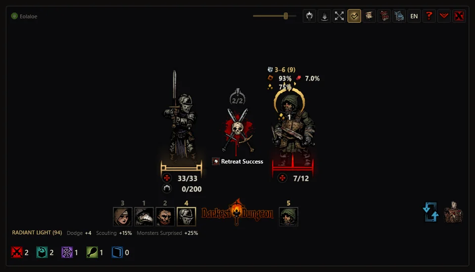
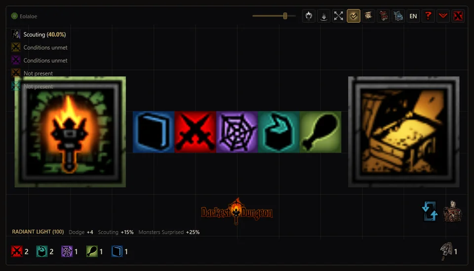

### What it does

- **Battle screen** — See damage, hit, crit and effect chances above each target of your selected skill. It also shows support skills, movement, the enemy's chosen skill and targets, active statuses and effects due next turn.
- **Exploration choices** — Check the outcomes on curio, obstacle and hunger cards, then click an option. Trap cards let you compare each hero's disarm chance and stress before choosing who should try.
- **Auto stop before traps and inventory sorting** — Stop before scouted traps, and sort supplies and loot with the bag button or `[I]`. Hover over the bag to display sell values on the game's inventory and loot slots.
- **Detailed map** — Check curio outcomes, enemy groups, remaining tiles, supply uses, routes to objectives, scouting chance and light modifiers.
- **Records and town preparation** — Use the activity log, meters, hero table, Codex search, supply recommendations (dungeon mods included), auto-buy and building or district cost planner.
- **Screen guide** — Open a seven-chapter, 31-step tour from the question-mark button. It uses recorded example scenes, with cards you can hover over in some steps.

### Standalone window mode

The app floats over the game as its own window and gathers the map, battle screen, cards and records in one place. You can resize it and adjust the background opacity. Loading a save switches to overlay mode automatically; you can change modes freely afterwards.

<table>
<tr><td align="center" width="50%">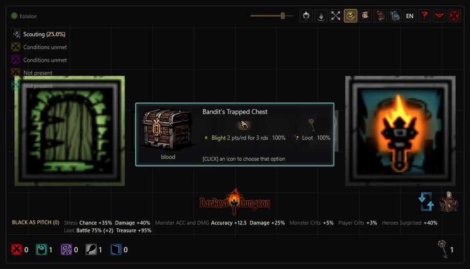 Curio card</td><td align="center" width="50%">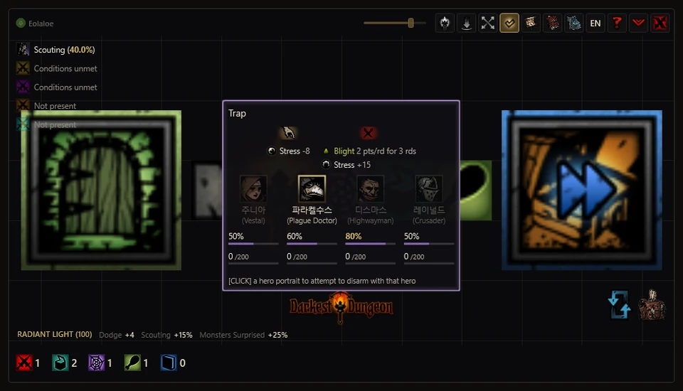 Trap disarming</td></tr>
<tr><td align="center" width="50%">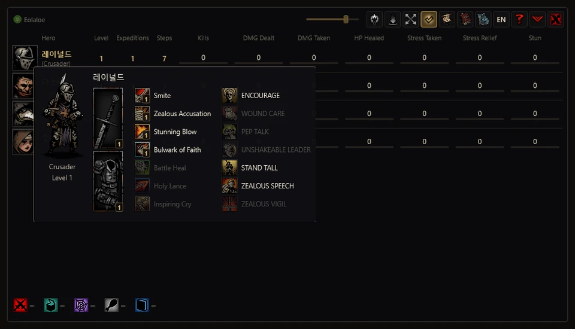 Hero table and card</td><td align="center" width="50%">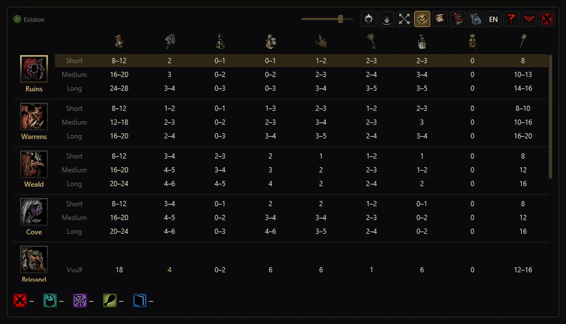 Supply recommendations</td></tr>
<tr><td align="center" width="50%">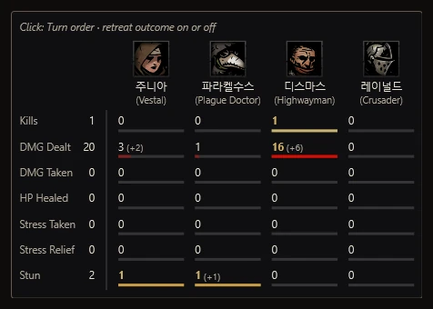 Expedition meter</td><td align="center" width="50%">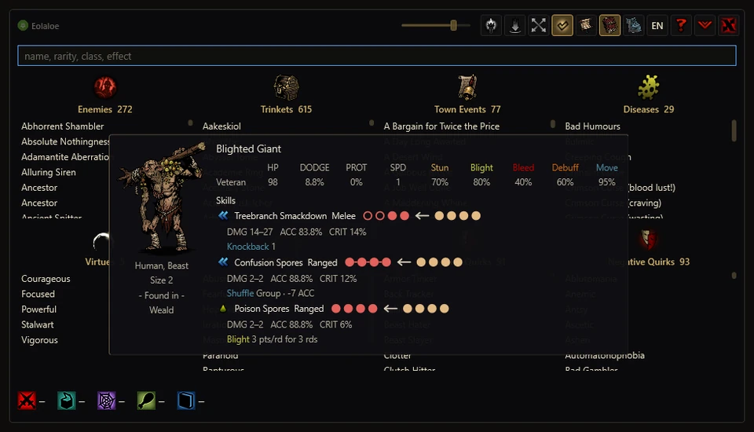 Codex</td></tr>
</table>

### Overlay mode

Press <code>[ &#96; ]</code> or the diamond button at the top right to switch modes. **Loading a save automatically switches to overlay mode**, including when you open the app with a save already loaded in the game. You can switch freely afterwards.

Where the standalone window gathers everything in one place, overlay mode folds the app window into a single candle button and **lays a transparent layer over the game screen so the information sits directly in place on the game's own UI.** It follows the game's fonts, art and layout, aiming to feel like a natural part of the original game.

- **Exploration** — The app map takes over the game's map panel, and curio, trap, obstacle and hunger cards appear in the middle of the game screen. Scouting chance and torch levels sit next to the game's own indicators.
- **Combat** — Turn order, damage and chances overhead and active statuses are shown on each character, and stalling is signalled by the colour of the glow around the round counter.
- **Side panel** — During an expedition, the right-hand panel holds the meter, activity log, Codex and town buildings as tabs. Switch them with `[Backspace]`, `[Home]` and `[End]`. Click the active tab again to fold the panel down to its buttons; the folded state is remembered.
- **Town** — A meter table for the whole roster sits under the estate name, and arrows above the bottom button bar open the Codex and building upgrade panels. Party Presets are available on quest select; Trinket Presets are available in town, on quest select and while provisioning. On the provisioning screen, the arrow above your gold opens the supply table (auto-buy included).
- Positions are read from the layout values the game actually uses. The overlay steps aside while hero details, menus or confirmation windows are open and during loading. Click the candle or press the key again to return to standalone window mode. If you quit while folded, the app starts in overlay mode next time.
- **Individual elements** — Open **Show or hide overlays** from the arrow above the side panel tabs to toggle the map, info cards, combat numbers, status effects, turn order and other elements separately.
- **Notice subtitles** — Progress, results and reasons for stopping automatic actions such as party formation, equipping and purchasing appear as subtitles over the game.
- In overlay mode, the app is hidden from the taskbar and Alt+Tab. Opening the standalone window restores its taskbar entry.
- The candle stays on top: click it to open the standalone window, or its X button to quit the app. Running the app again also opens the standalone window.

<table>
<tr><td align="center" width="50%"> Show or hide overlays</td></tr>
</table>
<!-- Screenshot: Notice subtitles -->

<table>
<tr><td align="center" width="50%"> Exploration — map</td><td align="center" width="50%"> Exploration — trap card</td></tr>
<tr><td align="center" width="50%"> Combat — stalling and overhead values</td><td align="center" width="50%"> Combat — enemy details</td></tr>
<tr><td align="center" width="50%"> Town — meter and Codex</td><td align="center" width="50%"> Town — provisions</td></tr>
</table>

### In detail

Expand the feature descriptions

#### Combat

- When combat starts, the main view changes from the map to the battle screen. On a hero's turn, it shows values for the targets their selected skill can reach. On an enemy's turn, it shows values for the targets the enemy has already chosen. Healing, buffs and movement skills use the appropriate formation.
- Two columns above each character distinguish active statuses and their remaining duration from ongoing effect amounts due next turn. A blood splatter marks expected HP depletion from ongoing damage. Current HP and stress appear below the character.
- Hover over the portraits along the bottom for hero and enemy combat cards. Compare values based on current equipment, quirks, diseases, buffs and conditions, as well as enemy skill and target selection chances. Artwork follows the current skin, transformation or stance.
- Check turn order, stalling reinforcement risk and retreat chance. Exact turn order and the predicted retreat result are on by default. In the standalone window, click the central title to turn these off: heroes and enemies with actions remaining then show their **Estimated chance to act next**, and retreat shows its success chance. In overlay mode, use **Exact retreat & turn order**. Hover over the title to open the expedition meter.
- Turn order odds use speed and dice rules without reading the hidden rolls. Some situations use sampling estimates; if the round's starting speed is unavailable, current speed is used as an approximation.

<!-- Screenshot: Turn order odds -->

#### Map and exploration

- View rooms, corridors, curios, traps, obstacles, battles and hunger tiles. Fog is on by default, showing revealed areas only; turn it off to see the whole map. Routes to quest curios, bosses and through the Courtyard account for keys and locked doors.
- The bottom counters show remaining tiles, while supply icons show where each item can be used. The battle and hunger icons separately hide enemy groups in unvisited tiles and hunger tile markers. You can also check scouting chance, light modifiers and special encounter locations or spawn conditions.
- Opening a curio, obstacle or hunger window in the game brings up the matching card. Click a column to execute that choice in the game; an item column on a curio card uses the item. Columns that require more supplies than you have will not execute.
- Auto stop before scouted traps is on by default. Toggle it with the trap counter. It does not disarm traps automatically: choose a hero on the card to attempt the disarm.
- While idle in a dungeon, click the bag or press `[I]` to merge stacks and arrange your inventory. Quest items stay in place and empty slots move to the end. After combat, the default party order is restored automatically once the loot window closes and exploration resumes. This is on by default; turn it off with the party button.

#### Party and trinket presets

- **Party Presets** — Open the arrow beside the roster on the quest select screen in overlay mode. Save parties separately for each save file, then click **Form party** to fill the embark slots. Register heroes by dragging them from the roster or embark slots, or save the current party.
- Heroes who cannot join the selected quest have a red X and a reason. Load the **Recent party**, search by class or preset name, or swap in another hero of the same class. **Party Combinations** lists named party lineups from the base game, DLC and mods, with their recorded status.
- **Form a random party** — Click the dice button on quest select to form a party from heroes who can join that quest, with randomised slot order too.
- **Trinket Presets** — Use them in town, on quest select or while provisioning. Store **10 presets per class**, separately for each save file. Drag trinkets in from the bag to register them. Hover over a preset to see its combined effects, including set bonuses.
- Pick a preset for each departing hero, then click **Equip trinkets** to equip the whole party at once. Each class's two most recent departure loadouts remain as **Recent trinkets 1 and 2**: gold star for 1, silver for 2. Click a star again to choose a preset to save it to.

<table>
<tr><td align="center" width="50%"> Party Presets</td><td align="center" width="50%"> Trinket Presets and combined effects</td></tr>
</table>

#### Records and town preparation

- The activity log keeps recording combat, exploration and camping events. Open it with `[End]`; combat no longer opens the log automatically. Review the last ten expeditions for each save, including their final meters.
- The town hero table compares levels, expedition counts, steps and cumulative stats recorded by the app. Hover over a portrait for equipment, combat skills and camping skills.
- The provisions table recommends amounts by dungeon and expedition length. Dungeons from enabled dungeon mods (Courtyard Plus, Farmstead Plus, The Sunward Isles, Vermintide, The Fiend Festival) are listed too, and the quest you picked is highlighted with its dungeon moved to the top. Click a row to preview purchases, sales and cost, then **click the same row again within 3 seconds to buy**. Ranges use the higher amount, and free provisions are not sold. It also adjusts Blood for cursed party members while reserving Blood for wasting heroes left in town.
- Search the Codex for enemies, trinkets, town events, diseases, virtues, afflictions and quirks by name, rarity, class or effect. The building and district view compares planned upgrade costs with your resources. It is a planner, not an automatic building tool.

### Installation

1. Download `AncestorsMap.zip` from the [latest release](https://github.com/Eolaloe/DD-AncestorsMap/releases/latest) and extract it to any folder.
2. Run `AncestorsMap.exe`. If the **.NET 8 Desktop Runtime** is missing, an installation prompt appears.
3. Launch the game and the app finds your save automatically. On your first run, try the question-mark button in the top-right corner.

### Requirements & compatibility

- Windows 10/11, the [.NET 8 Desktop Runtime](https://dotnet.microsoft.com/download/dotnet/8.0) and an installed copy of Darkest Dungeon 1. The app is a single executable of about **8.6 MB**; the runtime is separate.
- Live information and input assistance require a supported **64-bit** game build. The Steam public and `coming_in_hot` beta builds are supported, with either the Steam or DRM-free (`_windowsnosteam`) executable. With a 32-bit or unrecognised build, the app skips memory reading, offers save-based features only, and explains why in the log's status line.
- Active DLC, mods and their load order are read from your save. Dungeon mods checked include Courtyard Plus, Farmstead Plus, The Sunward Isles, Vermintide and The Fiend Festival. Not every mod has been tested.
- Built around Steam installations and also checked with the DRM-free executable. Other platforms, including GOG, may use game or save locations the app cannot find automatically.
- Supports 한국어, English, 日本語 and 简体中文. It follows the game language on first run, then uses the language you choose in the app.

### Safety

- **The app does not write directly to game files, saves or game memory, or inject code into the game process.** It opens memory with read permissions only. Its own settings and expedition records are stored separately.
- **Input assistance does operate the game.** Room movement, card choices and item use, trap disarming, auto-buy, sorting, party reordering, party formation and trinket equipping send clicks, keystrokes or drag-and-drop input. The game may save the results of these actions normally.
- Auto stop before traps sends key or mouse-button releases and blocks repeated movement-key input. It is **on by default**, controlled by the trap counter. Automatic party reordering after battle is also **on by default**, controlled by the party button.
- Even hovering over the bag for sell values can send `[Tab]` to open the inventory if the game is showing its map panel during exploration. Some display features therefore also send input.
- Do not move the mouse during auto-buy or sorting. Do not hold `[Shift]` while sorting: it overlaps with the game's discard action, so the app will not perform the drag.
- Network access is used to check GitHub releases: automatically at startup, or manually from app info. No account or API key is needed, and game records are not uploaded.
- Reading another process's memory may trigger antivirus false positives. Use the SHA-256 provided with the release to verify your download.

### Updates

The app checks for a new version at startup. Click the signature in the top-left corner to see your version or select **Check for updates**. The **New version available** notice opens the standalone window even in overlay mode; automatic mode switching waits until the notice closes. Choose **View update** to open the release page and download the new zip. Nothing is downloaded or replaced automatically. Close the running app before overwriting its files. Settings and expedition records remain in `%LocalAppData%\AncestorsMap`.

### Controls

| Key or mouse action | What it does |
|---|---|
| <code>[ &#96; ]</code> or the diamond button | Toggle overlay mode — the app window folds into the candle button and the information moves onto the game screen; clicking the candle also returns |
| `[Backspace]` | Return to the main view: town heroes / provisions / dungeon map / battle screen |
| `[Home]` / `[End]` | Open or close the Codex / Activity Log |
| `[Caps Lock]` | Restore the default party order now |
| `[I]` or click the bag | Sort inventory while idle in a dungeon |
| Hover over the bag | Show sell values on game inventory and open loot slots |
| Click the party icon | Toggle automatic party reordering after battle |
| Left-drag / right-drag | Move the app window / pan the map |
| Mouse wheel / middle-click | Zoom the map / toggle fog |
| Click a connected room on the app map | Move there in the game while standing in a room |
| Click a column on an automatic card | Choose a curio, obstacle or hunger option, or select a hero to disarm a trap |
| Click a supply row, then again within 3 seconds | Preview the purchase, then auto-buy |
| Drag a window edge / top slider | Resize / adjust background opacity |
| Question mark / hover over or click the signature | Screen guide / controls list or app info |

Shortcuts over the game work while its window is active. The app takes `[I]` only while idle in a dungeon; otherwise it retains its game function. In the app itself, <code>[ &#96; ]</code>, `[Home]` and `[End]` also work; `[Backspace]` deletes text when the search field contains any. Buying and sorting bring the game to the front. Room movement, card choices and trap disarming also require the game window to be active.

In overlay mode, `[Backspace]`, `[Home]` and `[End]` switch the side panel between the meter, Codex and activity log tabs during an expedition; in town they keep their game functions.

### Screen guide

Use the question mark to explore getting started, the map, exploration choices, combat, expedition management, town preparation, and records and reference. The first six chapters use recorded example scenes, so you can view them without running the game. The final chapter opens your own records and reference views. In steps that allow hovering, try the areas inside the gold outlines. Click a darkened area or switch to overlay mode to close the guide.

### Known limitations

- The app can reveal information the game hides, including enemy groups, hunger tiles, turn order and retreat results. Enable only the information you want.
- After a game update, live features are unavailable until support for that build is confirmed. Some save-based displays can lag until the game saves.
- Provisions recommendations draw on wikis, guides and dungeon generation rules; mod dungeon values include calculated estimates. Adjust them for your party and exploration plans.
- Input assistance depends on the game screen and layout. Unsupported layouts or some mods may limit these features.
- Overlay mode has been checked on 16:9 screens. On other aspect ratios or with the game in windowed mode, positions may be off.

### Reporting issues

Open an [issue](https://github.com/Eolaloe/DD-AncestorsMap/issues) with your app version (click the signature), game version (public / `coming_in_hot` / DRM-free), active mods, and which screen and action caused the problem. Include a screenshot and the app's notification text if possible.

### License & credits

[LICENSE](LICENSE) — free for personal use; share the official repository link (ask before re-uploading the file or sharing a modified build); no selling.
Darkest Dungeon is a game by Red Hook Studios.
Made with help from Claude and Codex.

Korean particle selection rules draw on [es-hangul](https://github.com/toss/es-hangul) (toss, MIT) and kohangul (MIT).

