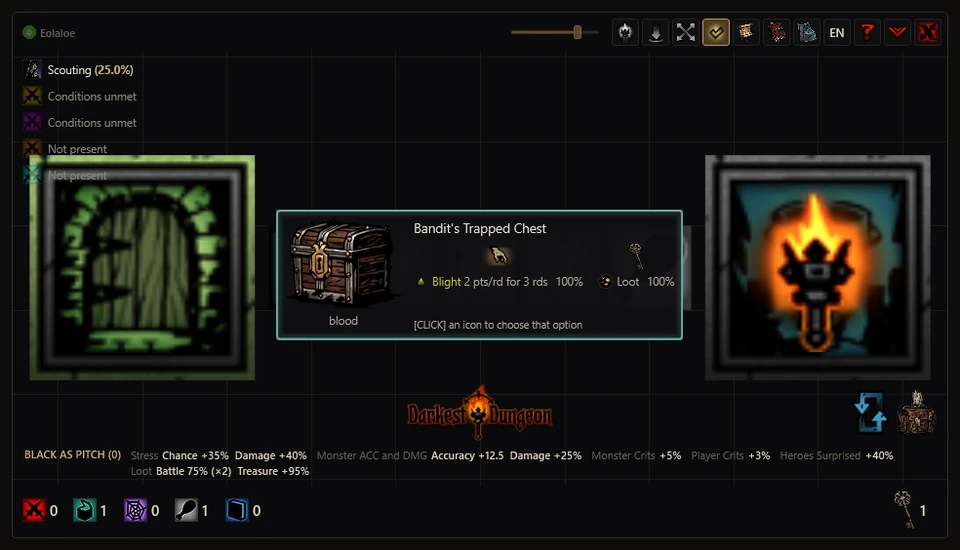
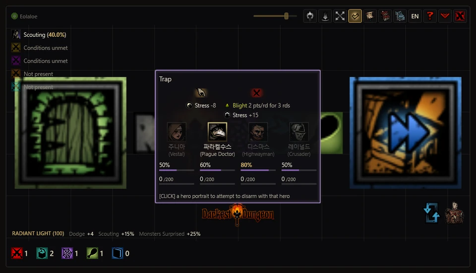
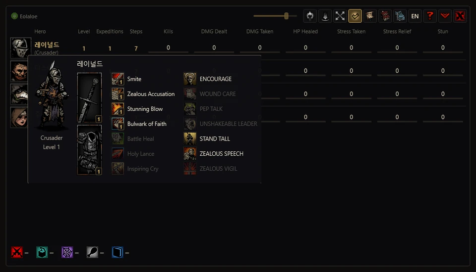
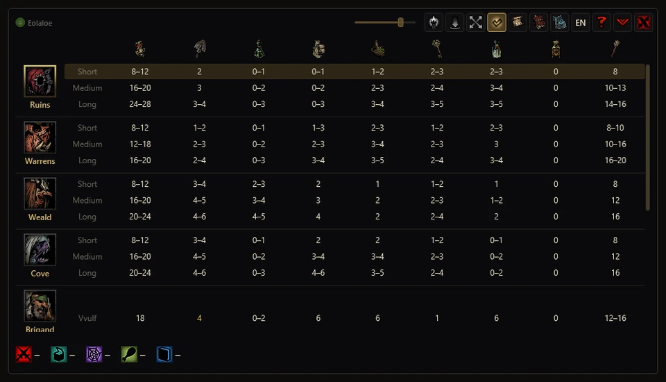
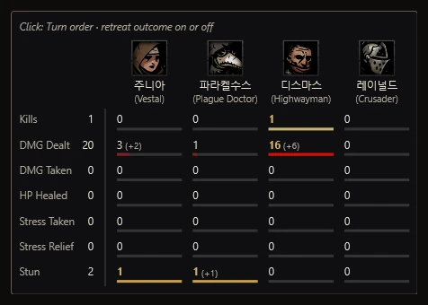
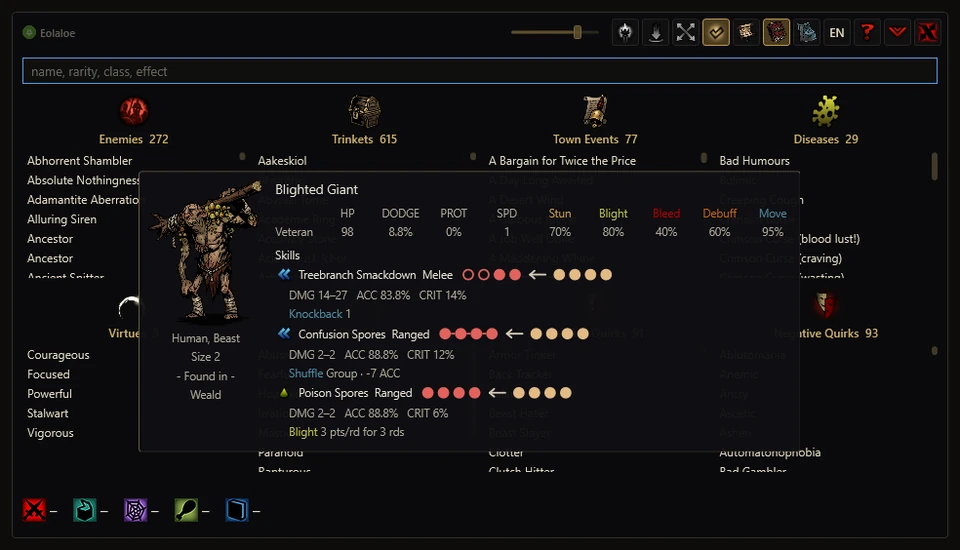

**English** · [한국어](../ko/guide.md) · [日本語](../ja/guide.md) · [中文](../zh/guide.md)

# User guide

[Back to the overview](../../README.md)

How to use each feature in 1.3.5, with controls and safety information. Game names and descriptions follow the game and your active mods. For changes by version, see the [changelog](CHANGELOG.md).

## Standalone window mode

The app floats over the game as its own window and gathers the map, battle screen, cards and records in one place. You can resize it and adjust the background opacity. Loading a save switches to overlay mode automatically; you can change modes freely afterwards.

<table>
<tr><td align="center" width="50%"> Curio card</td><td align="center" width="50%"> Trap disarming</td></tr>
<tr><td align="center" width="50%"> Hero table and card</td><td align="center" width="50%"> Supply recommendations</td></tr>
<tr><td align="center" width="50%"> Expedition meter</td><td align="center" width="50%"> Codex</td></tr>
</table>

## Overlay mode

Press <code>[ &#96; ]</code> or the diamond button at the top right to switch modes. **Loading a save automatically switches to overlay mode**, including when you open the app with a save already loaded in the game. You can switch freely afterwards.

Overlay mode folds the app window into a single candle button and **adds a transparent layer that places information directly on the game's own UI.** It follows the game's fonts, art and layout, aiming to feel like a natural part of the original game.

- **Exploration** — The app map takes over the game's map panel, and curio, trap, obstacle and hunger cards appear in the middle of the game screen. Scouting chance and torch levels sit next to the game's own indicators.
- **Combat** — Each character shows turn order, overhead damage and odds, and active statuses. The glow around the round counter changes colour to indicate stalling.
- **Side panel** — During an expedition, the right-hand panel has tabs for Speed settings, the meter, activity log, Codex and town buildings. The first button opens Speed settings. `[Backspace]`, `[Home]` and `[End]` switch to the meter, Codex and activity log respectively. Click the active tab again to fold the panel down to its buttons; the folded state is remembered.
- **Town** — A meter table for the whole roster sits under the estate name, and arrows above the bottom button bar open the Codex and building upgrade panels. Party Presets are available on quest select; Trinket Presets are available in town, on quest select and while provisioning. On the provisioning screen, the arrow above your gold opens the supply table (auto-buy included).
- Positions are read from the layout values the game actually uses. The overlay steps aside while hero details, menus or confirmation windows are open and during loading. Click the candle or press the key again to return to standalone window mode. If you quit while folded, the app starts in overlay mode next time.
- **Individual elements** — Open **Show or hide overlays** from the arrow above the side panel tabs to toggle the map, info cards, combat numbers, status effects, turn order and other elements separately.
- **On-screen notifications** — These show the progress and results of automatic actions, such as forming a party, equipping trinkets and buying supplies, and explain why an action stopped.
- In overlay mode, the app is hidden from the taskbar and Alt+Tab. Opening the standalone window restores its taskbar entry.
- The candle stays on top: click it to open the standalone window, or its X button to quit the app. Running the app again also opens the standalone window.

## In detail

### Speed settings (speed multipliers)

- Open the first tab in the overlay side panel. Adjust forward movement, backward movement, combat, scouting and room transition speeds separately.
- Adjust the multiplier with the − / + buttons, mouse wheel or direct number entry.
- Adjust in steps of 0.1×, from 1.0× to 4.0× for movement, scouting and room transitions, or 1.0× to 2.0× for combat.
- Room transition speed affects fades during room entry and exit and related transitions. It also speeds up the walk into a room, then returns to your selected forward movement speed.
- Reset or close the app normally to restore the original values, which are recorded before changes.

### Additional map and town settings

- Scouting automatically switches to the map tab. Scouting waves and tile reveal animations appear in both window and overlay modes.
- Use the curio icon below the map to hide details of unvisited curios and their entries in the supply tally. This setting is independent of the full-map and battle-information toggles.
- The fifth button on the overlay map toggles auto-hide for the object counters and supply totals: off keeps them visible; on hides them automatically. Hover over the map’s bottom-left corner for 0.5 seconds to slide them into view. They slide down about 1 second after you leave. While hidden, an arrow (the same icon used in the game) appears at the map’s bottom-left corner.
- The combat, curio preview, auto-stop before traps and hunger tile checkboxes in overlay settings share the existing map toggle settings.
- Town settings let you hide trinket presets or automatically close the trinket inventory and hero window after applying one. **Hide The Butcher's Circus** under miscellaneous settings is off by default and hides only the town icon.

### Combat

- When combat starts, the main view changes from the map to the battle screen. On a hero's turn, it shows values for the targets their selected skill can reach. On an enemy's turn, it shows values for the targets the enemy has already chosen. Healing, buffs and movement skills use the appropriate formation.
- Two columns above each character show active statuses and their remaining duration, alongside the ongoing effects due next turn. A blood splatter warns when ongoing damage is expected to deplete their HP. Current HP and stress appear below the character.
- Hover over the portraits along the bottom for hero and enemy combat cards. Compare values based on current equipment, quirks, diseases, buffs and conditions, as well as enemy skill and target selection chances. Artwork follows the current skin, transformation or stance.
- Check turn order, stalling reinforcement risk and retreat chance. Exact turn order and the predicted retreat result are on by default. In the standalone window, click the central title to turn these off: heroes and enemies with actions remaining then show their **Estimated chance to act next**, and retreat shows its success chance. In overlay mode, use **Exact retreat & turn order**. Hover over the title to open the expedition meter.
- Turn order odds use speed and dice rules without reading the hidden rolls. Some situations use sampling estimates; if the round's starting speed is unavailable, current speed is used as an approximation.

- **Riposte** — Targets that can riposte show their damage, hit, crit and effects below the attack preview. The preview remains while the attack plays out.

### Map and exploration

- View rooms, corridors, curios, traps, obstacles, battles and hunger tiles. Fog is on by default, showing revealed areas only; turn it off to see the whole map. Routes to quest curios, bosses and through the Courtyard account for keys and locked doors.
- The bottom counters show remaining tiles, while supply icons show where each item can be used. The battle and hunger icons separately hide enemy groups in unvisited tiles and hunger tile markers. You can also check scouting chance, light modifiers and special encounter locations or spawn conditions.
- Opening a curio, obstacle or hunger window in the game brings up the matching card. Click a column to execute that choice in the game; an item column on a curio card uses the item. You cannot select a column if you lack the required supplies.
- Auto stop before scouted traps is on by default. Toggle it with the trap counter. It does not disarm traps automatically: choose a hero on the card to attempt the disarm.
- While idle in a dungeon, click the bag or press `[I]` to merge stacks and arrange your inventory. Quest items stay in place and empty slots move to the end. After combat, the default party order is restored automatically once the loot window closes and exploration resumes. This is on by default; turn it off with the party button.

- **Auto-switch at Curios (1.3.2)** — If your party includes the Antiquarian or a modded hero with bonus curio loot, the app selects that hero as you approach a curio that can give loot. Use the toggle beside that hero's health bar during exploration.

- **Enemy info toggle (1.3.2)** — With enemy info hidden via the battle icon below the map, enemy groups in new battles along corridors you have already visited stay hidden until you actually face them.

- **Auto torch** — Choose a light level above the light information to use torches when light falls below it during exploration. Choose Black as Pitch (0) to hold at zero, including in battle. In 1.3.2, ending the expedition restores the setting used before Black as Pitch (0). Hover a level to inspect its modifiers; use Manual to stop automatic use.

- **Camping** — The scouting line becomes the nighttime ambush chance. If a class flashback battle is scheduled, it shows that instead. These are chances, not a prediction of the ambush roll.

### Party and trinket presets

- **Party Presets** — Open the arrow beside the roster on the quest select screen in overlay mode. Save parties separately for each save file, then click **Form party** to fill the embark slots. Register heroes by dragging them from the roster or embark slots, or save the current party.
- Heroes who cannot join the selected quest have a red X and a reason. Load the **Recent party**, search by class or preset name, or swap in another hero of the same class. **Party Combinations** lists named party lineups from the base game, DLC and mods, with their recorded status.
- **Form a random party** — Click the dice button on quest select to form a party from heroes who can join that quest, with their slot order randomised as well.
- **Trinket Presets** — Use them in town, on quest select or while provisioning. Store **10 presets per class**, separately for each save file. Drag trinkets in from the bag to register them. Hover over a preset to see its combined effects, including set bonuses.
- Pick a preset for each departing hero, then click **Equip trinkets** to equip the whole party at once. The two trinket loadouts most recently taken on an expedition by each class are kept as **Recent trinkets 1 and 2**: gold star for 1, silver for 2. Click a star again to choose a preset to save it to.

- **After equipping (1.3.2)** — Applying a trinket preset moves the cursor to the trinket bag's close button.

### Records and town preparation

- The activity log keeps recording combat, exploration and camping events. Open it with `[End]`; combat no longer opens the log automatically. Review the last ten expeditions for each save, including their final meters.
- The town hero table compares levels, expedition counts, steps and cumulative stats recorded by the app. Hover over a portrait for equipment, combat skills and camping skills.
- The provisions table recommends amounts by dungeon and expedition length. Dungeons from enabled dungeon mods (Courtyard Plus, Farmstead Plus, The Sunward Isles, Vermintide, The Fiend Festival) are listed too, and the quest you picked is highlighted with its dungeon moved to the top. Click a row to preview purchases, sales and cost, then **click the same row again within 3 seconds to buy**. Ranges use the higher amount, and free provisions are not sold. It also adjusts Blood for cursed party members while reserving Blood for wasting heroes left in town.
- Search the Codex for enemies, trinkets, town events, diseases, virtues, afflictions and quirks by name, rarity, class or effect. The building and district view compares planned upgrade costs with your resources. Use it to plan upgrades; it does not build them for you in the game.

- **Building navigation (1.3.2)** — In a building window, press Q / E or the new buttons to move to the previous / next building. Locked buildings are skipped, and the buttons follow the window's opening and switching animation.

- **Town meter (1.3.2)** — The overlay meter opens briefly when you enter town, then folds to its header strip. Hover over the strip to reopen it; it stays open while the pointer is on the table.

## Installation

1. Download `AncestorsMap.zip` from the [latest release](https://github.com/Eolaloe/DD-AncestorsMap/releases/latest) and extract it to any folder.
2. Run `AncestorsMap.exe`. If the **.NET 8 Desktop Runtime** is missing, an installation prompt appears.
3. Launch the game and the app finds your save automatically. On your first run, try the question-mark button in the top-right corner.

## Requirements & compatibility

- Windows 10/11, the [.NET 8 Desktop Runtime](https://dotnet.microsoft.com/download/dotnet/8.0) and an installed copy of Darkest Dungeon 1 are required. The runtime is installed separately.
- Live information and input assistance require a supported **64-bit** game build. The Steam public and `coming_in_hot` beta builds are supported, with either the Steam or DRM-free (`_windowsnosteam`) executable. With a 32-bit or unrecognised build, the app skips memory reading, offers save-based features only, and explains why in the log's status line.
- Active DLC, mods and their load order are read from your save. Tested dungeon mods include Courtyard Plus, Farmstead Plus, The Sunward Isles, Vermintide and The Fiend Festival. Not every mod has been tested.
- Designed for Steam installations and also tested with the DRM-free executable. Other platforms, including GOG, may use game or save locations the app cannot find automatically.
- Supports 한국어, English, 日本語 and 简体中文. It follows the game language on first run, then uses the language you choose in the app.

## Safety

| Memory access | Scope |
|---|---|
| **Read** | Reads the current game state for maps, combat information and other features. Only the two features below write directly to game memory. |
| **Write — Speed settings** | Changes the selected speed values. Original values are recorded before changes and restored when you reset or close the app normally. |
| **Write — Hide the Butcher’s Circus** | Changes only the icon’s display coordinates. Original coordinates are restored when you turn hiding off or close the app normally. |

- **Game files and saves** — The app does not write to them directly or inject code into the game process. Its own settings and expedition records are stored separately.
- **Input helpers operate the game.** Moving between rooms, choosing card options, using items, disarming traps, buying, sorting, restoring party order, forming parties and equipping trinkets all send clicks, keystrokes or drag-and-drop input to the game. The game may save the results of these actions as part of its normal saves.
- Auto stop before traps sends key or mouse-button releases and blocks repeated movement-key input. It is **on by default**, controlled by the trap counter. Automatic party reordering after battle is also **on by default**, controlled by the party button.
- Even hovering over the bag for sell values can send `[Tab]` to open the inventory if the game is showing its map panel during exploration. Some display features therefore also send input.
- Do not move the mouse during auto-buy or sorting. Do not hold `[Shift]` while sorting: it overlaps with the game's discard action, so the app will not perform the drag.
- Network access is used to check GitHub releases: automatically at startup, or manually from app info. No account or API key is needed, and game records are not uploaded.
- Antivirus software may flag the app by mistake. Use the SHA-256 hashes on the release page to verify your download.

## Updates

The app checks for a new version at startup. Click the signature in the top-left corner to see your version or select **Check for updates**. The **New version available** notice opens the standalone window even in overlay mode; automatic mode switching waits until the notice closes. Choose **View update** to open the release page and download the new zip. Nothing is downloaded or replaced automatically. Close the running app before overwriting its files. Settings and expedition records remain in `%LocalAppData%\AncestorsMap`.

## Controls

| Key or mouse action | What it does |
|---|---|
| First button in the overlay side panel | Open Speed settings |
| − / + buttons, mouse wheel or direct number entry in Speed settings | Adjust the multiplier |
| `[Q]` / `[E]` or building arrows | Previous / next building while a building window is open; locked buildings are skipped |
| <code>[ &#96; ]</code> or the diamond button | Toggle overlay mode — the app window folds into the candle button and the information moves onto the game screen; clicking the candle also returns |
| `[Backspace]` | Return to the main view: town heroes / provisions / dungeon map / battle screen |
| `[Home]` / `[End]` | Open or close the Codex / Activity Log |
| `[Caps Lock]` | Restore the default party order now |
| `[I]` or click the bag | Sort inventory while idle in a dungeon |
| Hover over the bag | Show sell values on game inventory and open loot slots |
| Click the party icon | Toggle automatic party reordering after battle |
| Left-drag / right-drag | Move the app window / pan the map |
| Mouse wheel / middle-click | Zoom the map / toggle fog |
| Click a connected room on the app map | Move there in the game while standing in a room |
| Click a column on an automatic card | Choose a curio, obstacle or hunger option, or select a hero to disarm a trap |
| Click a supply row, then again within 3 seconds | Preview the purchase, then auto-buy |
| Drag a window edge / top slider | Resize / adjust background opacity |
| Question mark / hover over or click the signature | Screen guide / controls list or app info |

Shortcuts over the game work while its window is active. The app handles `[I]` only while you are idle in a dungeon; otherwise the key keeps its normal game function. In the app itself, <code>[ &#96; ]</code>, `[Home]` and `[End]` also work; `[Backspace]` deletes text when the search field contains any. Buying and sorting bring the game to the front. Room movement, card choices and trap disarming also require the game window to be active.

In overlay mode, `[Backspace]`, `[Home]` and `[End]` switch the side panel between the meter, Codex and activity log tabs during an expedition; in town they keep their game functions.

## Screen guide

Use the question mark to explore getting started, the map, exploration choices, combat, expedition management, town preparation, and records and reference. The first six chapters use recorded example scenes, so you can view them without running the game. The final chapter opens your own records and reference views. When a step supports mouse interaction, hover inside the gold outlines. Click a darkened area or switch to overlay mode to close the guide.

## Known limitations

- The app can reveal information the game hides, including enemy groups, hunger tiles, turn order and retreat results. Enable only the information you want.
- After a game update, live features are unavailable until support for that build is confirmed. Some save-based displays can lag until the game saves.
- Provisions recommendations draw on wikis, guides and dungeon generation rules; mod dungeon values include calculated estimates. Adjust them for your party and exploration plans.
- Input assistance depends on the game screen and layout. Unsupported layouts or some mods may limit these features.
- Overlay mode has been checked on 16:9 screens. On other aspect ratios or with the game in windowed mode, positions may be off.

## Reporting issues

Open an [issue](https://github.com/Eolaloe/DD-AncestorsMap/issues) with your app version (click the signature), game version (public / `coming_in_hot` / DRM-free), active mods, and which screen and action caused the problem. Include a screenshot and the app's notification text if possible.

## License & credits

[LICENSE](../../LICENSE) — free for personal use; share the official repository link (ask before re-uploading the file or sharing a modified build); no selling.
Darkest Dungeon is a game by Red Hook Studios.
Made with help from Claude and Codex.

Korean particle selection rules draw on [es-hangul](https://github.com/toss/es-hangul) (toss, MIT) and kohangul (MIT).
