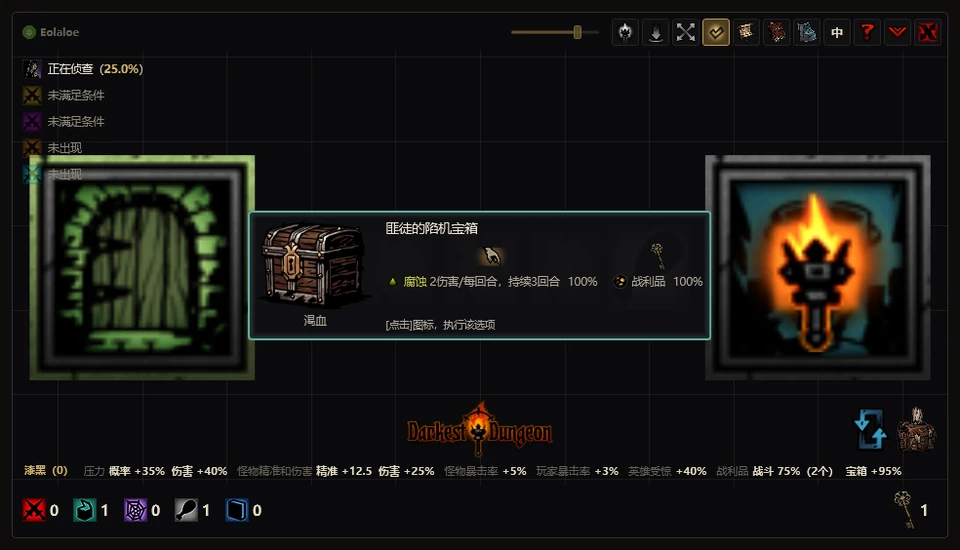
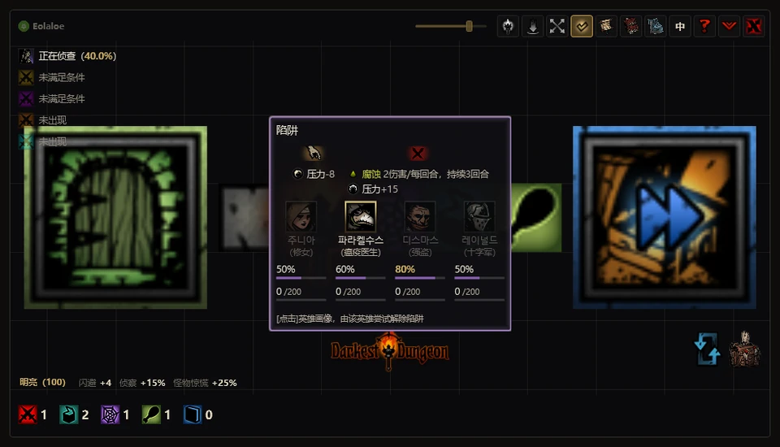
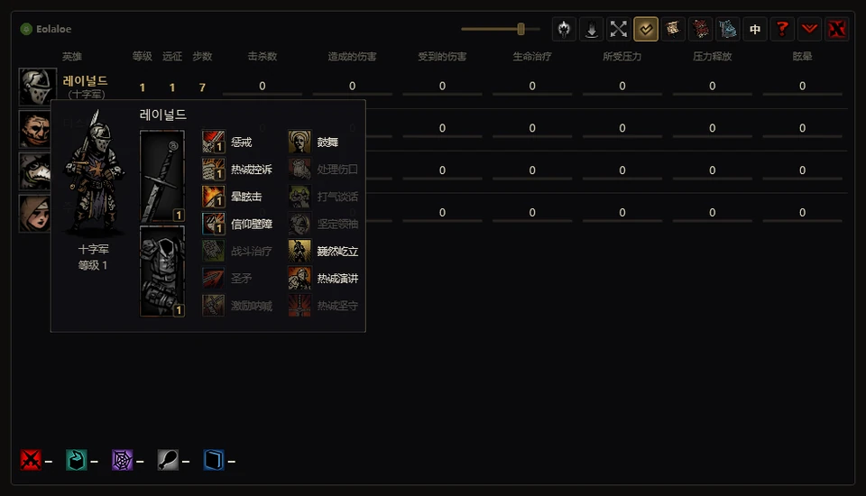
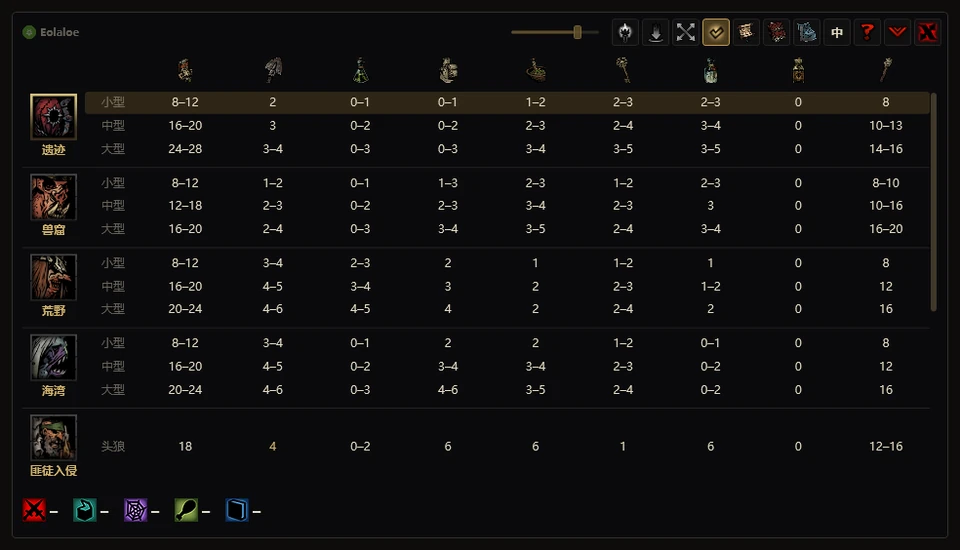
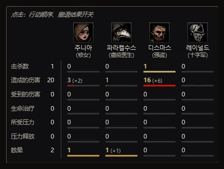
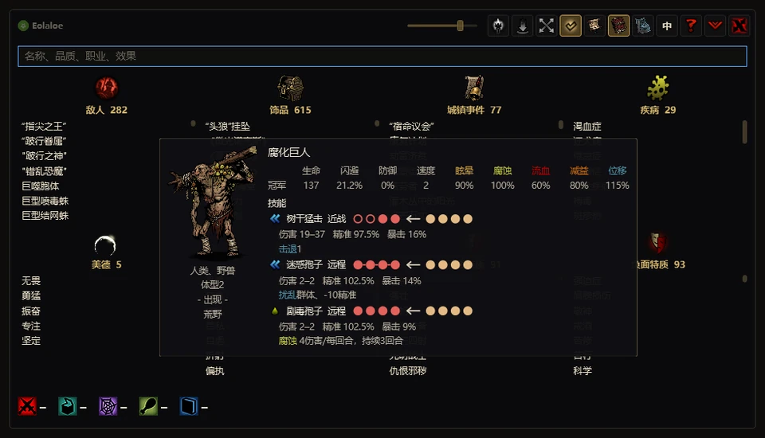

[English](guide.md) · [한국어](guide.ko.md) · [日本語](guide.ja.md) · **中文**

# 使用指南

[返回介绍页面](../README.zh.md)

本指南介绍1.3.2各项功能的用法、操作方式和安全信息。游戏内的名称与说明沿用游戏及已启用模组的译文。各版本的变化请参阅[更新日志](../CHANGELOG.zh.md)。

## 独立窗口模式

工具在游戏上方打开独立窗口，把地图、战斗界面、卡片和记录集中显示在一个窗口中。窗口大小和背景不透明度可自由调整。载入存档后会自动切换到叠加模式，此后可自由切换模式。

<table>
<tr><td align="center" width="50%"> 奇物卡片</td><td align="center" width="50%"> 解除陷阱</td></tr>
<tr><td align="center" width="50%"> 英雄表与卡片</td><td align="center" width="50%"> 补给推荐</td></tr>
<tr><td align="center" width="50%"> 远征统计</td><td align="center" width="50%"> 图鉴</td></tr>
</table>

## 叠加模式

按<code>[ &#96; ]</code>键或右上角的菱形按钮可切换模式。**载入存档后会自动切换到叠加模式。** 先启动游戏再打开工具时也一样，此后可自由切换。

叠加模式会将工具窗口折叠为一个蜡烛按钮，并**在游戏画面上覆盖一层透明图层，把信息直接显示在游戏界面的对应位置。** 它沿用游戏的字体、图像和布局，力求像游戏原本就有的界面一样自然地呈现信息。

- **探索**——工具地图嵌入游戏的地图栏；奇物、陷阱、障碍物和饥饿卡片显示在游戏画面中央。侦察概率和火炬亮度档位显示在游戏原有指示旁。
- **战斗**——在每个角色身上显示行动顺序、头顶的伤害与概率以及当前状态；回合计数周围的光圈颜色会提示拖延状态。
- **侧边面板**——远征中可通过右侧面板的标签页查看速度设置、统计、活动日志、图鉴和城镇建筑。第一个按钮打开速度设置；`[Backspace]`、`[Home]`、`[End]`分别打开统计、图鉴和活动日志。再次点击当前标签页会收起面板，只保留按钮，并记住收起状态。
- **城镇**——城镇名称下方显示全体英雄的统计表；底部按钮栏上方的箭头可打开图鉴和建筑升级面板。任务选择界面可使用队伍预设；城镇、任务选择和补给界面可使用饰品预设。在补给界面，金币上方的箭头可打开补给表（含自动购买）。
- 工具会读取游戏实际使用的布局数值，据此对齐显示位置。英雄详情、菜单或确认窗口打开时以及加载中会暂时隐藏；点击蜡烛或再次按该键即可回到独立窗口模式。若在收起状态下退出，下次也会以叠加模式启动。
- **按元素开关**——通过侧边面板标签页上方的箭头打开**显示或隐藏叠加层**，可分别开关地图、信息卡片、战斗数值、状态效果和行动顺序等元素。
- **通知字幕**——编组、装备、购买等自动操作的进度、结果和中断原因会以游戏画面上的字幕显示。
- 叠加模式下，工具不会出现在任务栏或Alt+Tab中；展开为独立窗口后会重新显示在任务栏中。
- 蜡烛始终置顶，点击可展开为独立窗口，点击蜡烛上的X按钮可退出工具。再次运行工具也会展开独立窗口。

## 功能详情

### 速度设置（倍速模式）

- 点击叠加显示侧边面板的第一个标签页，可分别调整前进、后退、战斗和侦察速度。
- 使用 − / + 按钮、鼠标滚轮或直接输入数值来调整倍率。
- 前进、后退和侦察可在0.5~4.0倍之间调整，战斗为0.5~2.0倍，每次调整0.1倍。
- 重置或退出工具时会恢复原始值。只有速度设置会直接写入游戏内存，修改前会先记录原始值。

### 战斗

- 进入战斗后，主界面会从地图切换为战斗界面。己方行动时，显示所选技能可作用目标的数值；敌方行动时，只显示敌人已选定目标的数值。治疗、增益和位移技能也会按相应阵型展示。
- 角色上方的两列分别显示已有状态及剩余时间、下次行动时生效的持续效果数值。预计持续伤害会耗尽生命时，以血迹提示。角色下方显示当前生命和压力。
- 将鼠标移到下方头像上，可打开英雄或敌人的战斗卡片，比较计入当前装备、特质、疾病、增益及触发条件后的数值，以及敌人选择技能和目标的概率。外观也会跟随当前皮肤、变身或姿态。
- 显示行动顺序、拖延战斗带来的增援风险和撤退概率。确定的行动顺序与撤退结果默认开启。在独立窗口中，点击中央标题关闭后，会为仍有行动次数的英雄和敌人显示**接下来行动的概率（估计）**，撤退则显示成功概率。在叠加模式中使用**撤退、回合确定判定**切换。将鼠标移到标题上可打开远征统计面板。
- 行动顺序的预测概率根据速度与骰子规则估算，不读取隐藏的掷骰结果。部分情况采用抽样估算；无法确认回合开始时的速度时，以当前速度近似计算。

- **反击**——可反击的目标会在攻击预览下方显示反击伤害、命中、暴击与效果。攻击演出期间保留预览。

### 地图与探索

- 显示房间、走廊、奇物、陷阱、障碍物、战斗和饥饿格。默认只显示已知区域，关闭迷雾后可查看全图。通往任务奇物和首领的路线，以及庭院中的路线，都会考虑获取钥匙与通过上锁房门的先后顺序。
- 下方计数器显示剩余格子，补给图标显示该物品的用途。战斗与饥饿图标可分别隐藏未到访格子的敌人组成和饥饿格。还可查看侦察概率、亮度修正，以及特殊遭遇的位置或出现条件。
- 游戏打开奇物、障碍物或饥饿窗口时，工具会显示对应卡片。点击卡片中的一列即可在游戏中执行对应选项；点击奇物卡片的物品列会使用相应物品。补给不足时无法执行该列的选项。
- 已侦察陷阱前的自动停止默认开启，可点击陷阱计数器关闭。工具不会自动解除陷阱；需要在卡片中选择英雄，由该英雄尝试解除。
- 探索中未进行其他操作时点击背包或按[I]，会合并同类堆叠并整理顺序。任务物品留在原位，空格移到末尾。战斗后，关闭战利品窗口、返回探索时会自动恢复初始队伍阵型；此功能默认开启，可通过队伍按钮关闭。

- **奇物前自动切换（1.3.2）**——队伍中有古董商人，或具有奇物额外掉落特性的模组英雄时，会在可能获得战利品的奇物前自动选中该英雄。探索中可通过该英雄生命条旁的开关启用或关闭。

- **敌人信息防剧透（1.3.2）**——通过地图下方战斗图标关闭敌人信息后，走过的走廊中新出现的战斗，其敌人组合也会隐藏，直到实际遭遇。

- **火炬自动使用**——在亮度信息上方选择档位，探索中低于该档位时自动使用火炬。亮度0选项会保持亮度为0，战斗中也有效。1.3.2起，远征结束会恢复选择亮度0选项之前的设置。鼠标悬停在档位上可查看修正，选择手动可停止自动使用。

- **扎营**——侦察信息所在行会改为显示夜袭概率；如果已安排职业回忆战斗，则改为提示该战斗。这里显示的是概率，不会提前揭示夜袭的随机判定结果。

### 队伍与饰品预设

- **队伍预设**——在叠加模式的任务选择界面，点击名册旁的箭头打开。按存档分别保存队伍，点击**编组队伍**即可将英雄编入出征栏位。可从名册或出征栏位拖入英雄，也可直接保存当前队伍。
- 无法参加所选任务的英雄会显示红色X和原因。可载入**最近的队伍**，按职业或预设名称搜索，或替换为同职业的其他英雄。**队伍阵容**列出本体、DLC和模组中有专属名称的队伍阵容及达成情况。
- **随机编组队伍**——点击任务选择界面的骰子按钮，从能参加该任务的英雄中随机编组，出征栏位顺序也随机。
- **饰品预设**——可在城镇、任务选择和补给界面使用。每个存档中，**每种职业可保存10个预设**，从背包拖入饰品即可添加。将鼠标移到预设上，可查看各项效果的总和，包括套装效果。
- 为每位出征英雄选择预设，再点击**饰品装备**为全队批量装备。各职业最近使用的两套出征饰品组合会保留在**最近的饰品 1、2**中：金星为最近的第1套，银星为第2套。再次点击星标可选择要保存到的预设。

- **装备后的光标（1.3.2）**——应用饰品预设后，光标会移动到饰品背包的关闭按钮上。

### 记录与城镇准备

- 活动日志持续记录战斗、探索和扎营事件，按[End]打开。进入战斗不会自动切换到日志。每个存档保留最近10次远征及其最终统计，供以后查看。
- 城镇英雄表可比较等级、远征次数、步数和工具记录的累计数值。将鼠标移到头像上，可查看装备、战斗技能和扎营技能。
- 补给表按地牢和远征长度给出推荐数量。已启用的地牢模组（Courtyard Plus、Farmstead Plus、The Sunward Isles、Vermintide、The Fiend Festival）的地牢也会列出，并高亮所选任务的行，把该地牢移到表格最上方。点击一行预览购买、出售和费用，**3秒内再点同一行即购买**。数量范围按上限处理，不会出售免费发放的物品。还会为受猩红诅咒的英雄调整血酿数量，并为留在城镇中处于凋零状态的英雄预留血酿。
- 图鉴可按名称、品质、职业和效果搜索敌人、饰品、城镇事件、疾病、美德、折磨与特质。建筑与区域建筑界面可比较所选升级需要的资源与持有量；此功能仅用于规划，不会替你在游戏里建造。

- **建筑切换（1.3.2）**——在建筑窗口按Q／E或使用新按钮，切换到上一个／下一个建筑，跳过未解锁建筑。按钮会跟随窗口的打开和切换动画移动。

- **城镇统计（1.3.2）**——叠加统计表在进入城镇时短暂展开，随后收起，仅保留表头。鼠标悬停在表头上可再次展开，停留在表内时会保持显示。

## 安装

1. 从[最新发行版](https://github.com/Eolaloe/DD-AncestorsMap/releases/latest)下载`AncestorsMap.zip`，解压到任意文件夹。
2. 运行`AncestorsMap.exe`。如果没有安装**.NET 8 Desktop Runtime**，会出现安装提示。
3. 启动游戏后，工具会自动查找存档。首次使用建议点击右上角问号，查看界面指南。

## 系统要求与兼容性

- 需要Windows 10/11、[.NET 8 Desktop Runtime](https://dotnet.microsoft.com/download/dotnet/8.0)，并已安装《暗黑地牢》一代。运行时需另行安装。
- 实时信息与输入辅助需要工具支持的**64位**游戏。支持Steam公开版和`coming_in_hot`测试版的Steam及无DRM（`_windowsnosteam`）可执行文件。对于32位或无法识别的游戏版本，工具不会读取内存，只提供基于存档的功能，并在日志状态栏说明原因。
- 会读取启用的DLC、模组及其加载顺序。已测试的地牢模组包括Courtyard Plus、Farmstead Plus、The Sunward Isles、Vermintide和The Fiend Festival，并非所有模组都经过验证。
- 工具以Steam安装环境为基础开发，也测试过无DRM可执行文件。GOG等其他平台的安装位置或存档路径可能无法自动识别。
- 支持한국어、English、日本語和简体中文。首次启动跟随游戏语言，此后使用你在工具中选择的语言。

## 安全说明

| 内存访问 | 范围 |
|---|---|
| **读取** | 读取当前游戏状态，用于地图、战斗信息等功能。除速度设置外，其他功能不直接写入游戏内存。 |
| **写入——仅限速度设置** | 仅修改所选倍率对应的速度值。修改前记录原始值，重置或退出工具时恢复。 |

- **游戏文件与存档**——工具不直接修改游戏文件或存档，也不向游戏进程注入代码。工具设置与远征记录另行保存。
- **输入辅助会实际操作游戏。** 房间移动、卡片选项和物品使用、陷阱解除、自动购买、物品整理、阵型恢复、编组队伍与饰品装备，都会发送点击、按键或拖放输入。这些操作的结果可能由游戏正常写入存档。
- 陷阱前自动停止会发送松开移动键或鼠标按钮的输入，并拦截移动键的重复输入。此功能**默认开启**，通过陷阱计数器切换。战斗后自动恢复阵型同样**默认开启**，通过队伍按钮关闭。
- 将鼠标移到背包上查看售价时，如果探索中的游戏正显示地图面板，也会发送[Tab]来打开物品栏。因此，部分显示功能也会发送输入。
- 自动购买或整理时请勿移动鼠标。整理时也请勿按住[Shift]；这会与游戏的丢弃操作冲突，工具因此不会执行拖放。
- 联网用于查询GitHub发行版：启动时自动检查，也可在应用信息中手动检查。不需要账号或API密钥，不会上传游戏记录。
- 杀毒软件可能误报。你可以使用发布页面提供的SHA-256哈希值核对下载的文件。

## 更新

启动时自动检查新版本。点击左上角署名可查看当前版本并通过**检查更新**手动检查。**有新版本可用**通知会在叠加模式下展开独立窗口显示；自动切换会等到通知关闭后再继续。点击**查看更新**打开发行页面，下载新zip即可。工具不会自动下载或替换文件；请先关闭正在运行的工具，再覆盖文件。设置与远征记录保存在`%LocalAppData%\AncestorsMap`。

## 操作

| 按键或鼠标 | 功能 |
|---|---|
| 叠加显示侧边面板的第一个按钮 | 打开速度设置 |
| 速度设置中的 − / + 按钮、鼠标滚轮或直接输入数值 | 调整倍率 |
| [Q]／[E]或建筑箭头 | 建筑窗口中切换上一个／下一个建筑，跳过未解锁建筑 |
| <code>[ &#96; ]</code>或菱形按钮 | 开关叠加模式——工具窗口折叠为蜡烛按钮，信息显示在游戏画面的对应位置；点击蜡烛也可恢复 |
| [Backspace] | 返回主界面：城镇英雄表／补给表／探索地图／战斗界面 |
| [Home]／[End] | 打开或关闭图鉴／活动日志 |
| [Caps Lock] | 立即恢复初始队伍阵型 |
| [I]或点击背包 | 探索中未进行其他操作时整理物品栏 |
| 将鼠标移到背包上 | 显示游戏物品栏及已打开战利品格的售价 |
| 点击队伍图标 | 切换战斗后自动恢复阵型 |
| 左键拖动／右键拖动 | 移动工具窗口／移动地图 |
| 滚轮／中键单击 | 缩放地图／切换迷雾 |
| 点击工具地图上相连的房间 | 身处房间时，在游戏中前往该房间 |
| 点击自动弹出卡片中的列 | 执行奇物、障碍物、饥饿选项，或选择英雄解除陷阱 |
| 点击补给行→3秒内再次点击同一行 | 预览购买→自动购买 |
| 拖动窗口边缘／顶部滑块 | 调整尺寸／背景不透明度 |
| 问号／鼠标移到署名上或点击署名 | 界面指南／操作说明或应用信息 |

游戏上的快捷键在游戏窗口位于前台时生效。[I]仅在探索中未进行其他操作时由工具接管，其他时候保留游戏原本的功能。在工具窗口中也可使用<code>[ &#96; ]</code>、[Home]和[End]；搜索框有文字时，[Backspace]会删除文字。购买和整理会将游戏切到前台，房间移动、卡片选择、陷阱解除等也需要游戏窗口位于前台。

叠加模式下，远征中的[Backspace]、[Home]、[End]用于切换侧边面板的统计、图鉴和活动日志标签页；在城镇中则保留游戏原本的按键功能。

## 界面指南

点击问号，可依次了解初次使用、地图、探索选择、战斗、远征管理、城镇准备，以及记录与查阅。前6章使用录制好的示例场景，不启动游戏也能查看；最后一章“记录与查阅”会打开你自己的数据。在支持鼠标交互的步骤中，可将鼠标移到金色边框内。点击暗处或切换到叠加模式即可关闭指南。

## 已知限制

- 工具也会显示游戏原本隐藏的信息，包括敌人组成、饥饿格、行动顺序和撤退结果。请按需要启用。
- 游戏更新后，在确认兼容前无法使用实时功能。部分基于存档的信息要等游戏保存后才会更新。
- 补给推荐参考了Wiki、攻略和地牢生成规则，模组地牢的推荐数量中也包含通过计算得出的估算值。请根据队伍与探索计划调整。
- 输入辅助依赖游戏画面和布局；不支持的布局或某些模组可能限制功能。
- 叠加模式已在16:9画面上测试。画面比例不同时，或游戏以窗口模式运行时，显示位置可能会偏移。

## 问题反馈

请在[Issues](https://github.com/Eolaloe/DD-AncestorsMap/issues)中说明工具版本（点击署名查看）、游戏版本（公开版／`coming_in_hot`／无DRM版）、启用的模组，以及在哪个界面进行了什么操作。方便的话，请附上截图和工具显示的通知文字。

## 许可与致谢

[LICENSE](../LICENSE) — 可供个人自由使用；请通过官方仓库链接分享（重新上传文件或发布修改版请先联系作者）；禁止售卖。
《暗黑地牢》（Darkest Dungeon）是 Red Hook Studios 的游戏。
在 Claude 和 Codex 的协助下制作。

韩语助词处理规则参考了[es-hangul](https://github.com/toss/es-hangul)（toss，MIT）和kohangul（MIT）。
