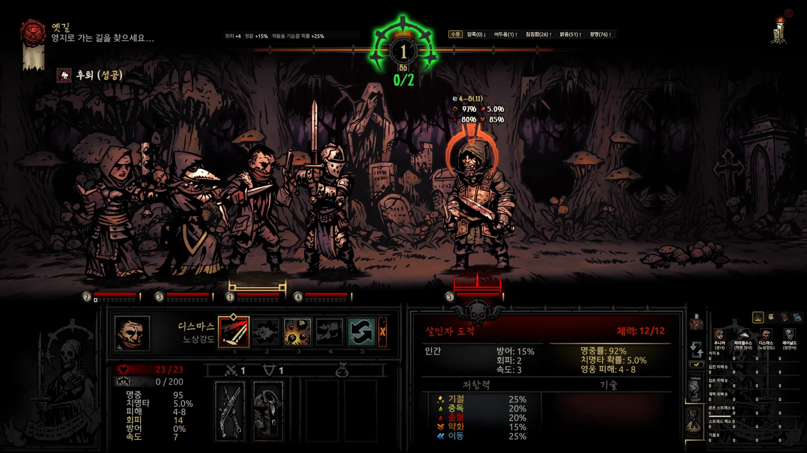
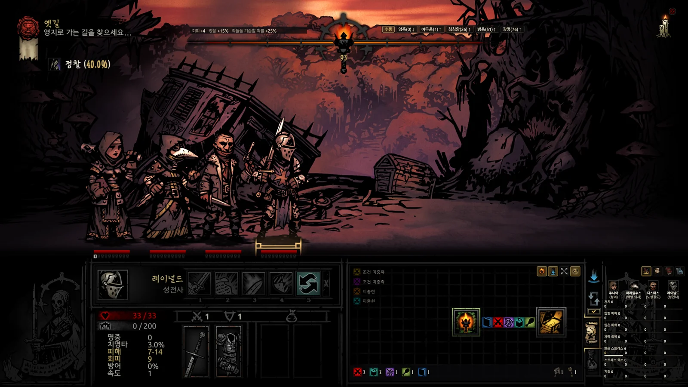
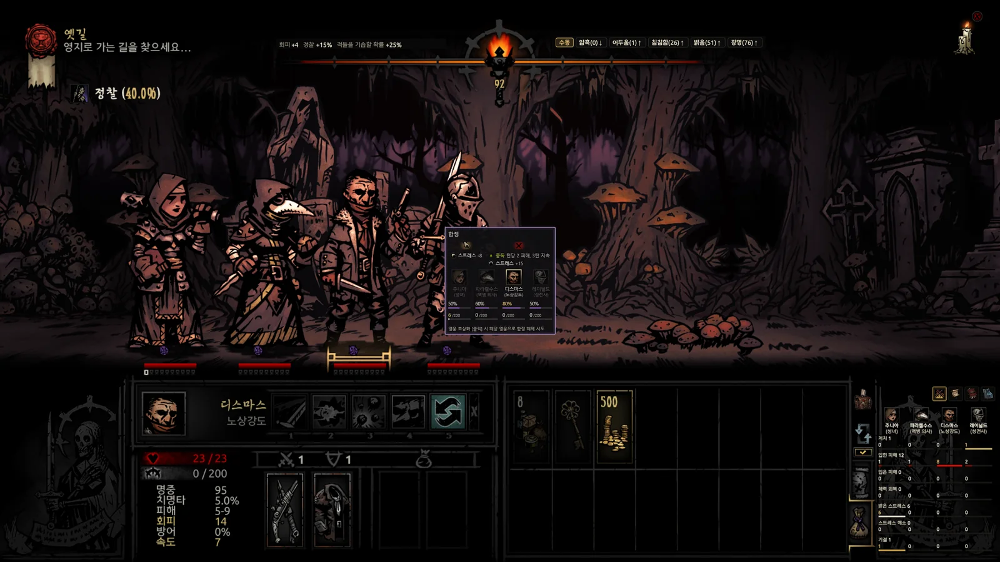
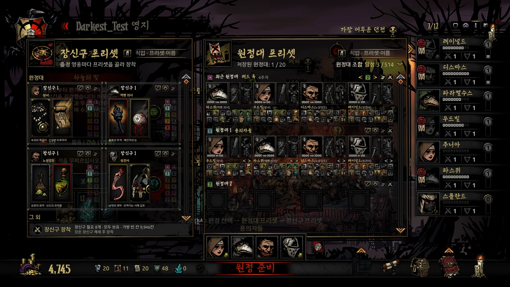
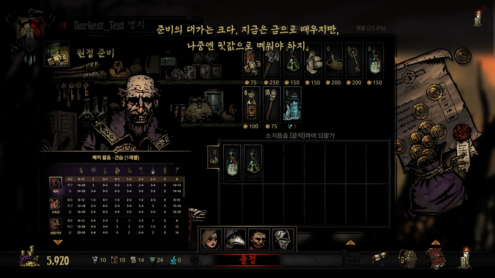

[English](../../README.md) · [한국어](../ko/README.md) · **日本語** · [中文](../zh/README.md)

# Ancestor's Map — DD Field Guide

**Darkest Dungeonの隠れた数値や情報を、ゲーム画面上で確認。**

Darkest Dungeon 1向けのオーバーレイツールです。ゲームのメモリとセーブデータから現在の状態を読み取り、有効なDLCやMODのデータを反映して、ゲームと同じ計算式で数値を求めます。

  

[全機能一覧](#全機能一覧) · [使い方ガイド](guide.md) · [更新履歴](CHANGELOG.md)

個人利用は無料・MOD対応・ゲームファイルの直接変更なし。メモリの読み取り・書き込みの範囲と操作補助については、[安全性](#安全性)をご覧ください。

<!-- SHOT S1: 오버레이 전투 움짤 8 ~ 10초(영어 · 1600×900) — 기술을 바꿀 때마다 적 머리 위 값이 바뀌는 장면. 찍으면 같은 이름으로 덮어쓰기 -->

- **使用中のMODの情報をまとめて確認。** 有効なMODのデータを自動で統合し、MODで追加・変更された敵・スキル・トリンケット・奇癖などの詳細を一か所で確認できます。
- **スキルを使う前に比較。** 現在の装備・バフ・対象の耐性を反映したダメージや、命中・クリティカル・効果の発生確率を対象ごとに確認できます。
- **次の部屋へ進む前に確認。** マップで敵の編成、キュリオを調べたときの結果、トラップを確認できます。マップ全体・敵情報・空腹マスは、それぞれ表示するかどうかを選べます。
- **保存した構成で出発準備。** プリセットからパーティーを編成し、全員のトリンケットをまとめて装備。そのまま補給品のおすすめ表から自動購入できます。

> AI（Claude・Codex）の支援を受けて開発しています。企画・ゲーム内での動作確認・最終判断は作者自身が行っています。

## 全機能一覧

<table>
<tr>
<td valign="top" width="380">
<b>共通</b>
<ul>
<li><b>別ウィンドウモード</b> 情報を1つのウィンドウに集約・新機能の追加は終了</li>
<li><b>オーバーレイモード</b> ゲーム画面の対応位置に表示</li>
<li><b>MOD・DLC対応</b> 有効なMOD・DLCの値を反映</li>
<li><b>図鑑</b> 敵・トリンケット・奇癖・病気を検索</li>
<li><b>4言語対応</b> ゲームの公式訳に合わせた用語</li>
</ul>
</td>
<td valign="top" width="380">
<b>村</b>
<ul>
<li><b>総合メーター</b> 英雄全員の累計記録を比較</li>
<li><b>施設の増築計画</b> 増築費用と所持資源を比較</li>
<li><b>施設ウィンドウの切り替え</b> Q・Eで前後の施設に切り替え</li>
<li><b>ブッチャーズ・サーカスを非表示</b> 街の設定からアイコンの表示を切り替え</li>
<li><b>パーティープリセット</b> セーブごとに保存・直近の編成を呼び出し</li>
<li><b>トリンケットプリセット</b> 職業ごとに10個・一括装備</li>
<li><b>ランダムパーティー編成</b></li>
<li><b>補給品のおすすめ・自動購入</b> おすすめの数量まで購入・余剰分を売却</li>
</ul>
</td>
</tr>
<tr>
<td valign="top" width="380">
<b>遠征</b>
<ul>
<li><b>速度設定（倍速モード）</b> 前進・後退・戦闘・偵察・部屋移動の速度を個別に調整</li>
<li><b>マップ下部バーの自動非表示</b> オーバーレイマップの下端にマウスを合わせるとカウンターと補給品集計を表示</li>
<li><b>詳細ダンジョンマップ</b> 各マスのキュリオ・トラップ・敵編成</li>
<li><b>マップ全体表示</b> 未探索のエリアも事前に確認</li>
<li><b>ネタバレ防止設定</b> 判明した範囲のみ表示・敵情報を非表示</li>
<li><b>クエストの進行状況・ルート案内</b> 目標・鍵・ボス部屋への経路</li>
<li><b>オブジェクトカウンター</b> 残りの戦闘・キュリオ・トラップ数</li>
<li><b>特殊エンカウント</b> 出現確率・確定位置</li>
<li><b>マップの部屋をクリックして移動</b></li>
<li><b>オブジェクト情報・操作カード</b> 結果・確率を見てカードで直接選択</li>
<li><b>補給品の使用先一覧</b> 使える場所の一覧と箇所数を補給品ごとに表示</li>
<li><b>トラップ前の自動停止</b></li>
<li><b>キュリオの前で英雄を自動切り替え</b> 古物収集家を自動で選択</li>
<li><b>松明の自動使用</b> 選んだ明るさを維持・暗闇にも固定可能</li>
<li><b>偵察・夜間の奇襲確率</b></li>
<li><b>所持品の自動整理・売却額</b> 同じアイテムをまとめて並べ替え</li>
<li><b>アクティビティログ・メーター</b> 戦闘・探索の記録と英雄ごとの貢献</li>
</ul>
</td>
<td valign="top" width="380">
<b>戦闘</b>
<ul>
<li><b>ターン順</b> 確定した行動順・次に行動する確率</li>
<li><b>ダメージ・確率プレビュー</b> 対象別ダメージ・命中率・クリティカル率</li>
<li><b>付与されている状態の情報</b> 残りの持続時間・次のターンの継続ダメージ</li>
<li><b>引き延ばし警告</b> 増援の危険性・増援を防ぐ行動</li>
<li><b>撤退確率・結果</b></li>
<li><b>パーティーを基本の隊列に戻す</b> 戦闘後に自動で復元・Caps Lockでも操作可能</li>
</ul>
</td>
</tr>
</table>

<table>
<tr>
<!-- SHOT S2: 오버레이 지도 — 전체 지도 공개 · 보스방까지 길 안내 (영어 · 1600×900) -->
<td width="380" align="center"> マップ全体表示</td>
<!-- SHOT S3: 함정 · 골동품 앞 게임 화면 가운데 상호작용 카드 (영어 · 1600×900) -->
<td width="380" align="center"> オブジェクト情報・操作カード</td>
</tr>
<tr>
<!-- SHOT S4: 원정대 프리셋 판 (영어 · 1600×900) -->
<td width="380" align="center"> パーティープリセット</td>
<!-- SHOT S5: 보급품 구입 화면 추천 표 · 자동 구매 (영어 · 1600×900) -->
<td width="380" align="center"> 補給品のおすすめ・自動購入</td>
</tr>
</table>

詳しい使い方は[使い方ガイド](guide.md)をご覧ください。

## 使い始めるまでの3ステップ

1. [最新リリース](https://github.com/Eolaloe/DD-AncestorsMap/releases/latest)から`AncestorsMap.zip`をダウンロードします。
2. 任意のフォルダーにzipを展開します。
3. ゲームでセーブデータを読み込んでから、`AncestorsMap.exe`を起動します。必要なランタイムがなければ、インストールの案内が表示されます。

初めて使う方は、はてなマークのボタンから全7章・31ステップの画面ガイドをご覧ください。詳しい説明は[使い方ガイド](guide.md)にあります。

### 動作環境・互換性

- Windows 10/11、[.NET 8 Desktop Runtime](https://dotnet.microsoft.com/download/dotnet/8.0)、インストール済みのDarkest Dungeon 1が必要です。

- リアルタイム情報と操作補助は、対応する**64ビット版**のゲームで使えます。
  Steam公開版・`coming_in_hot`ベータのSteam用およびDRMフリー用（`_windowsnosteam`）実行ファイルに対応しています。
  32ビット版や未対応のバージョンではメモリを読み取らず、セーブに基づく機能のみ利用できます。理由はログの状態欄に表示します。

- 有効なDLC・MODと適用順を読み取ります。
  ダンジョン追加MODはCourtyard Plus、Farmstead Plus、The Sunward Isles、Vermintide、The Fiend Festivalで確認しています。
  すべてのMODを検証したわけではありません。

- Steamのインストール環境を前提に開発しており、DRMフリーの実行ファイルでも動作を確認しています。
  GOGなどではインストール先やセーブの場所を自動検出できない場合があります。

- 한국어・English・日本語・简体中文に対応しています。
  初回起動時はゲームの言語に合わせ、その後はアプリで選んだ言語を使用します。

## 安全性

| メモリへのアクセス | 対象 |
|---|---|
| **読み取り** | マップや戦闘情報などに使う、現在のゲーム状態を読み取ります。ゲームメモリに直接書き込むのは、以下の2機能のみです。 |
| **書き込み — 速度設定** | 選択した速度の値を変更します。変更前の値を記録し、リセット時やアプリの正常終了時に元に戻します。 |
| **書き込み — ブッチャーズ・サーカスを非表示** | アイコンの表示座標だけを変更します。非表示を解除するか、アプリを正常に終了すると元の座標に戻します。 |

- ゲームファイルやセーブデータへの直接書き込み、ゲームへのコード注入は行いません。
  アプリの設定と遠征記録は別に保存します。

- 操作補助はクリック、キー入力、ドラッグで実際にゲームを操作します。
  トラップ前の自動停止と戦闘後に隊列を戻す機能は、初期設定で有効になっています。それぞれ無効にできます。
  バッグにマウスを重ねたときにも、所持品画面を開く操作を送る場合があります。
  これらの操作結果は、ゲームの通常のセーブに反映されることがあります。

- 自動購入・整理中は、マウスを動かしたり`[Shift]`を押したりしないでください。
  更新の確認のためにGitHubへ接続します。アカウントやAPIキーは不要で、ゲームの記録をアップロードすることもありません。
  ウイルス対策ソフトが誤検知する場合があります。ダウンロードしたファイルは、リリースページのSHA-256ハッシュ値で確認できます。

安全性と操作補助については[使い方ガイド](guide.md)をご覧ください。

## バージョン別の主な機能

| 系列 | 主な追加機能 |
|---|---|
| 1.0 (1.0.2 ~ 1.0.8) | ダンジョンマップ・戦闘カード・ログ・メーター、部屋移動、おすすめ補給品と自動購入。 |
| 1.1 (1.1.0 ~ 1.1.4) | 戦闘画面、探索カードでの選択、トラップ前停止、所持品整理、反撃・松明の自動使用。 |
| 1.2 (1.2.0) | オーバーレイモード — ゲームUIの対応位置に情報を表示。 |
| 1.3 (1.3.0 ~ 1.3.5) | パーティー・トリンケットプリセット、行動順の確率予測、オーバーレイ設定、施設ウィンドウの切り替え、キュリオの前で英雄を自動切り替え、速度設定（倍速モード）。 |

各バージョンの詳細は[更新履歴](CHANGELOG.md)と[リリースページ](https://github.com/Eolaloe/DD-AncestorsMap/releases)をご覧ください。

## 制限事項

- 敵の編成、空腹マス、ターン順、撤退の成否など、ゲームが隠している情報も表示します。
  必要な項目だけ有効にしてください。
- 補給品のおすすめ数量は、Wiki・攻略情報・ダンジョン生成ルールを参考にしています。
  MODダンジョンのおすすめ数量には、計算による推定値も含まれます。
  パーティーや探索の予定に合わせて調整してください。
- オーバーレイモードは16:9の画面で確認しています。
  画面の縦横比が異なる場合や、ゲームをウィンドウモードで起動した場合は、表示位置がずれることがあります。

## 不具合の報告

[Issues](https://github.com/Eolaloe/DD-AncestorsMap/issues)に、アプリのバージョン（署名をクリックして確認）、ゲームのバージョン（公開版／`coming_in_hot`／DRMフリー版）、有効なMOD、どの画面で何をしたかを書いてください。
可能であれば、スクリーンショットとアプリに表示された通知の内容も添えてください。

## ライセンス・クレジット

[LICENSE](../../LICENSE) — 個人での利用は自由です。
共有する際は公式リポジトリのリンクをご利用ください（ファイルの再アップロードや改変版の共有は事前にご相談ください）。
販売は禁止です。
Darkest DungeonはRed Hook Studiosのゲームです。

韓国語の助詞処理ルールは[es-hangul](https://github.com/toss/es-hangul)（toss、MIT）・kohangul（MIT）を参考にしています。

[使い方ガイド](guide.md) · [最新版をダウンロード](https://github.com/Eolaloe/DD-AncestorsMap/releases/latest)
