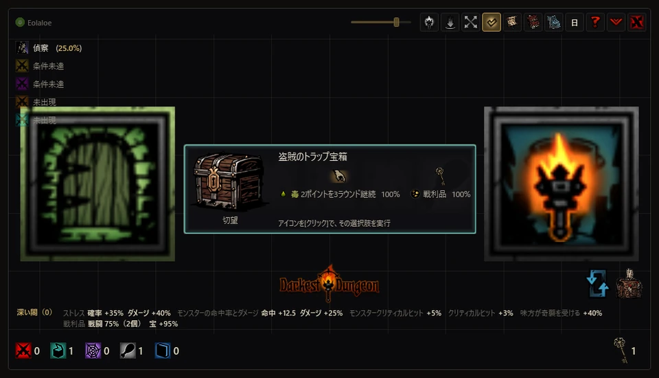
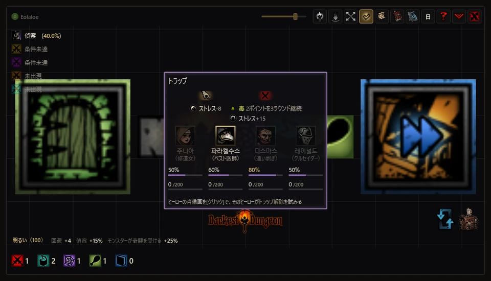
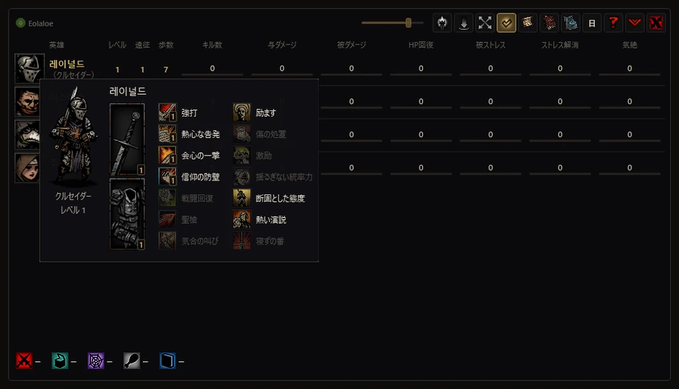
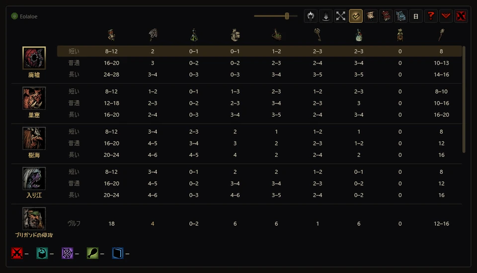
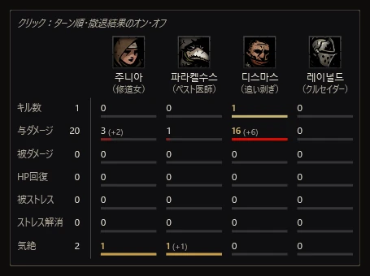
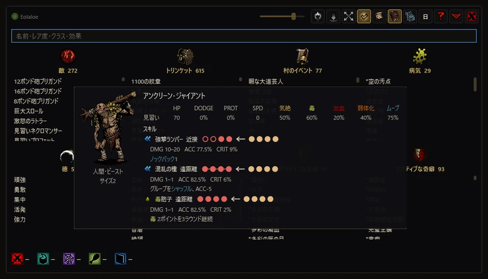

[English](../en/guide.md) · [한국어](../ko/guide.md) · **日本語** · [中文](../zh/guide.md)

# 使い方ガイド

[紹介ページへ戻る](README.md)

1.5.2の各機能の使い方、操作方法、安全性について説明します。ゲーム内の名称や説明は、ゲームと有効なMODの表記に合わせています。バージョンごとの変更点は[更新履歴](CHANGELOG.md)をご覧ください。

## 別ウィンドウモード

ゲーム画面の手前に独立したウィンドウを開き、マップ・戦闘画面・カード・記録を1つのウィンドウにまとめて表示します。ウィンドウの大きさと背景の不透明度は自由に調整できます。セーブを読み込むとオーバーレイモードに自動で切り替わり、その後は好きなモードに変更できます。

<table>
<tr><td align="center" width="50%"> キュリオカード</td><td align="center" width="50%"> トラップ解除</td></tr>
<tr><td align="center" width="50%"> 英雄表とカード</td><td align="center" width="50%"> おすすめ補給品</td></tr>
<tr><td align="center" width="50%"> 遠征メーター</td><td align="center" width="50%"> 図鑑</td></tr>
</table>

## オーバーレイモード

<code>[ &#96; ]</code>キーか右上のひし形ボタンでモードを切り替えます。**セーブを読み込むと、自動でオーバーレイモードに切り替わります。** ゲームを先に起動してからアプリを開いた場合も同じです。その後は自由に切り替えられます。

別ウィンドウモードでは情報を1つのウィンドウにまとめます。オーバーレイモードではアプリのウィンドウをろうそくのボタン1つに折りたたみ、**ゲーム画面の上に透明なレイヤーを1枚重ねて、ゲームUIの対応する位置に情報を直接表示します。** ゲームのフォント・画像・配置をそのまま使い、もともとゲームにあった画面のように自然に情報を見せることを目指しています。

- **探索** — ゲームのマップ欄にアプリのマップを表示し、キュリオ・トラップ・障害物・空腹のカードはゲーム画面の中央に表示されます。偵察確率と松明の明るさは、ゲーム本来の表示の横に並びます。
- **戦闘** — ターン順、頭上のダメージ・確率、かかっている状態を人物ごとに表示し、引き延ばしはラウンド数のまわりの光の色で知らせます。
- **サイドパネル** — 遠征中、右側のパネルで速度設定・メーター・アクティビティログ・図鑑・村の施設をタブで切り替えられます。先頭のボタンで速度設定を開きます。`[Backspace]`・`[Home]`・`[End]`は、それぞれメーター・図鑑・アクティビティログを開きます。開いているタブをもう一度クリックするとボタンだけを残して折りたたみ、その状態を記憶します。
- **村** — 領地名の下に名簿全体のメーター表を表示し、下のボタン列の上の矢印から図鑑・施設の増築パネルを開きます。クエスト選択画面ではパーティープリセットを、村・クエスト選択・補給品画面ではトリンケットプリセットを使えます。補給品の画面では、金貨の上の矢印から補給品表（自動購入を含む）を開きます。
- 表示位置は、ゲームが実際に使っている配置の値を読み取って合わせます。英雄の詳細・メニュー・確認ウィンドウが開いているときやロード中は一時的に隠れます。ろうそくをクリックするか同じキーをもう一度押すと、別ウィンドウモードに戻ります。たたんだまま終了すると、次回もオーバーレイモードで始まります。
- **要素ごとの表示切替** — サイドパネルのタブ上の矢印から**オーバーレイの表示切替**を開き、マップ・情報カード・戦闘数値・付与中の効果・ターン順などを個別に切り替えられます。
- **通知字幕** — 編成・装備・購入などの自動操作の進行、結果、中断理由をゲーム画面上の字幕で確認できます。
- オーバーレイモード中はタスクバー・Alt+Tabにアプリが表示されません。別ウィンドウに戻すとタスクバーに再表示されます。
- 常に最前面に表示されるろうそくをクリックすると別ウィンドウに戻り、ろうそくのXボタンでアプリを終了できます。アプリをもう一度起動しても別ウィンドウに戻ります。

## 詳しい機能

### 速度設定（倍速モード）

- オーバーレイのサイドパネルにある先頭のタブから開きます。前進・後退・戦闘・偵察・部屋移動の速度を個別に調整できます。
- − / + ボタン、マウスホイール、または数値の直接入力で倍率を調整できます。
- 前進・後退・偵察・部屋移動は1.0〜4.0倍、戦闘は1.0〜2.0倍の範囲で、0.1倍ずつ調整できます。
- 部屋移動の設定は、部屋の出入りなどの画面切り替えに適用されます。入室時に歩く速度にも適用され、入室後は設定した前進速度に戻ります。
- 変更前の値を記録し、リセット時やアプリの正常終了時に元に戻します。

### マップと村の追加設定

- 偵察が発生するとマップタブに自動で切り替わります。波紋とマスの公開演出は、別ウィンドウ・オーバーレイの両モードで表示します。
- マップ下のキュリオアイコンで、未訪問のキュリオの詳細と、それに対応する補給品の集計を非表示にできます。マップ全体の公開や戦闘情報とは個別に設定できます。
- オーバーレイマップの5番目のボタンは「オブジェクトカウンターを自動で隠す」です（補給品集計も一緒に隠れます）。オフなら常時表示、オンなら自動で隠れます。マップ左下の隅にマウスを0.5秒間合わせると開き、離れて約1秒後に下へ隠れます。隠れている間はマップ左下の隅に矢印（ゲーム内と同じ矢印アイコン）を表示します。
- オーバーレイ設定の戦闘・キュリオプレビュー・トラップの手前で自動停止・空腹マスを表示のチェックボックスは、マップの既存の切り替え設定と連動します。
- 村の設定では、トリンケットプリセットの非表示と、適用後にトリンケット保管庫・英雄ウィンドウを自動で閉じる設定を選べます。「その他」の**ブッチャーズ・サーカスを非表示**は初期状態ではオフで、村のアイコンだけを隠します。

### 戦闘

- 戦闘が始まると、基本画面がマップから戦闘画面に切り替わります。味方のターンでは選んだスキルが届く対象の数値を、敵のターンでは敵が選んだ対象の数値を表示します。回復・強化・移動スキルも、それぞれに合った配置で表示します。
- キャラクターの上の2列には、付与中の状態と残り期間、次のターンに受ける継続効果の量を分けて表示します。継続ダメージでHPが尽きると予想される場合は、血しぶきで知らせます。下には現在のHPとストレスを表示します。
- 下段の肖像にマウスを合わせると戦闘カードが開きます。現在の装備・奇癖・病気・強化や条件を反映した数値と、敵のスキル・対象選択確率を比べられます。スキン、変身、構えも現在の姿に合わせます。
- ターン順、引き延ばしによる増援の危険、撤退確率を表示します。確定したターン順と撤退の成否は初期状態でオンです。別ウィンドウでは中央のタイトルでオフにすると、まだ行動が残っている英雄・敵ごとの**次に行動する確率（推定）**と撤退の成功確率を表示します。オーバーレイでは**撤退・ターンの確定判定**で切り替えます。タイトルにマウスを合わせると遠征メーターが開きます。
- ターン順の確率は、隠された出目を読み取らず、速度とダイスのルールから求めた推定値です。一部の状況ではサンプリングで推定し、ラウンド開始時の速度を確認できない場合は、現在の速度を使って近似値を求めます。

- **反撃** — 反撃できる対象には、攻撃の数値の下に反撃のダメージ・命中・クリティカル・効果を表示します。攻撃演出中も表示を維持します。

### マップと探索

- 部屋・通路・キュリオ・トラップ・障害物・戦闘・空腹マスを表示します。初期状態では判明した範囲だけを表示し、霧をオフにすると全体を見られます。クエスト用キュリオ・ボス・呪われた庭園への経路は、鍵と施錠された扉の順序も考慮します。
- 下段のカウンターで残りのマスを、補給品のアイコンで使い道を確認できます。戦闘・空腹アイコンから、未訪問マスの敵編成と空腹マスの表示を個別に隠せます。偵察確率、明るさの補正、特殊エンカウントの位置や出現条件も表示します。
- ゲームでキュリオ・障害物・空腹の画面が開くと、対応するカードが現れます。列をクリックするとゲームの選択肢を実行し、キュリオのアイテム列ならそのアイテムを使います。補給品が足りない列は実行しません。
- 偵察済みのトラップ前の自動停止は初期状態でオンです。トラップのカウンターでオフにできます。自動解除はしません。カードで英雄を選ぶと、その英雄で解除を試みます。
- 探索中に移動や操作をしていない状態で、バッグをクリックするか[I]を押すと、同じ品目をまとめて並べ直します。クエストアイテムはそのまま、空き枠は末尾に置きます。戦闘後は、戦利品画面を閉じて探索に戻った時点でデフォルトの整列順に自動で戻します。初期状態はオンで、パーティーのボタンでオフにできます。

- **キュリオの前で自動切替（1.3.2）** — 古物収集家、またはキュリオから追加の戦利品を得られる特性を持つMOD英雄がいると、戦利品が出る可能性のあるキュリオの手前で、その英雄に自動で切り替えます。探索中、その英雄のHPバー横の切り替えボタンでオン・オフにできます。

- **敵情報のネタバレ防止（1.3.2）** — マップ下の戦闘アイコンで敵情報を隠すと、通過済みの通路に新たに発生した戦闘の敵編成も、実際に遭遇するまで隠れます。

- **松明の自動使用** — 明るさの情報の上で段階を選ぶと、探索中にその段階を下回ったときに松明を使います。明るさ0の設定は戦闘中も明るさを0に保ちます。1.3.2では遠征終了時に、明るさ0の設定を選ぶ前の設定へ戻ります。段階にマウスを合わせて補正を確認でき、手動にすると自動使用を止めます。

- **キャンプ** — 偵察の行が夜襲の確率に変わります。クラス固有の回想戦闘が予定されていれば、そちらを表示します。夜襲の抽選結果を先に示すものではありません。

### パーティー・トリンケットプリセット

- **パーティープリセット** — オーバーレイモードのクエスト選択画面で、名簿横の矢印から開きます。セーブごとにパーティーを保存し、**パーティー編成**をクリックして出撃枠に配置します。名簿・出撃枠から英雄をドラッグするか、現在のパーティーを保存して登録します。
- 選んだクエストに行けない英雄には赤いXと理由を表示します。**最近のパーティー**の呼び出し、職業・プリセット名での検索、同じ職業の別の英雄への交代ができます。**パーティー構成**では本編・DLC・MODで名前が付けられたパーティーの組み合わせと達成状況を確認できます。
- **ランダムパーティー編成** — クエスト選択画面のサイコロボタンで、そのクエストに行ける英雄から出撃枠の順番も含めてランダムに編成します。
- **トリンケットプリセット** — 村・クエスト選択・補給品画面で使えます。セーブごとに**職業あたり10個**保存でき、袋からトリンケットをドラッグして登録します。プリセットにマウスを合わせると、セット効果を含む効果の合計を表示します。
- 出撃する英雄ごとにプリセットを選び、**トリンケット装備**でパーティー全員にまとめて装備します。職業ごとに、出撃時のトリンケットの組み合わせを直近2組まで保存し、**最近のトリンケット 1・2**として残します。金の星は最近の1組目、銀の星は2組目です。星をもう一度クリックすると、保存先のプリセットを選べます。

- **装備後のカーソル（1.3.2）** — トリンケットプリセットの適用後、カーソルがトリンケットの袋を閉じるボタンへ移動します。

### 記録と村での準備

- アクティビティ・ログは[End]で開けます。セーブごとに直近10回の遠征のメーターを振り返れます。戦闘開始時にログへ自動で切り替わることはありません。
- 村の英雄表ではレベル・遠征回数・歩数と、アプリが記録した累計値を比較できます。肖像にマウスを合わせると装備・戦闘スキル・キャンプスキルを表示します。
- 補給品の表はダンジョンと遠征の長さに応じたおすすめ数を示します。有効にしたダンジョンMOD（Courtyard Plus・Farmstead Plus・The Sunward Isles・Vermintide・The Fiend Festival）のダンジョンも表示し、選んだクエストの行を強調してそのダンジョンを表の一番上に移します。行をクリックして購入・売却・費用を確認し、**3秒以内に同じ行をもう一度クリックすると購入**します。数量に幅があれば上限に合わせ、無料支給品は売りません。赤の呪いを受けた英雄のための血も調整し、村に残る消耗状態の英雄の分を確保します。
- 図鑑では敵・トリンケット・村のイベント・病気・徳・精神崩壊・奇癖を、名前・レア度・クラス・効果で検索できます。施設・区画の画面では、選んだ増築に必要な資源と所持量を比較できます。増築計画を立てるための機能で、ゲーム内の建設は行いません。

- **施設の切り替え（1.3.2）** — 施設のウィンドウでQ・Eまたは新しいボタンを使うと、前・次の施設へ移動します。未解放の施設は飛ばし、ボタンはウィンドウの表示・切り替え演出に合わせて動きます。

- **村のメーター（1.3.2）** — オーバーレイのメーターは村に入ると短時間だけ開き、その後は見出しだけを残して折りたたまれます。見出しにマウスを合わせると再び開き、表の上にマウスがある間は開いたままになります。

## 導入

1. [最新リリース](https://github.com/Eolaloe/DD-AncestorsMap/releases/latest)から`AncestorsMap.zip`をダウンロードし、任意のフォルダーに展開します。
2. `AncestorsMap.exe`を実行します。**.NET 8 Desktop Runtime**がなければ、インストールの案内が表示されます。
3. ゲームを起動するとセーブを自動で探します。初めて使うときは、右上のはてなマークから画面ガイドを開いてみてください。

## 動作環境・互換性

- Windows 10/11、[.NET 8 Desktop Runtime](https://dotnet.microsoft.com/download/dotnet/8.0)、インストール済みのDarkest Dungeon 1が必要です。ランタイムは別途インストールします。
- リアルタイム情報と操作補助は、対応する**64ビット版**のゲームで使えます。Steam版・DRMフリー版（`_windowsnosteam`）・GOG版に対応しています。32ビット版や未対応のバージョンではメモリを読み取らず、セーブに基づく機能のみ利用できます。理由はログの状態欄に表示します。
- 有効なDLC・MODと適用順を読み取ります。ダンジョン追加MODはCourtyard Plus、Farmstead Plus、The Sunward Isles、Vermintide、The Fiend Festivalで確認しています。すべてのMODを検証したわけではありません。
- 한국어・English・日本語・简体中文に対応しています。初回はゲームの言語を使い、その後はアプリで選んだ言語を使います。

## 安全性

| メモリへのアクセス | 対象 |
|---|---|
| **読み取り** | マップや戦闘情報などに使う、現在のゲーム状態を読み取ります。ゲームメモリに直接書き込むのは、以下の2機能のみです。 |
| **書き込み — 速度設定** | 選択した速度の値を変更します。変更前の値を記録し、リセット時やアプリの正常終了時に元に戻します。 |
| **書き込み — ブッチャーズ・サーカスを非表示** | アイコンの表示座標だけを変更します。非表示を解除するか、アプリを正常に終了すると元の座標に戻します。 |

- **ゲームファイル・セーブデータ** — 直接書き込むことはなく、ゲームへのコード注入も行いません。アプリの設定と遠征記録は別に保存します。
- **操作補助は実際にゲームを操作します。** 部屋の移動、カードの選択とアイテム使用、トラップ解除、自動購入、所持品整理、整列、パーティー編成・トリンケット装備は、クリック・キー・ドラッグ入力を送ります。これらの操作結果も、ゲームが通常のセーブ時に保存することがあります。
- トラップ前の自動停止では、移動キーやマウスボタンを離す入力を送り、移動キーのリピート入力を止めます。**初期状態はオン**で、トラップのカウンターから切り替えます。戦闘後の自動整列も**初期状態はオン**で、パーティーのボタンで切り替えます。
- バッグにマウスを合わせて売却額を見るときも、探索中にゲームがマップ画面を開いていれば、[Tab]入力で所持品画面を開きます。表示のために入力を送る場合もあります。
- 自動購入・整理中はマウスを動かさないでください。整理時は[Shift]を押さないでください。ゲームの破棄操作と重なるため、アプリはドラッグを行いません。
- 通信はGitHubのリリース確認に使います。起動時に自動で確認し、アプリ情報から手動でも確認できます。アカウントやAPIキーは不要で、ゲームの記録をアップロードしません。
- ウイルス対策ソフトが誤検知する場合があります。ダウンロードしたファイルは、リリースページのSHA-256ハッシュ値で確認できます。

## 更新

起動時に新しいリリースを確認します。左上の署名をクリックすると現在のバージョンと**更新を確認**が表示されます。**新バージョン公開**の通知は、オーバーレイでも別ウィンドウを開いて表示し、自動切り替えは通知を閉じるまで待ちます。**更新内容を見る**からリリースページを開き、zipをダウンロードしてください。自動ダウンロード・置き換えは行いません。アプリを終了してから、新しいファイルで上書きしてください。設定と遠征記録は`%LocalAppData%\AncestorsMap`に残ります。

## 操作

| キー・マウス | 操作 |
|---|---|
| オーバーレイのサイドパネルの先頭ボタン | 速度設定を開く |
| 速度設定の − / + ボタン、マウスホイール、または数値の直接入力 | 倍率を調整 |
| [Q]／[E]または施設の矢印 | 施設ウィンドウで前・次の施設へ移動。未解放の施設は飛ばす |
| <code>[ &#96; ]</code>またはひし形ボタン | オーバーレイモードのオン・オフ — アプリのウィンドウはろうそくのボタンにたたまれ、情報はゲーム画面の本来の位置に。ろうそくのクリックでも元に戻る |
| [Backspace] | 基本画面へ：村の英雄表／補給品表／探索マップ／戦闘画面 |
| [Home]／[End] | 図鑑／アクティビティ・ログを開く・閉じる |
| [Caps Lock] | 今すぐデフォルトの整列順に戻す |
| [I]またはバッグをクリック | 探索待機中に所持品を整理 |
| バッグにマウスを合わせる | ゲームの所持品・開いている戦利品の枠に売却額 |
| パーティーのアイコンをクリック | 戦闘後の自動整列のオン・オフ |
| 左ドラッグ／右ドラッグ | アプリの移動／マップの移動 |
| ホイール／ホイールクリック | マップの拡大・縮小／霧のオン・オフ |
| アプリのマップで隣接する部屋をクリック | 部屋にいるとき、その部屋へゲーム内で移動 |
| 自動表示されたカードの列をクリック | キュリオ・障害物・空腹の選択、または英雄を選んでトラップ解除 |
| 補給品の行をクリック→3秒以内に同じ行 | 購入内容の確認→自動購入 |
| ウィンドウの端をドラッグ／上部スライダー | サイズ／背景の不透明度 |
| はてなマーク／署名にマウスを合わせる・クリック | 画面ガイド／操作一覧・アプリ情報 |

ゲーム上のショートカットは、ゲームウィンドウが前面にあるときに動きます。[I]は探索待機中だけアプリが受け取り、それ以外はゲーム本来の操作になります。アプリ側でも<code>[ &#96; ]</code>・[Home]・[End]を使えます。検索欄に文字があるときの[Backspace]は文字を消します。購入・整理はゲームを前面に出して行い、部屋の移動・カードの選択・トラップ解除などもゲームが前面にある必要があります。

オーバーレイモードでは、遠征中の[Backspace]・[Home]・[End]がサイドパネルのメーター・図鑑・アクティビティ・ログのタブを切り替え、村ではゲーム本来のキーとして動きます。

## 画面ガイド

はてなマークから、使い始め、マップ、探索中の選択、戦闘、遠征管理、村での準備、記録と検索を確認できます。最初の6章は録画した見本の場面なので、ゲームを起動しなくても見られます。最後の「記録と調べもの」では、自分のデータを使います。マウス操作を試せるステップでは、金色の枠内にマウスを合わせてみてください。暗い部分をクリックするかオーバーレイモードに切り替えると、ガイドを閉じます。

## 制限事項

- 敵の編成、空腹マス、ターン順、撤退の成否など、ゲームが隠している情報も表示します。必要な項目だけ有効にしてください。
- ゲームの更新後は、対応を確認するまでリアルタイム機能を使えません。セーブに基づく一部の情報は、ゲームがセーブするまで更新されないことがあります。
- おすすめ補給品はWiki・攻略情報・ダンジョン生成ルールを参考にしています。MODダンジョンには計算による推定値も含みます。パーティーや探索の予定に合わせて調整してください。
- 操作補助はゲーム画面と配置に依存します。未対応の配置や一部のMODでは機能が制限される場合があります。
- オーバーレイモードは16:9の画面で確認しています。画面の縦横比が異なる場合や、ゲームをウィンドウモードで起動した場合は、表示位置がずれることがあります。

## 不具合の報告

[Issues](https://github.com/Eolaloe/DD-AncestorsMap/issues)に、アプリのバージョン（署名をクリックして確認）、ゲームのバージョン（Steam版／DRMフリー版／GOG版）、有効なMOD、どの画面で何をしたかを書いてください。可能ならスクリーンショットとアプリに表示された通知文も添えてください。

## ライセンス・クレジット

[LICENSE](../../LICENSE) — 個人での利用は自由です。共有する際は公式リポジトリのリンクをご利用ください（ファイルの再アップロードや改変版の共有は事前にご相談ください）。販売は禁止です。
Darkest DungeonはRed Hook Studiosのゲームです。
ClaudeとCodexの支援を受けて開発しています。

韓国語の助詞処理ルールは[es-hangul](https://github.com/toss/es-hangul)（toss、MIT）・kohangul（MIT）を参考にしています。
