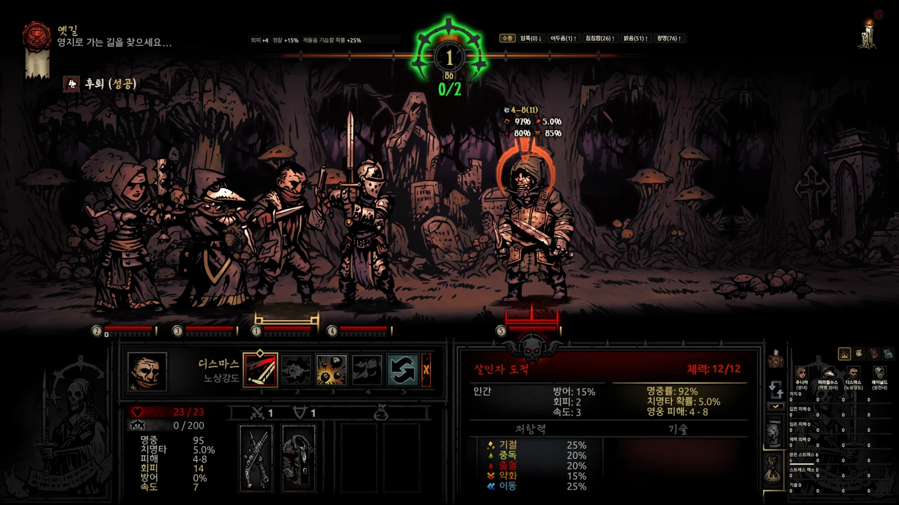
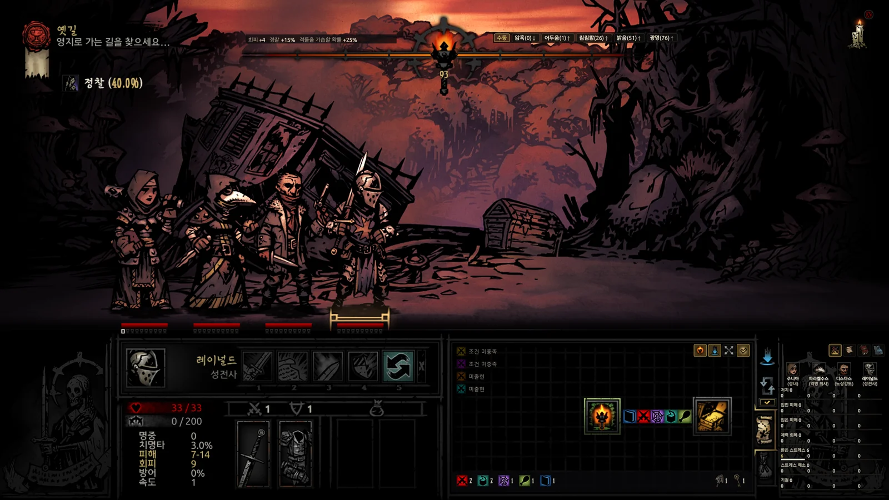
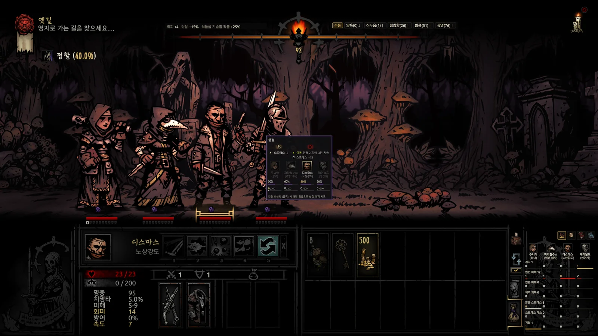
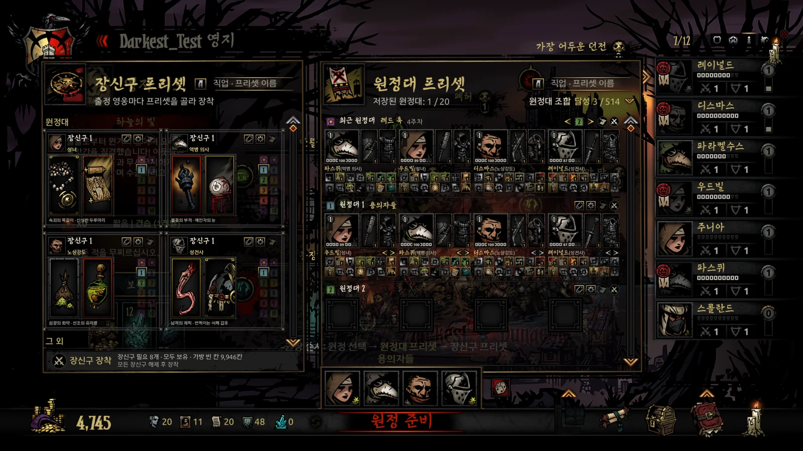
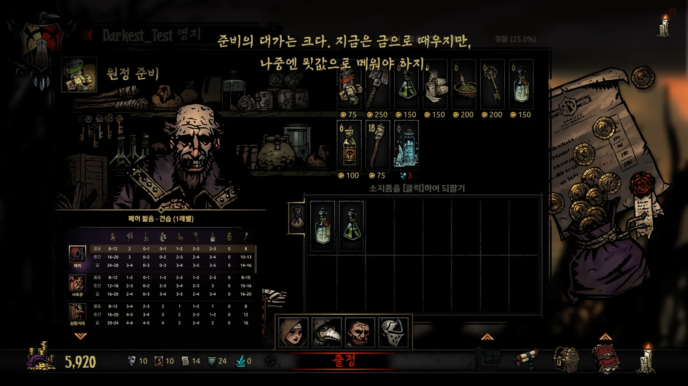

[English](../../README.md) · **한국어** · [日本語](../ja/README.md) · [中文](../zh/README.md)

# Ancestor's Map — DD Field Guide

**다키스트 던전이 숨긴 수치와 정보를 게임 화면 위에서 확인하세요.**

다키스트 던전 1용 오버레이입니다. 게임 메모리와 세이브에서 현재 상태를 읽고, 활성화된 DLC와 모드 데이터를 반영해 게임과 같은 공식으로 수치를 계산합니다.

  

[전체 기능](#전체-기능) · [사용 안내](guide.md) · [업데이트 내역](CHANGELOG.md)

개인 사용 무료 · 모드 지원 · 게임 파일 직접 수정 없음. 메모리 읽기·쓰기 범위와 입력 보조에 관한 설명은 아래 [안전](#안전) 항목에서 확인할 수 있습니다.

<!-- SHOT S1: 오버레이 전투 움짤 8 ~ 10초(영어 · 1600×900) — 기술을 바꿀 때마다 적 머리 위 값이 바뀌는 장면. 찍으면 같은 이름으로 덮어쓰기 -->

- **사용 중인 모드 정보를 한곳에서 확인** — 활성화된 모드의 데이터를 자동으로 병합해, 모드가 추가하거나 변경한 적·기술·장신구·기벽 등의 상세 정보를 함께 보여줍니다.
- **기술을 쓰기 전에 비교** — 현재 장비와 강화, 대상의 저항에 따른 피해량과 명중·치명타·효과 확률을 대상별로 비교합니다.
- **다음 방으로 가기 전에 확인** — 지도에서 적 구성과 골동품 상호작용 결과, 함정을 살펴봅니다. 전체 지도, 적 정보, 허기짐 칸은 각각 표시 여부를 고를 수 있습니다.
- **저장한 구성으로 출정 준비** — 원정대 프리셋으로 편성하고 장신구를 일괄 장착한 뒤, 보급품 추천 표에서 자동 구매합니다.

> AI(Claude · Codex)의 도움으로 개발했습니다. 기획, 게임 내 테스트, 최종 판단은 제작자가 직접 합니다.

## 전체 기능

<table>
<tr>
<td valign="top" width="380">
<b>일반</b>
<ul>
<li><b>별도 창 모드</b> 정보를 한 창에 모아 보기 · 기능 추가 중단</li>
<li><b>오버레이 모드</b> 게임 화면의 해당 위치에 정보 표시</li>
<li><b>모드 · DLC 지원</b> 활성화된 모드 · DLC의 수치 반영</li>
<li><b>도감</b> 적 · 장신구 · 기벽 · 질병 검색</li>
<li><b>4개 언어 지원</b> 게임 공식 번역 용어 사용</li>
</ul>
</td>
<td valign="top" width="380">
<b>마을</b>
<ul>
<li><b>통합 미터기</b> 영웅 전체의 누적 기록 비교</li>
<li><b>건물 증축 계획</b> 증축 비용과 보유 재화 비교</li>
<li><b>건물 창 넘기기</b> Q · E로 이전 · 다음 건물</li>
<li><b>도살자의 서커스 숨기기</b> 마을 설정에서 아이콘 표시 여부 선택</li>
<li><b>원정대 프리셋</b> 세이브별 저장 · 최근 원정대 불러오기</li>
<li><b>장신구 프리셋</b> 직업마다 10개 · 일괄 장착</li>
<li><b>무작위 원정대 편성</b></li>
<li><b>보급품 추천 · 자동 구매</b> 추천 수량에 맞춰 구매 · 초과분 되팔기</li>
</ul>
</td>
</tr>
<tr>
<td valign="top" width="380">
<b>원정</b>
<ul>
<li><b>속도 설정(배속모드)</b> 전진 · 후진 · 전투 · 정찰 · 방 이동 속도를 따로 조정</li>
<li><b>오브젝트 카운터 자동 숨김</b> 오버레이 지도 아래에 마우스를 대면 카운터·보급품 집계 표시</li>
<li><b>상세 던전 지도</b> 각 칸의 골동품 · 함정 · 적 구성 표시</li>
<li><b>전체 지도 공개</b> 안 가 본 곳까지 미리 보기</li>
<li><b>스포일러 방지 설정</b> 밝혀진 구역만 표시 · 적 정보 숨기기</li>
<li><b>목표 진행 · 길 안내</b> 목표 · 열쇠 · 보스방까지 경로</li>
<li><b>오브젝트 카운터</b> 남은 전투 · 골동품 · 함정 수</li>
<li><b>특수 인카운터</b> 출현 확률 · 확정 위치</li>
<li><b>지도의 방을 클릭해 이동</b></li>
<li><b>오브젝트 정보 및 상호작용 카드</b> 결과 · 확률 보고 카드에서 바로 선택</li>
<li><b>보급품 사용처 집계</b> 보급품별 사용 가능한 장소와 개수</li>
<li><b>함정 앞 자동 정지</b></li>
<li><b>골동품 앞 자동 전환</b> 유물수집상을 자동으로 선택</li>
<li><b>횃불 자동 사용</b> 고른 밝기 유지 · 암흑 고정</li>
<li><b>정찰 · 야습 확률</b></li>
<li><b>소지품 자동 정리 · 판매가</b> 묶음 합치기 · 칸 정렬</li>
<li><b>활동 일지 · 미터기</b> 전투 · 탐험 기록과 영웅별 기여</li>
</ul>
</td>
<td valign="top" width="380">
<b>전투</b>
<ul>
<li><b>턴 순서</b> 확정 순서 · 다음에 행동할 확률</li>
<li><b>피해 · 확률 미리보기</b> 대상별 피해 · 명중 · 치명타 확률</li>
<li><b>적용 중인 상태 정보</b> 남은 기간 · 다음 턴의 지속 피해</li>
<li><b>스톨링 경고</b> 증원 위험 · 방지 행동</li>
<li><b>후퇴 확률 · 결과</b></li>
<li><b>기본 원정대 대형 복원</b> 전투 후 자동 복원 · Caps Lock 단축키</li>
</ul>
</td>
</tr>
</table>

<table>
<tr>
<!-- SHOT S2: 오버레이 지도 — 전체 지도 공개 · 보스방까지 길 안내 (영어 · 1600×900) -->
<td width="380" align="center"> 전체 지도 공개</td>
<!-- SHOT S3: 함정 · 골동품 앞 게임 화면 가운데 상호작용 카드 (영어 · 1600×900) -->
<td width="380" align="center"> 오브젝트 정보 및 상호작용 카드</td>
</tr>
<tr>
<!-- SHOT S4: 원정대 프리셋 판 (영어 · 1600×900) -->
<td width="380" align="center"> 원정대 프리셋</td>
<!-- SHOT S5: 보급품 구입 화면 추천 표 · 자동 구매 (영어 · 1600×900) -->
<td width="380" align="center"> 보급품 추천 · 자동 구매</td>
</tr>
</table>

자세한 사용법은 [사용 안내](guide.md)에 있습니다.

## 빠른 시작 3단계

1. [최신 릴리스](https://github.com/Eolaloe/DD-AncestorsMap/releases/latest)에서 `AncestorsMap.zip`을 받습니다.
2. 원하는 폴더에 zip을 풉니다.
3. 게임에서 세이브를 불러온 채 `AncestorsMap.exe`를 실행합니다. 필요한 런타임이 없으면 설치 안내가 뜹니다.

처음이라면 물음표 버튼을 눌러 7장 31단계로 구성된 화면 안내를 살펴보세요. 자세한 설명은 [사용 안내](guide.md)에 있습니다.

### 실행 환경 · 호환성

- Windows 10/11, [.NET 8 Desktop Runtime](https://dotnet.microsoft.com/download/dotnet/8.0), 설치된 Darkest Dungeon 1이 필요합니다.

- 실시간 정보와 입력 보조를 쓰려면 앱이 지원하는 **64비트** 게임이 필요합니다.
  스팀 공개판과 `coming_in_hot` 베타에서 스팀용 실행 파일과 DRM 없는(`_windowsnosteam`) 실행 파일을 지원합니다.
  32비트 게임이나 앱이 인식하지 못하는 버전에서는 메모리를 읽지 않습니다. 세이브를 바탕으로 하는 기능만 쓸 수 있으며, 일지 상태 줄에 이유가 나옵니다.

- 켜 둔 DLC와 모드를 확인하고 적용 순서에 맞춰 자료를 읽습니다.
  던전 추가 모드는 Courtyard Plus, Farmstead Plus, The Sunward Isles, Vermintide, The Fiend Festival에서 동작을 확인했습니다.
  모든 모드를 검증한 것은 아닙니다.

- 스팀 설치 환경을 기준으로 만들었으며, DRM 없는 실행 파일에서도 동작을 확인했습니다.
  GOG 등 다른 플랫폼에서는 게임 설치 폴더나 세이브 경로를 자동으로 찾지 못할 수 있습니다.

- 한국어·English·日本語·简体中文을 지원합니다.
  처음에는 게임 언어를 따르고, 이후에는 앱에서 선택한 언어를 사용합니다.

## 안전

| 메모리 접근 | 범위 |
|---|---|
| **읽기** | 지도·전투 정보 등 현재 게임 상태를 확인합니다. 아래 두 기능 외에는 게임 메모리에 직접 쓰지 않습니다. |
| **쓰기 — 속도 설정** | 선택한 속도 값을 변경합니다. 변경 전 값을 기록하고, 초기화하거나 앱을 정상 종료하면 복원합니다. |
| **쓰기 — 도살자의 서커스 숨기기** | 서커스 아이콘의 표시 좌표만 변경합니다. 숨기기를 해제하거나 앱을 정상 종료하면 변경 전 좌표로 복원합니다. |

- 게임 파일이나 세이브에 직접 쓰지 않고, 게임 프로세스에 코드를 주입하지 않습니다.
  앱 설정과 원정 기록은 따로 저장합니다.

- 입력 보조는 실제로 게임에 클릭, 키 입력, 드래그를 보냅니다.
  함정 앞 자동 정지와 전투 후 원정대 복귀는 기본으로 켜져 있으며, 각각 끌 수 있습니다.
  가방에 마우스를 올리면 소지품 창을 여는 입력을 보내기도 합니다. 이런 조작의 결과는 게임의 일반적인 저장 과정에서 세이브에 반영될 수 있습니다.

- 자동 구매나 정리 중에는 마우스를 움직이거나 `[Shift]`를 누르지 마세요.
  앱은 업데이트를 확인하기 위해 GitHub에 연결합니다. 계정이나 API 키는 필요 없으며 게임 기록을 업로드하지 않습니다.
  백신이 잘못 탐지할 수 있으니 릴리스에 있는 SHA-256으로 파일을 확인하세요.

안전과 입력 보조에 관한 자세한 설명은 [사용 안내](guide.md)에 있습니다.

## 버전별 주요 기능

| 버전 | 주요 추가 기능 |
|---|---|
| 1.0 (1.0.2 ~ 1.0.8) | 던전 지도·전투 카드·일지·미터기, 방 이동, 보급품 추천과 자동 구매. |
| 1.1 (1.1.0 ~ 1.1.4) | 전투 화면, 탐험 카드 선택, 함정 앞 정지, 소지품 정리, 반격·횃불 자동 사용. |
| 1.2 (1.2.0) | 오버레이 모드 — 게임 UI 제자리에 정보 표시. |
| 1.3 (1.3.0 ~ 1.3.5) | 원정대·장신구 프리셋, 턴 순서 예상 확률, 오버레이 조절, 건물 창 넘기기, 골동품 앞 자동 전환, 속도 설정(배속모드). |

버전별 자세한 내용은 [전체 변경 내역](CHANGELOG.md)과 [릴리스 페이지](https://github.com/Eolaloe/DD-AncestorsMap/releases)에서 확인할 수 있습니다.

## 알려진 제한 사항

- 적 구성과 허기짐 칸, 턴 순서, 후퇴 결과 등 게임이 숨기는 정보도 보여 줍니다.
  필요한 항목만 켜서 사용하세요.
- 보급품 추천 수량은 위키와 공략, 던전 생성 규칙을 참고했습니다. 모드 던전의 추천 수량에는 계산으로 추정한 값도 포함됩니다.
  원정대와 탐험 계획에 맞춰 조절하세요.
- 오버레이 모드는 16:9 화면에서 확인했습니다.
  화면비가 다르거나 게임을 창 모드로 띄우면 표시 위치가 어긋날 수 있습니다.

## 문제 제보

[Issues](https://github.com/Eolaloe/DD-AncestorsMap/issues)에 앱 버전(서명 클릭), 게임 버전(공개판 / `coming_in_hot` / DRM 없는 판), 켜 둔 모드 목록, 어느 화면에서 어떤 조작을 했는지 적어 주세요.
가능하면 스크린샷과 앱에 나온 알림 문구도 첨부해 주세요.

## 라이선스 · 크레딧

[LICENSE](../../LICENSE) — 개인 용도로 자유롭게 사용할 수 있습니다. 공유할 때는 공식 저장소 링크를 이용해 주세요(파일 재업로드나 수정본 공유는 문의). 판매는 금지합니다.
Darkest Dungeon은 Red Hook Studios의 게임입니다.

한국어 조사 처리 규칙은 [es-hangul](https://github.com/toss/es-hangul)(toss, MIT)와 kohangul(MIT)을 참고했습니다.

[사용 안내](guide.md) · [최신 버전 다운로드](https://github.com/Eolaloe/DD-AncestorsMap/releases/latest)
