[English](../en/guide.md) · **한국어** · [日本語](../ja/guide.md) · [中文](../zh/guide.md)

# 사용 안내

[첫 화면으로](README.md)

1.3.5 기준으로 각 기능의 사용법과 조작 방법, 안전 정보를 안내합니다. 게임 고유 명칭과 설명은 게임과 활성화된 모드의 표기를 따릅니다. 버전별 변경 사항은 [변경 이력](CHANGELOG.md)에서 확인할 수 있습니다.

## 별도 창 모드

게임 위에 별도 창을 띄워 지도와 전투 화면, 카드, 기록을 한곳에 모아 보여 줍니다. 창 크기와 배경 불투명도는 자유롭게 조절할 수 있습니다. 세이브를 불러오면 오버레이 모드로 자동 전환되며, 이후에는 원하는 모드로 바꿀 수 있습니다.

<table>
<tr><td align="center" width="50%">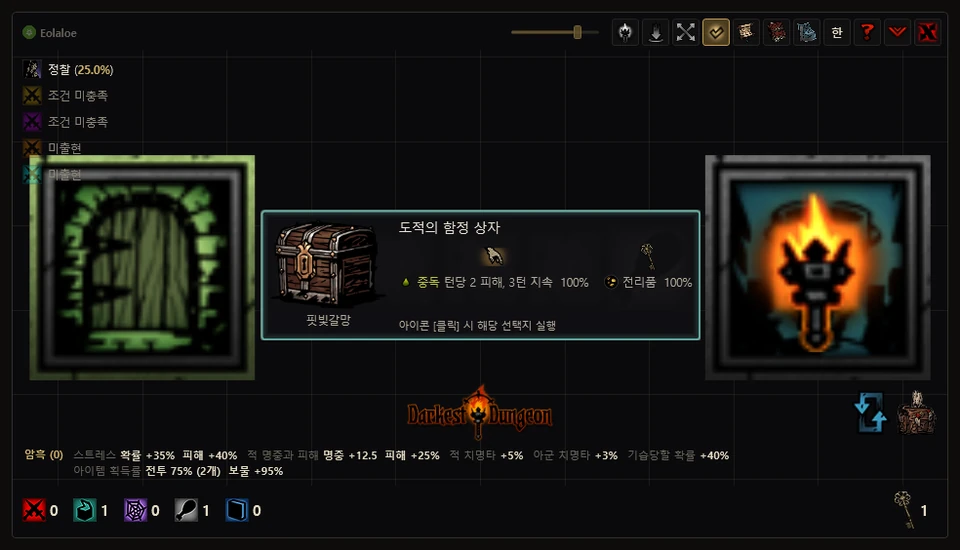 골동품 카드</td><td align="center" width="50%">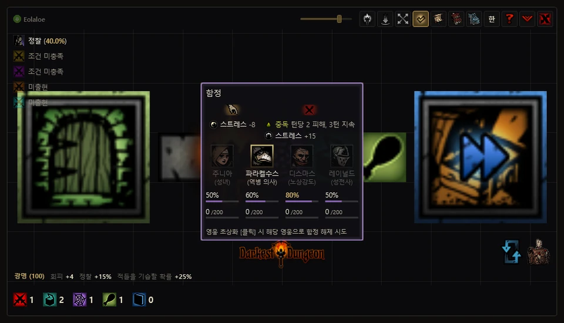 함정 해제</td></tr>
<tr><td align="center" width="50%">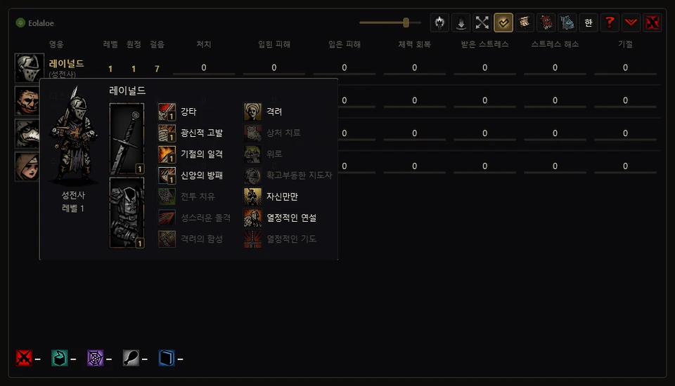 영웅 표와 카드</td><td align="center" width="50%">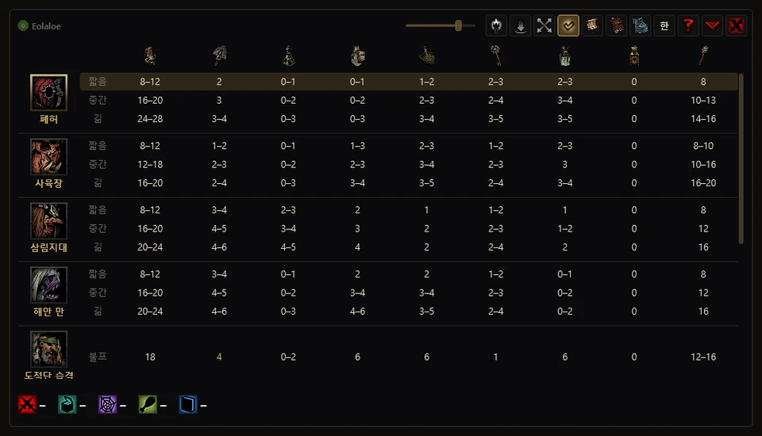 보급품 추천</td></tr>
<tr><td align="center" width="50%">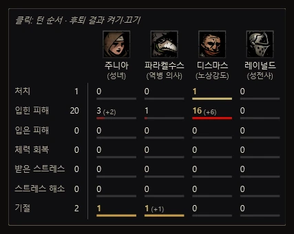 원정 미터기</td><td align="center" width="50%">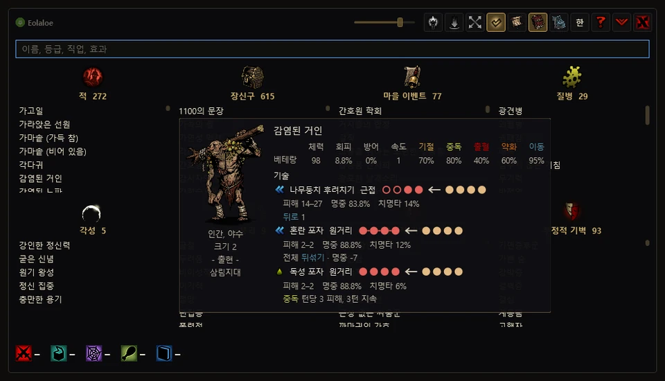 도감</td></tr>
</table>

## 오버레이 모드

<code>[ &#96; ]</code> 키나 오른쪽 위 마름모 버튼으로 두 모드를 바꿉니다. **세이브를 불러오면 자동으로 오버레이 모드로 전환**됩니다. 게임을 먼저 켜 두고 앱을 실행해도 마찬가지입니다. 이후에는 자유롭게 바꿀 수 있습니다.

오버레이 모드에서는 앱 창을 촛불 버튼 하나로 접고, **게임 화면 위에 투명한 층을 씌워 게임 UI의 해당 위치에 정보를 보여 줍니다.** 게임의 글꼴과 그림, 배치를 따라 원래 게임에 있던 화면처럼 자연스럽게 보이도록 만드는 것이 목표입니다.

- **탐험** — 게임 지도 칸에 앱 지도가 들어가고, 골동품과 함정, 장애물, 허기짐 카드는 게임 화면 가운데에 뜹니다. 정찰 확률과 횃불 단계는 게임 표시 옆에 붙습니다.
- **전투** — 각 인물의 머리 위에 턴 순서와 피해·확률, 걸린 상태가 나오며, 스톨링은 라운드 숫자를 둘러싼 빛의 색으로 알립니다.
- **사이드 패널** — 원정 중에는 오른쪽 패널에서 속도 설정, 미터기, 활동 일지, 도감, 마을 건물을 탭으로 나누어 봅니다. 맨 앞 버튼은 속도 설정을 엽니다. `[Backspace]`·`[Home]`·`[End]`는 각각 미터기·도감·활동 일지를 엽니다. 켠 탭을 다시 누르면 버튼만 남기고 접히며, 접은 상태를 기억합니다.
- **마을** — 영지 이름 아래에서 명단 전체의 미터기 표를 볼 수 있습니다. 아래쪽 버튼 줄 위의 화살표를 누르면 도감과 건물 증축 화면이 열립니다. 원정 선택 화면에서는 원정대 프리셋을, 마을과 원정 선택, 보급품 화면에서는 장신구 프리셋을 사용합니다. 보급품 화면에서는 금화 위 화살표로 보급품 표(자동 구매 포함)를 엽니다.
- 표시 위치는 게임이 실제로 쓰는 배치 값을 읽어 맞춥니다. 영웅 정보나 메뉴, 확인 창이 뜨거나 로딩 중일 때는 잠시 숨습니다. 촛불을 누르거나 같은 키를 다시 누르면 별도 창 모드로 돌아옵니다. 접은 채 끄면 다음에도 오버레이 모드로 시작합니다.
- **요소별 켜기·끄기** — 사이드 패널 탭 위 화살표의 **오버레이 켜기 · 끄기**에서 지도와 정보 카드, 전투 수치, 상태 효과, 턴 순서 등을 따로 켜고 끕니다.
- **알림 자막** — 원정대 편성이나 장신구 장착, 구매 등 자동 입력이 얼마나 진행됐는지, 결과는 무엇인지, 왜 중단됐는지 게임 화면 위 자막으로 알려 줍니다.
- 오버레이 모드에서는 작업 표시줄과 Alt+Tab 목록에 앱이 나오지 않습니다. 별도 창으로 펼치면 작업 표시줄에 다시 나타납니다.
- 늘 맨 위에 있는 촛불을 누르면 별도 창으로 펼치고, 촛불의 X 버튼으로 앱을 끕니다. 앱을 한 번 더 실행해도 별도 창으로 펼쳐집니다.

<table>
<tr><td align="center" width="50%">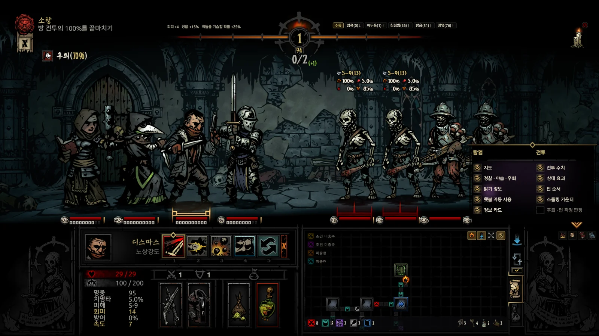 오버레이 켜기 · 끄기</td></tr>
</table>

<table>
<tr><td align="center" width="50%">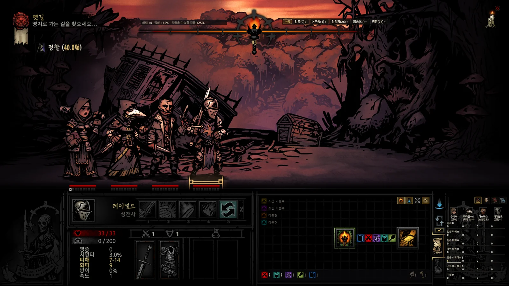 탐험 — 지도</td><td align="center" width="50%">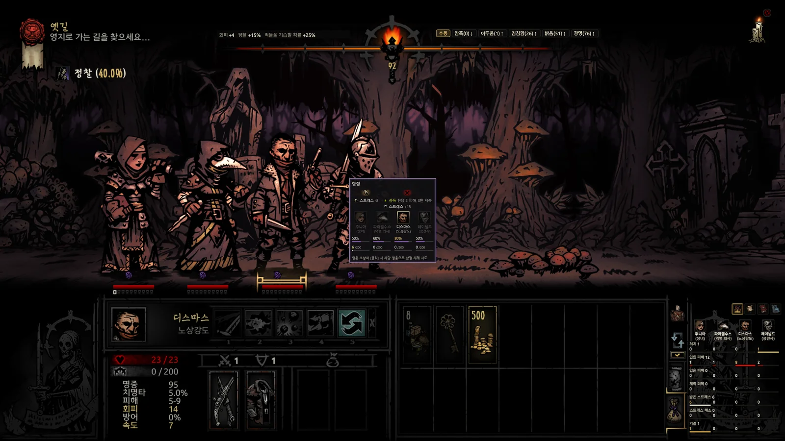 탐험 — 함정 카드</td></tr>
<tr><td align="center" width="50%">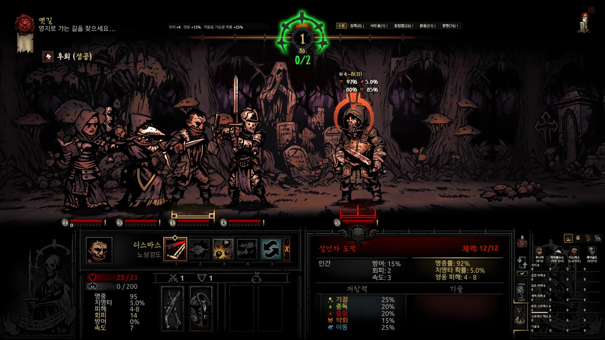 전투 — 스톨링·머리 위 값</td><td align="center" width="50%">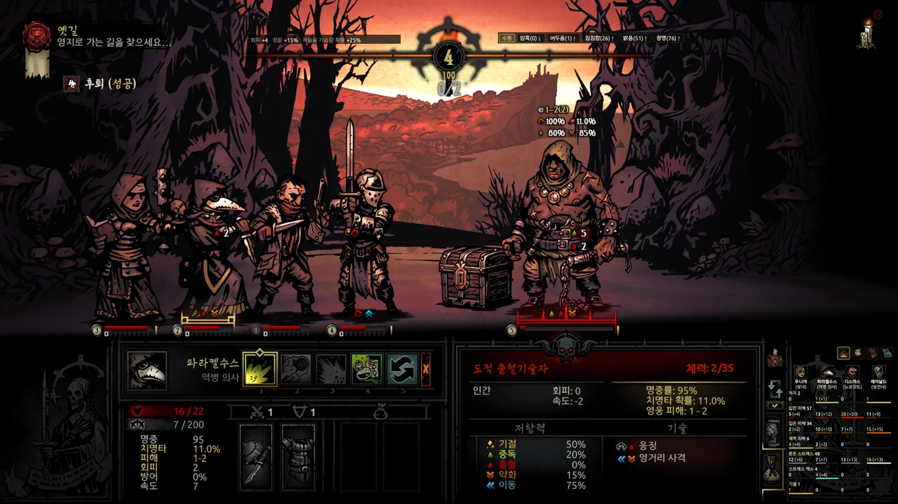 전투 — 적 정보</td></tr>
<tr><td align="center" width="50%">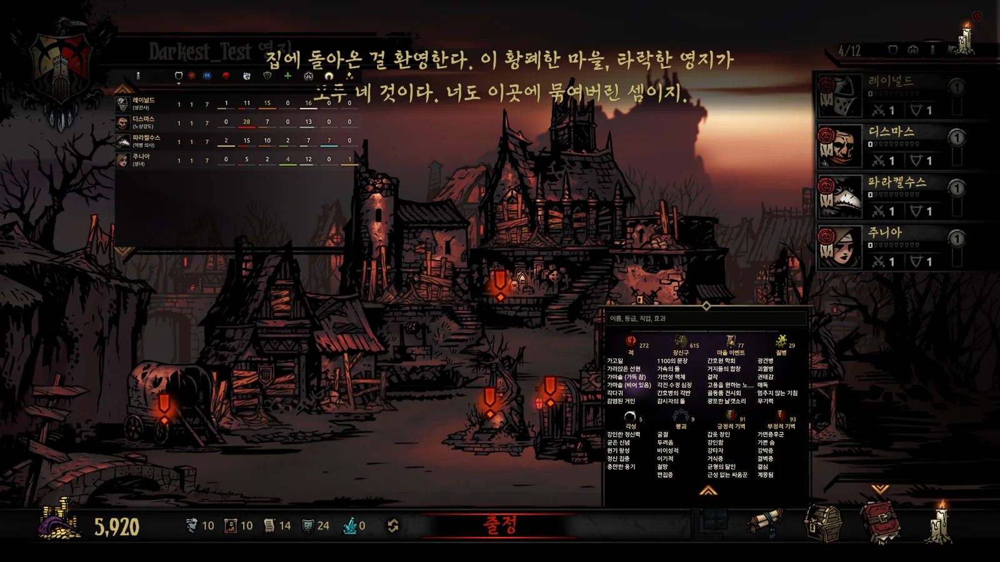 마을 — 미터기·도감</td><td align="center" width="50%">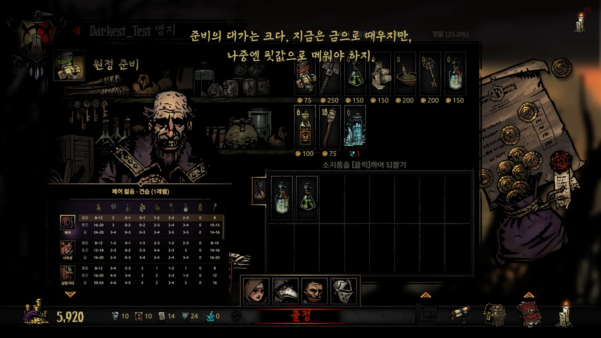 마을 — 보급품</td></tr>
</table>

## 자세히

### 속도 설정(배속모드)

- 오버레이 사이드 패널의 맨 앞 탭에서 엽니다. 전진·후진·전투·정찰·방 이동 속도를 각각 조정할 수 있습니다.
- − / + 버튼, 마우스 휠 또는 숫자 직접 입력으로 배율을 조정합니다.
- 전진·후진·정찰·방 이동은 1.0~4.0배, 전투는 1.0~2.0배 범위에서 0.1배 단위로 조정합니다.
- 방 이동은 방 출입 등의 화면 전환에 적용됩니다. 방 진입 중에는 걸어 들어가는 속도에도 적용하고, 끝나면 설정한 전진 속도로 돌아갑니다.
- 초기화하거나 앱을 정상 종료하면 변경 전 값으로 복원합니다. 변경 전에 원래 값을 기록합니다.

### 지도·마을 설정 추가

- 정찰이 발동하면 지도 탭으로 자동 전환합니다. 파동과 칸 공개 연출은 별도창·오버레이 모두에 적용됩니다.
- 지도 아래 골동품 아이콘으로 미방문 골동품의 상세 정보와 관련 보급품 집계를 숨길 수 있습니다. 전체 지도 공개 및 전투 정보 토글과 별도로 설정합니다.
- 오버레이 지도의 다섯 번째 버튼은 하단바 자동 숨김입니다. 꺼짐은 항상 표시, 켜짐은 자동 숨김입니다. 아래 전체 가장자리에 마우스를 대면 바가 올라오고, 벗어난 약 1.5초 뒤 내려갑니다. 숨긴 상태에는 중앙에 금색 손잡이가 표시됩니다.
- 오버레이 설정의 전투·골동품 미리보기·함정 앞 자동 정지·허기짐 칸 표시 체크박스는 기존 지도 토글과 연동됩니다.
- 마을 설정에서 장신구 프리셋 숨기기와 프리셋 적용 후 보관함·영웅 창 자동 닫기를 설정할 수 있습니다. 기타의 **도살자의 서커스 숨기기**는 기본으로 꺼져 있으며, 켜면 마을의 서커스 아이콘만 숨깁니다.

### 전투

- 전투가 시작되면 기본 화면의 지도가 전투 화면으로 바뀝니다. 아군 차례에는 고른 기술이 닿는 대상들의 수치가, 적 차례에는 적이 선택한 대상의 수치가 나옵니다. 회복과 강화, 이동 기술도 각 기술에 맞는 배치로 보여 줍니다.
- 각 인물 위에는 걸린 상태와 남은 기간, 다음 차례에 받는 지속 효과량이 두 열로 나뉘어 나옵니다. 지속 피해로 체력이 소진될 것으로 예상되면 핏자국으로 알립니다. 아래에는 체력과 스트레스가 표시됩니다.
- 아래 초상에 마우스를 올리면 영웅과 적의 전투 카드가 뜹니다. 현재 장비와 기벽, 질병, 강화, 각종 조건에 따른 수치를 비교하고, 적이 기술과 대상을 선택할 확률도 볼 수 있습니다. 스킨과 변신, 태세도 현재 모습에 맞춰 보여 줍니다.
- 턴 순서와 스톨링에 따른 증원 위험, 후퇴 확률을 보여 줍니다. 확정 턴 순서와 후퇴 결과는 기본으로 켜져 있으며 별도 창에서는 가운데 타이틀을 눌러 끕니다. 끄면 아직 행동이 남은 영웅과 적마다 **다음 차례 예상 확률**이 나오고, 후퇴는 성공 확률로 나옵니다. 오버레이에서는 **후퇴 · 턴 확정 판정**으로 바꿉니다. 타이틀에 마우스를 올리면 원정 미터기가 뜹니다.
- 턴 순서 예상 확률은 숨겨진 굴림을 읽지 않고 속도와 주사위 규칙으로 예상한 값입니다. 일부 상황에서는 표본으로 확률을 추정하며, 라운드 시작 시점의 속도를 확인하지 못하면 현재 속도로 근삿값을 구합니다.

- **반격** — 반격할 수 있는 대상의 공격 미리보기 아래에는 반격 피해와 명중·치명타 확률, 효과가 나옵니다. 공격 연출 중에도 미리보기가 남습니다.

### 지도와 탐험

- 방과 복도, 골동품, 함정, 장애물, 전투, 허기짐 칸을 보여 줍니다. 기본으로는 밝혀진 구역만 보이며, 안개를 끄면 전체를 볼 수 있습니다. 목표 골동품과 보스까지의 경로, 안뜰의 경로는 열쇠와 잠긴 문을 거치는 순서에 맞춰 안내합니다.
- 아래 계수기에서 남은 칸을, 보급품 그림에서 그 품목의 사용처를 확인합니다. 전투와 허기짐 아이콘을 누르면 아직 가 보지 않은 칸의 적 구성과 허기짐 칸을 각각 숨길 수 있습니다. 정찰 확률, 밝기 보정, 특수 조우의 위치 또는 출현 조건도 볼 수 있습니다.
- 게임에서 골동품이나 장애물, 허기짐 창이 열리면 그에 맞는 카드가 뜹니다. 열을 누르면 게임의 선택지를 실행하며, 골동품 카드의 아이템 열을 누르면 해당 아이템을 씁니다. 필요한 보급품이 부족하면 그 열의 선택지는 실행하지 않습니다.
- 정찰된 함정 앞 자동 정지는 기본으로 켜져 있으며 함정 계수기로 끕니다. 해제는 자동으로 하지 않습니다. 카드에서 영웅을 고르면 그 영웅으로 해제를 시도합니다.
- 탐험 대기 중 가방 버튼이나 `[I]`로 같은 품목 묶음을 합치고 칸을 정리합니다. 퀘스트 아이템은 제자리에, 빈 칸은 뒤에 둡니다. 전투 후에는 전리품 창을 닫고 탐험으로 돌아왔을 때 기본 원정대로 자동 복귀합니다. 기본으로 켜져 있으며 원정대 버튼으로 끕니다.

- **골동품 앞 자동 전환(1.3.2)** — 원정대에 유물수집상이나 골동품 추가 획득 특성을 가진 모드 영웅이 있으면, 전리품이 나올 수 있는 골동품 앞에서 그 영웅을 자동으로 선택합니다. 탐험 중 해당 영웅의 체력 막대 옆 토글로 켜고 끕니다.

- **적 정보 스포일러 방지(1.3.2)** — 지도 아래 전투 아이콘으로 적 정보를 끄면, 이미 지나온 복도에 새로 생긴 전투의 적 구성도 직접 맞서기 전까지 숨깁니다.

- **횃불 자동 사용** — 밝기 정보 위에서 단계를 고르면 탐험 중 그보다 어두워질 때 횃불을 씁니다. 암흑(0)은 전투 중에도 밝기를 0으로 유지합니다. 1.3.2부터는 원정이 끝나면 암흑(0)을 고르기 전 설정으로 돌아갑니다. 단계에 마우스를 올려 보정을 보고, 수동으로 바꾸면 자동 사용을 멈춥니다.

- **야영** — 정찰 줄이 야습 확률로 바뀝니다. 직업 회상 전투가 예정돼 있으면 그것을 대신 알립니다. 야습 굴림 결과를 미리 보여 주는 기능은 아닙니다.

### 원정대 · 장신구 프리셋

- **원정대 프리셋** — 오버레이 모드의 원정 선택 화면에서 명단 옆 화살표로 엽니다. 세이브별로 원정대를 저장하고, **원정대 편성**으로 클릭 한 번에 출정 칸을 채웁니다. 게임 명단이나 출정 칸에서 영웅을 드래그해 등록하거나, 현재 원정대를 그대로 저장할 수 있습니다.
- 고른 원정에 갈 수 없는 영웅에게는 붉은 X와 함께 이유가 나옵니다. **최근 원정대**를 다시 불러오고, 직업이나 프리셋 이름으로 검색하거나 같은 직업의 다른 영웅으로 바꿀 수 있습니다. **원정대 조합**에서는 본편과 DLC, 모드에 있는 이름 붙은 원정대 조합과 달성 여부를 볼 수 있습니다.
- **무작위 원정대 편성** — 원정 선택 화면의 주사위 버튼으로, 그 원정에 갈 수 있는 영웅 가운데서 출정 칸 순서까지 무작위로 편성합니다.
- **장신구 프리셋** — 마을과 원정 선택, 보급품 화면에서 사용합니다. 세이브별로 **직업마다 10개**를 저장하며, 가방에서 장신구를 드래그해 등록합니다. 프리셋에 마우스를 올리면 세트 효과를 포함해 합산한 효과를 볼 수 있습니다.
- 출정 영웅마다 프리셋을 고르고 **장신구 장착**으로 원정대 전체에 일괄 장착합니다. 직업마다 최근 출정 때 쓴 장신구 구성 두 벌이 **최근 장신구 1 · 2**로 남습니다. 금별은 최근 1, 은별은 최근 2이며, 별을 다시 누르면 저장할 프리셋을 고를 수 있습니다.

<table>
<tr><td align="center" width="50%">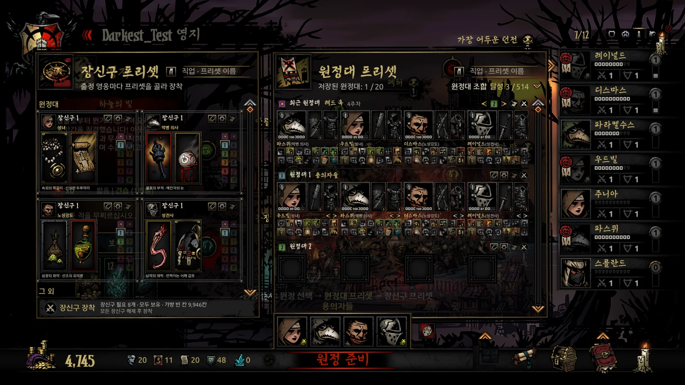 원정대 프리셋</td><td align="center" width="50%">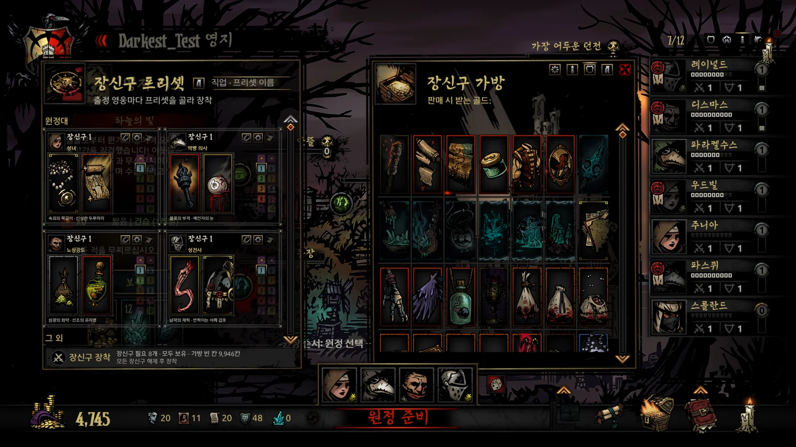 장신구 프리셋 · 효과 합계</td></tr>
</table>

- **장착 뒤 커서(1.3.2)** — 장신구 프리셋 적용 후 커서가 장신구 가방의 닫기 버튼 위치로 이동합니다.

### 기록과 마을 준비

- 활동 일지는 전투와 탐험, 야영 기록을 계속 쌓으며 `[End]`로 엽니다. 전투가 시작돼도 일지로 자동 전환하지 않습니다. 세이브별로 최근 원정 10개와 최종 미터기를 다시 볼 수 있습니다.
- 마을 영웅 표에서는 레벨, 원정 횟수, 걸음 수와 앱이 기록한 누적 수치를 비교합니다. 초상에 마우스를 올리면 장비와 전투 기술, 야영 기술이 보입니다.
- 보급품 표는 던전과 원정 길이에 맞는 추천 수량을 보여 줍니다. 켜 둔 던전 모드(안뜰+, 농장+, 태양을 향한 섬들, 버민타이드, 악마의 축제)의 던전도 함께 나오고, 고른 퀘스트의 줄을 강조해 그 던전을 표 맨 위로 올립니다. 줄을 클릭하면 살 물품과 팔 물품, 비용을 미리 보여 주고, **3초 안에 같은 줄을 다시 클릭하면 구매**합니다. 추천 수량이 범위로 나올 때는 큰 값에 맞춰 사고, 무료 지급품은 판매하지 않습니다. 핏빛 저주에 걸린 영웅에게 필요한 피도 수량을 맞춰 사고, 마을에 남아 있는 쇠약 상태 영웅의 몫은 남겨 둡니다.
- 도감에서는 적과 장신구, 마을 이벤트, 질병, 각성, 붕괴, 기벽을 검색할 수 있습니다. 이름과 등급, 직업, 효과로 검색합니다. 건물과 추가 건물 화면에서는 고른 증축에 필요한 재화와 보유량을 비교합니다. 증축 계획을 세우는 기능으로, 게임에서 대신 건설하지는 않습니다.

- **건물 창 넘기기(1.3.2)** — 건물 창에서 Q · E나 새 버튼으로 이전·다음 건물로 이동합니다. 잠긴 건물은 건너뛰며, 버튼은 창이 열리고 바뀌는 연출을 따라 움직입니다.

- **마을 미터기(1.3.2)** — 오버레이 미터기는 마을에 들어올 때 잠깐 펼쳐졌다가 제목 줄만 남기고 접힙니다. 제목 줄에 마우스를 올리면 다시 펼쳐지고, 표 위에 마우스가 있는 동안 유지됩니다.

## 설치

1. [최신 릴리스](https://github.com/Eolaloe/DD-AncestorsMap/releases/latest)에서 `AncestorsMap.zip`을 받아 아무 폴더에 풉니다.
2. `AncestorsMap.exe`를 실행합니다. **.NET 8 Desktop Runtime**이 없으면 설치 안내가 뜹니다.
3. 게임을 실행하면 세이브를 자동으로 찾습니다. 처음에는 오른쪽 위 물음표 버튼으로 화면 안내를 열어 보세요.

## 실행 환경 · 호환성

- Windows 10/11, [.NET 8 Desktop Runtime](https://dotnet.microsoft.com/download/dotnet/8.0), 설치된 Darkest Dungeon 1이 필요합니다. 런타임은 별도로 설치합니다.
- 실시간 정보와 입력 보조를 쓰려면 앱이 지원하는 **64비트** 게임이 필요합니다. 스팀 공개판과 `coming_in_hot` 베타에서 스팀용 실행 파일과 DRM 없는(`_windowsnosteam`) 실행 파일을 지원합니다. 32비트 게임이나 앱이 인식하지 못하는 버전에서는 메모리를 읽지 않습니다. 세이브를 바탕으로 하는 기능만 쓸 수 있으며, 일지 상태 줄에 이유가 나옵니다.
- 켜 둔 DLC와 모드를 확인하고 적용 순서에 맞춰 자료를 읽습니다. 던전 추가 모드는 Courtyard Plus, Farmstead Plus, The Sunward Isles, Vermintide, The Fiend Festival에서 동작을 확인했습니다. 모든 모드를 검증한 것은 아닙니다.
- 스팀 설치 환경을 기준으로 만들었으며, DRM 없는 실행 파일에서도 동작을 확인했습니다. GOG 등 다른 플랫폼에서는 게임 설치 폴더나 세이브 경로를 자동으로 찾지 못할 수 있습니다.
- 한국어·English·日本語·简体中文을 지원합니다. 처음에는 게임 언어를 따르고, 이후에는 앱에서 선택한 언어를 사용합니다.

## 안전

| 메모리 접근 | 범위 |
|---|---|
| **읽기** | 지도·전투 정보 등 현재 게임 상태를 확인합니다. 아래 두 기능 외에는 게임 메모리에 직접 쓰지 않습니다. |
| **쓰기 — 속도 설정** | 선택한 속도 값을 변경합니다. 변경 전 값을 기록하고, 초기화하거나 앱을 정상 종료하면 복원합니다. |
| **쓰기 — 도살자의 서커스 숨기기** | 서커스 아이콘의 표시 좌표만 변경합니다. 숨기기를 해제하거나 앱을 정상 종료하면 변경 전 좌표로 복원합니다. |

- **게임 파일·세이브** — 직접 쓰지 않으며, 게임 프로세스에 코드를 주입하지 않습니다. 앱 자체의 설정과 원정 기록은 따로 저장합니다.
- **입력 보조 기능은 실제 게임 조작입니다.** 방 이동, 카드 선택과 아이템 사용, 함정 해제, 자동 구매, 소지품 정리, 기본 원정대 설정, 원정대 편성과 장신구 장착은 게임에 클릭, 키 입력, 드래그를 보냅니다. 이런 조작의 결과도 게임이 평소처럼 저장할 수 있습니다.
- 함정 앞 자동 정지는 이동 키와 마우스 버튼을 떼는 입력을 보내고, 이동 키의 반복 입력을 차단합니다. **기본으로 켜져 있으며** 함정 계수기로 끕니다. 전투 후 자동 원정대 복귀도 **기본으로 켜져 있으며** 원정대 버튼으로 끕니다.
- 가방에 마우스를 올려 판매가를 볼 때도, 탐험 중 게임이 지도 창이면 `[Tab]` 입력으로 소지품 창을 엽니다. 보기 기능 중에도 이처럼 입력을 보내는 경우가 있습니다.
- 자동 구매나 정리 중에는 마우스를 움직이지 마세요. 정리할 때 `[Shift]`를 누르지 마세요. 게임의 버리기 조작과 겹쳐 앱이 드래그를 진행하지 않습니다.
- 앱은 GitHub 릴리스를 확인할 때 통신합니다. 시작할 때 자동 확인하며 앱 정보에서 수동으로 다시 확인할 수 있습니다. 계정이나 API 키는 필요 없고 게임 기록을 업로드하지 않습니다.
- 일부 백신이 앱을 잘못 탐지할 수 있습니다. 릴리스 페이지의 SHA-256으로 다운로드한 파일을 확인하세요.

## 업데이트

시작할 때 새 버전을 확인합니다. 왼쪽 위 서명을 클릭하면 현재 버전과 **업데이트 확인**을 볼 수 있습니다. **새 버전 출시** 알림은 오버레이에서도 별도 창으로 펼쳐 표시하며, 자동 전환은 알림을 닫은 뒤 이어갑니다. **업데이트 내용 보기**로 릴리스 페이지를 열어 새 zip을 받으세요. 자동 다운로드·교체는 하지 않습니다. 실행 중인 앱을 종료하고 새 파일을 덮어쓰면 됩니다. 설정과 원정 기록은 `%LocalAppData%\AncestorsMap`에 남습니다.

## 조작

| 키·마우스 | 동작 |
|---|---|
| 오버레이 사이드 패널 맨 앞 버튼 | 속도 설정 열기 |
| 속도 설정의 − / + 버튼, 마우스 휠 또는 숫자 직접 입력 | 배율 조정 |
| `[Q]` · `[E]` 또는 건물 화살표 | 건물 창에서 이전·다음 건물로 이동, 잠긴 건물은 건너뜀 |
| <code>[ &#96; ]</code> 또는 마름모 버튼 | 오버레이 모드 켜기·끄기 — 앱 창은 촛불 버튼으로 접히고 정보는 게임 화면 제자리에. 촛불 클릭으로도 복귀 |
| `[Backspace]` | 기본 화면으로: 마을 영웅 표 / 보급품 표 / 탐험 지도 / 전투 화면 |
| `[Home]` / `[End]` | 도감 / 활동 일지 열기·닫기 |
| `[Caps Lock]` | 지금 기본 원정대 설정 |
| `[I]` 또는 가방 클릭 | 탐험 대기 중 소지품 정리 |
| 가방에 마우스 올리기 | 게임 소지품·열린 전리품 칸의 판매가 |
| 원정대 그림 클릭 | 전투 후 기본 원정대 자동 복귀 켜기·끄기 |
| 왼쪽 드래그 / 오른쪽 드래그 | 앱 창 이동 / 지도 이동 |
| 휠 / 휠 클릭 | 지도 확대·축소 / 안개 켜기·끄기 |
| 앱 지도의 이어진 방 클릭 | 방 안에 있을 때 게임에서 그 방으로 이동 |
| 자동으로 뜬 카드의 열 클릭 | 골동품·장애물·허기짐 선택 또는 영웅을 골라 함정 해제 |
| 보급품 줄 클릭 → 3초 안에 같은 줄 클릭 | 구매 미리보기 → 자동 구매 |
| 창 경계 드래그 / 위 슬라이더 | 창 크기 / 배경 불투명도 |
| 물음표 / 서명에 마우스 올리기·클릭 | 화면 안내 / 조작표·앱 정보 |

게임 위 단축키는 게임 창이 앞에 있을 때 동작합니다. `[I]`는 탐험 대기 중에만 앱이 처리하며, 그 밖에는 게임의 원래 기능으로 동작합니다. 앱 자체에서는 <code>[ &#96; ]</code>·`[Home]`·`[End]`도 사용할 수 있고, 검색란에 글이 있을 때 `[Backspace]`는 글자를 지웁니다. 구매와 정리는 게임 창을 앞으로 가져오며, 방 이동이나 카드 선택, 함정 해제 등도 게임 창이 앞에 있어야 합니다.

오버레이 모드에서는 원정 중 `[Backspace]`·`[Home]`·`[End]`가 사이드 패널의 미터기·도감·활동 일지 탭을 바꾸고, 마을에서는 게임 키로 그대로 동작합니다.

## 화면 안내

물음표 버튼에서 처음 사용, 지도, 탐험 중 선택, 전투, 원정 관리, 마을 준비, 기록과 검색을 살펴보세요. 처음 6장은 녹화된 견본 장면이므로 게임을 실행하지 않아도 볼 수 있습니다. 마지막 ‘기록과 검색’ 장에서는 사용자의 자료를 엽니다. 마우스를 올릴 수 있는 단계에서는 금색 테두리 안에 올려 보세요. 어두운 곳을 누르거나 오버레이 모드로 바꾸면 안내를 닫습니다.

## 알려진 한계

- 적 구성과 허기짐 칸, 턴 순서, 후퇴 결과 등 게임이 숨기는 정보도 보여 줍니다. 필요한 항목만 켜서 사용하세요.
- 게임이 업데이트되면 지원 여부를 확인할 때까지 실시간 기능을 사용할 수 없습니다. 세이브를 바탕으로 하는 일부 정보는 게임이 저장한 뒤에야 갱신됩니다.
- 보급품 추천 수량은 위키와 공략, 던전 생성 규칙을 참고했습니다. 모드 던전의 추천 수량에는 계산으로 추정한 값도 포함됩니다. 원정대와 탐험 계획에 맞춰 조절하세요.
- 자동 입력은 게임 화면과 배치에 영향을 받습니다. 지원하지 않는 배치나 일부 모드에서는 기능이 제한될 수 있습니다.
- 오버레이 모드는 16:9 화면에서 확인했습니다. 화면비가 다르거나 게임을 창 모드로 띄우면 표시 위치가 어긋날 수 있습니다.

## 문제 신고

[Issues](https://github.com/Eolaloe/DD-AncestorsMap/issues)에 앱 버전(서명 클릭), 게임 버전(공개판 / `coming_in_hot` / DRM 없는 판), 켜 둔 모드 목록, 어느 화면에서 어떤 조작을 했는지 적어 주세요. 가능하면 스크린샷과 앱에 나온 알림 문구도 첨부해 주세요.

## 라이선스 · 크레딧

[LICENSE](../../LICENSE) — 개인 용도로 자유롭게 사용할 수 있습니다. 공유할 때는 공식 저장소 링크를 이용해 주세요(파일 재업로드나 수정본 공유는 문의). 판매는 금지합니다.
Darkest Dungeon은 Red Hook Studios의 게임입니다.
Claude와 Codex의 도움을 받아 만들었습니다.

한국어 조사 처리 규칙은 [es-hangul](https://github.com/toss/es-hangul)(toss, MIT)와 kohangul(MIT)을 참고했습니다.
