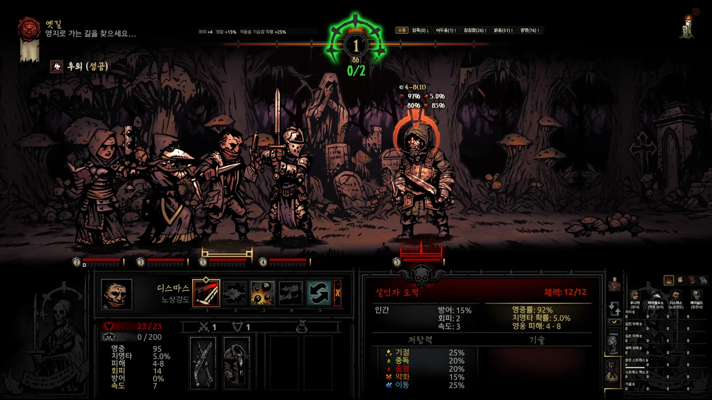
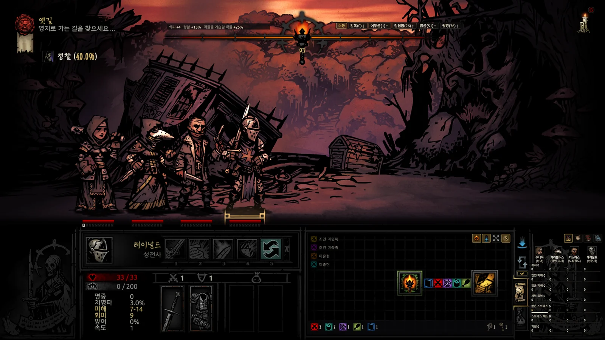
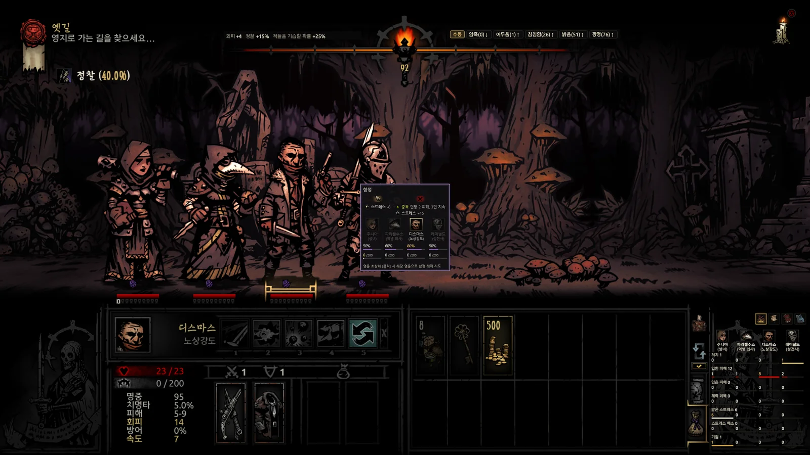
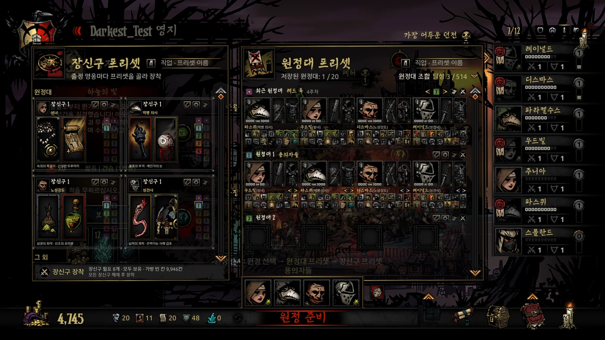
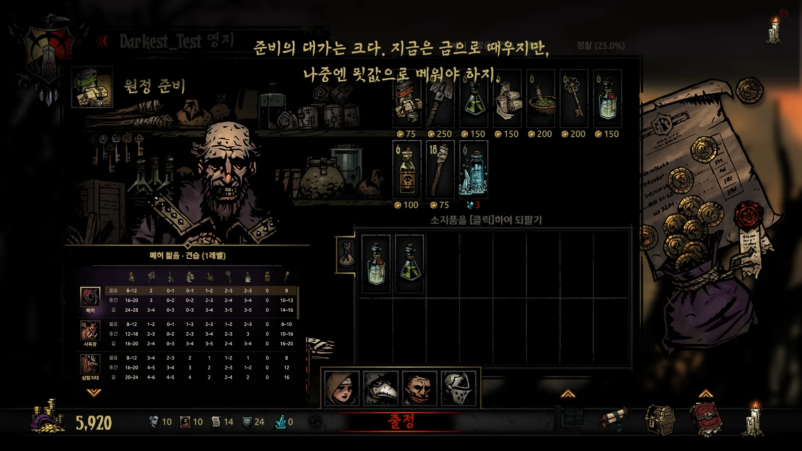

[English](../../README.md) · [한국어](../ko/README.md) · [日本語](../ja/README.md) · **中文**

# Ancestor's Map — DD Field Guide

**在游戏画面上，直接查看《暗黑地牢》隐藏的数值与信息。**

这是一款《暗黑地牢》一代的游戏内叠加显示工具。它从游戏内存和存档中读取当前状态，结合已启用的DLC与模组数据，按照游戏本身的公式计算各项数值。

  

[完整功能列表](#完整功能列表) · [使用指南](guide.md) · [更新日志](CHANGELOG.md)

个人使用免费 · 支持模组 · 不直接修改游戏文件。内存读写范围与操作辅助功能详见[安全说明](#安全说明)。

<!-- SHOT S1: 오버레이 전투 움짤 8 ~ 10초(영어 · 1600×900) — 기술을 바꿀 때마다 적 머리 위 값이 바뀌는 장면. 찍으면 같은 이름으로 덮어쓰기 -->

- **集中查看当前启用的模组内容。** 自动合并已启用模组的数据，在一处查看模组新增或修改的敌人、技能、饰品、怪癖等详细信息。
- **出手前，先比较目标。** 根据当前装备、增益和目标抗性，预览对各个目标的伤害，以及命中、暴击和施加效果的概率。
- **进入下一间房前，先看地图。** 查看敌人阵容、奇物交互结果和陷阱。全图、敌人信息和饥饿格子的显示可以分别开关。
- **用保存的配置准备出征。** 载入队伍预设，为全队一键装备饰品，再按补给推荐表自动购买。

> 本工具在AI（Claude、Codex）的协助下开发。策划、游戏内测试和最终决策均由作者负责。

## 完整功能列表

<table>
<tr>
<td valign="top" width="380">
<b>通用</b>
<ul>
<li><b>独立窗口模式</b> 在一个窗口集中查看信息；不再新增功能</li>
<li><b>叠加显示模式</b> 在游戏画面对应位置显示信息</li>
<li><b>模组与DLC支持</b> 采用已启用模组与DLC的实际数值</li>
<li><b>图鉴</b> 搜索敌人、饰品、特质、疾病</li>
<li><b>支持四种语言</b> 沿用游戏官方术语</li>
</ul>
</td>
<td valign="top" width="380">
<b>城镇</b>
<ul>
<li><b>综合统计</b> 比较全体英雄的累计记录</li>
<li><b>建筑升级规划</b> 对比升级费用与现有资源</li>
<li><b>建筑窗口切换</b> 按Q、E切换到上一个或下一个建筑</li>
<li><b>隐藏屠夫赛场</b> 在城镇设置中选择是否显示图标</li>
<li><b>队伍预设</b> 按存档保存，可载入上次使用的队伍</li>
<li><b>饰品预设</b> 每个职业可存10套，全队一键装备</li>
<li><b>随机组队</b></li>
<li><b>补给推荐与自动购买</b> 按推荐数量补齐，多余物品卖回商店</li>
</ul>
</td>
</tr>
<tr>
<td valign="top" width="380">
<b>远征</b>
<ul>
<li><b>速度设置（倍速模式）</b> 分别调整前进、后退、战斗、侦察和房间切换速度</li>
<li><b>自动隐藏地图要素统计</b> 鼠标在叠加地图左下角停留0.5秒后显示地图要素统计和补给统计</li>
<li><b>详细地牢地图</b> 显示每个格子的奇物、陷阱和敌人阵容</li>
<li><b>全图显示</b> 提前查看未探索区域</li>
<li><b>防剧透设置</b> 仅显示已知区域、隐藏敌人信息</li>
<li><b>任务进度与路线指引</b> 通往目标、钥匙和首领房间的路线</li>
<li><b>地图要素统计</b> 剩余战斗、奇物和陷阱的数量</li>
<li><b>特殊遭遇</b> 出现概率与已确认的位置</li>
<li><b>点击地图前往房间</b></li>
<li><b>对象信息与交互卡片</b> 比较结果与概率，直接在卡片上选择操作</li>
<li><b>补给品使用地点汇总</b> 列出各补给品的可用地点，并统计地点数量</li>
<li><b>陷阱前自动停步</b></li>
<li><b>奇物前自动切换英雄</b> 自动选择古董商人</li>
<li><b>自动使用火炬</b> 维持所选亮度，也可保持全黑</li>
<li><b>侦察与夜袭概率</b></li>
<li><b>物品栏自动整理与售价</b> 合并物品堆叠并重新排序</li>
<li><b>活动日志与统计</b> 最近10次远征的战斗、探索统计及各英雄的贡献</li>
</ul>
</td>
<td valign="top" width="380">
<b>战斗</b>
<ul>
<li><b>行动顺序</b> 已确定的顺序与下一个行动的概率</li>
<li><b>伤害与概率预览</b> 对各目标的伤害、命中率与暴击率</li>
<li><b>当前状态效果</b> 剩余持续时间与下次行动时的持续伤害</li>
<li><b>拖延警告</b> 增援风险、阻止增援的行动</li>
<li><b>撤退概率与结果</b></li>
<li><b>恢复默认阵型</b> 战斗后自动恢复，也可按Caps Lock恢复</li>
</ul>
</td>
</tr>
</table>

<table>
<tr>
<!-- SHOT S2: 오버레이 지도 — 전체 지도 공개 · 보스방까지 길 안내 (영어 · 1600×900) -->
<td width="380" align="center"> 全图显示</td>
<!-- SHOT S3: 함정 · 골동품 앞 게임 화면 가운데 상호작용 카드 (영어 · 1600×900) -->
<td width="380" align="center"> 对象信息与交互卡片</td>
</tr>
<tr>
<!-- SHOT S4: 원정대 프리셋 판 (영어 · 1600×900) -->
<td width="380" align="center"> 队伍预设</td>
<!-- SHOT S5: 보급품 구입 화면 추천 표 · 자동 구매 (영어 · 1600×900) -->
<td width="380" align="center"> 补给推荐与自动购买</td>
</tr>
</table>

详细用法请参阅[使用指南](guide.md)。

## 三步上手

1. 从[最新发行版](https://github.com/Eolaloe/DD-AncestorsMap/releases/latest)下载`AncestorsMap.zip`。
2. 将zip解压到任意文件夹。
3. 在游戏中载入存档后，运行`AncestorsMap.exe`。如果缺少所需的运行时，程序会提示安装。

首次使用时，可以点击问号按钮，查看分为7章、共31步的界面引导。详细说明请参阅[使用指南](guide.md)。

### 系统要求与兼容性

- 需要Windows 10/11、[.NET 8 Desktop Runtime](https://dotnet.microsoft.com/download/dotnet/8.0)，并已安装《暗黑地牢》一代。

- 实时信息与操作辅助功能需要受支持的**64位**游戏版本。
  支持Steam版、无DRM版（`_windowsnosteam`）和GOG版。
  对于32位或无法识别的游戏版本，工具不会读取内存，只提供基于存档的功能，并在日志状态栏说明原因。

- 会读取启用的DLC、模组及其加载顺序。
  已测试的地牢模组包括Courtyard Plus、Farmstead Plus、The Sunward Isles、Vermintide和The Fiend Festival，并非所有模组都经过验证。

- 支持한국어、English、日本語和简体中文。
  首次启动跟随游戏语言，此后使用你在工具中选择的语言。

## 安全说明

| 内存访问 | 范围 |
|---|---|
| **读取** | 读取当前游戏状态，用于地图、战斗信息等功能。只有以下两项功能会直接写入游戏内存。 |
| **写入——速度设置** | 修改所选速度值。修改前记录原始值，重置或正常退出工具时恢复。 |
| **写入——隐藏屠夫赛场** | 仅修改图标的显示坐标。关闭隐藏选项或正常退出工具时恢复原始坐标。 |

- 不直接修改游戏文件或存档，也不向游戏进程注入代码。
  工具设置与远征记录另行保存。

- 操作辅助会向游戏发送实际的点击、按键和拖拽操作。
  陷阱前自动停步与战斗后自动恢复阵型默认开启，可以分别关闭。
  将鼠标移到背包上时，工具也可能发送打开物品栏的操作。
  这些操作的结果可能随游戏的正常保存写入存档。

- 自动购买或整理期间，请勿移动鼠标或按住`[Shift]`。
  工具会连接GitHub检查更新，无需账号或API密钥，也不会上传游戏记录。
  杀毒软件可能误报。你可以使用发布页面提供的SHA-256哈希值核对下载的文件。

有关安全与操作辅助功能的详细说明，请参阅[使用指南](guide.md)。

## 各版本系列新增内容

| 系列 | 主要新增功能 |
|---|---|
| 1.0 (1.0.2 ~ 1.0.8) | 地牢地图、战斗卡片、日志与统计，房间移动，补给推荐与自动购买。 |
| 1.1 (1.1.0 ~ 1.1.4) | 战斗界面、在探索卡片上选择操作、陷阱前停步、物品整理、反击与自动使用火炬。 |
| 1.2 (1.2.0) | 叠加显示模式：在游戏界面的对应位置显示信息。 |
| 1.3 (1.3.0 ~ 1.3.5) | 队伍与饰品预设、行动顺序概率预测、叠加显示设置、建筑窗口切换、奇物前自动切换英雄、速度设置（倍速模式）。 |

各版本的详细内容请参阅[完整更新日志](CHANGELOG.md)和[发布页面](https://github.com/Eolaloe/DD-AncestorsMap/releases)。

## 已知限制

- 工具也会显示游戏原本隐藏的信息，包括敌人阵容、饥饿格子、行动顺序和撤退结果。
  请按需要启用。
- 补给推荐参考了Wiki、攻略和地牢生成规则，模组地牢的推荐数量中也包含通过计算得出的估算值。
  请根据队伍与探索计划调整。
- 叠加显示模式已在16:9画面上测试。
  画面比例不同时，或游戏以窗口模式运行时，显示位置可能会偏移。

## 问题反馈

请在[Issues](https://github.com/Eolaloe/DD-AncestorsMap/issues)中说明工具版本（点击署名查看）、游戏版本（Steam版／无DRM版／GOG版）、启用的模组，以及在哪个界面进行了什么操作。
方便的话，请附上截图和工具显示的通知文字。

## 许可与致谢

[LICENSE](../../LICENSE) — 可供个人自由使用；请通过官方仓库链接分享（重新上传文件或发布修改版请先联系作者）；禁止售卖。
《暗黑地牢》（Darkest Dungeon）是 Red Hook Studios 的游戏。

韩语助词处理规则参考了[es-hangul](https://github.com/toss/es-hangul)（toss，MIT）和kohangul（MIT）。

[使用指南](guide.md) · [下载最新版本](https://github.com/Eolaloe/DD-AncestorsMap/releases/latest)
